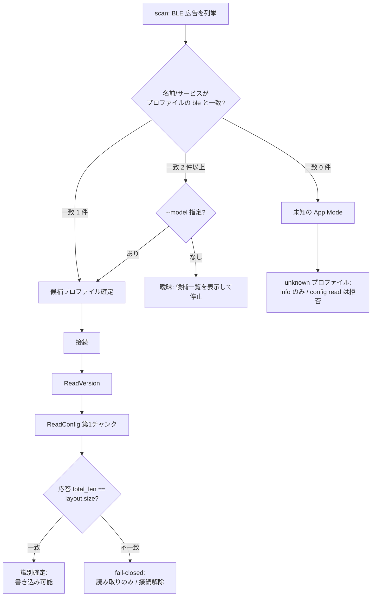

# 機種抽象化（Device Model Abstraction）設計

- 対象: 8BitDo Ultimate 2 Bluetooth（`0x600F`）にハードコードされている現行実装を、**将来の別機種**（Ultimate 2C / Pro 2 / Ultimate 3、将来的には他社コントローラ）に拡張できる構造へ移行するための設計。
- リポジトリ: ブランチ `docs/device-model`、base `81b0ac1`。**本ドキュメントは設計のみで、実装コードは含まない**（diff は docs のみ）。
- 位置づけ: **機種抽象化の実装計画の正本**は本ドキュメント、プロトコル値の正本は [PROTOCOL_SPEC.md](PROTOCOL_SPEC.md)、BT2 構造体の正本は [STRUCT_BT2_2768B.md](STRUCT_BT2_2768B.md)、機能の実装/実機状況は [FEATURE_MATRIX.md](FEATURE_MATRIX.md)。**Phase 1〜5 のフェーズ全体の正本は [IMPLEMENTATION_PLAN.md](IMPLEMENTATION_PLAN.md) §5** であり、本ドキュメントは機種をまたぐ構造だけを定義してそれらを**置き換えない**。
- 記載ルール: 断定できない事項は **「要検証」** と明記する。[FEATURE_MATRIX.md](FEATURE_MATRIX.md) §0 のラベル定義（RE 確認済み / 推測 / 未確認、実機確認済み / 未検証）をそのまま使う。

---

## 0. 結論（先に読む要約）

1. **抽象化の単位は「機種ごとの trait 実装」ではなく「機種 × レイアウト × コマンド集合 × 能力」の 4 つのデータ**とする。`DeviceProfile` は機種 1 つ分のデータであり、機種をまたぐコードの単位は trait 実装ではなくこのデータ + レジストリである（理由は §5.1）。
2. 現行のハードコードは **54 行・53 件**（`crates/` 内、テストコードを除く。1 行は参考掲載で機種依存なし）。うち「レイアウト」23 件、「識別」9 件、「コマンド」7 件、「機能集合・件数」7 件、「製品名・UI 文言」5 件、「タイミング」2 件に分類できる（§3）。
3. 機種差の大半は **定数とオフセット表**であり、アルゴリズム差はごく少ない。したがって `DeviceProfile` は `&'static` の**データ**とし、アルゴリズム差だけを小さな enum / trait に閉じ込める。
4. 能力は `bool` ではなく **三値（`Supported` / `Unsupported` / `Unverified`）** で表現する。本プロジェクトは「推測実装禁止」を運用ルールにしており、UI が「非対応」と「未確認」を区別できないと、未確認機能を黙って出すか黙って隠すかのどちらかになり、どちらも誤りだから。
5. UI / CLI / モバイルには `DeviceProfile` を渡さず、**capability descriptor（JSON / UniFFI record）** を渡す。UI は descriptor のフラグでページ・セクション・フィールドを出し分ける。
6. 移行は **BT2 を「最初のプロファイル」として 8 段階**で行う。既存の公開 API（`CONFIG_SIZE` / `Bt2Config` / `Session`）は re-export で維持し、**既存テストは 1 件も書き換えない**ことを各段階の受け入れ条件にする（§9、§10.4）。
7. 抽象化しないものも明確にする: CRC アルゴリズム、16 バイトヘッダ、`Session` の単一フライト / 再同期、BLE 単一所有者ロック、OTA の安全ゲート。これらは**機種差の証拠が無い**ため、パラメータ化しない（§4.3）。

---

## 1. 目的とスコープ

### 1.1 目的

| # | 目的 | 達成の判定 |
| --- | --- | --- |
| G1 | 別機種の追加が「プロファイル 1 つ + 証跡」で済む | 2 機種目の追加が、既存 BT2 のコードを変更せずに 1 ディレクトリ追加で完結する |
| G2 | 機種を取り違えた書き込みを構造的に防ぐ | プロファイル不一致時に write 経路が接続後・初回読み取り後に fail-closed する |
| G3 | UI / CLI / モバイルが同じ能力情報を見る | descriptor の単一の生成元（core）から 3 経路が派生する |
| G4 | 未確認機能を「対応済み」と表示しない | 能力が三値で、`Unverified` は UI で無効 + 理由表示になる |
| G5 | 既存 BT2 の挙動とテストを壊さない | 移行の各段階で既存テスト件数・内容が不変 |

### 1.2 スコープ外（この設計で決めないこと）

- USB HID / 2.4G トランスポートの実装（[PROTOCOL_SPEC.md](PROTOCOL_SPEC.md) §4.4 の USB Boot TX 未文書化が解消するまで保留。現行方針を維持）。
- OTA の wire 確定（[OTA_VERIFICATION_PLAN.md](OTA_VERIFICATION_PLAN.md)）。
- 他社コントローラのプロトコル解析（§11.4 の将来論に留める）。
- GUI の実装方式そのもの（Tauri v2 への移行は**未マージの `feat/tauri-gui` ブランチで進行中**であり、本ドキュメントは「Tauri に capability descriptor をどう渡すか」だけを定義する。根拠と更新対象は §1.3 の注記）。

### 1.3 前提（現状認識）

| 項目 | 現状 | 根拠 |
| --- | --- | --- |
| 対応機種 | Ultimate 2 Bluetooth（`0x600F`）のみ | [PROTOCOL_SPEC.md](PROTOCOL_SPEC.md) §2 |
| 設定サイズ | 2768B（`0x0AD0`）固定 | [STRUCT_BT2_2768B.md](STRUCT_BT2_2768B.md) §1 |
| 設定スロット数 | 3 slot × 4 macro、22 ボタン、24 LED | 同上 §1.1 |
| 近い別機種の情報 | **Ultimate 2 Wireless（`0x6012`, 1592B）の `ConfigLayout` 差分は既に特定済み**（レガシー領域 A 1176B が無いだけ）。※ USB Save subcmd の差（BT2 `0x0123` / Wireless `0x0064`）はレイアウト差ではなく**コマンド差**なので、ここには含めない | [STRUCT_BT2_2768B.md](STRUCT_BT2_2768B.md) §10 |
| Ultimate 2C（`0x301A`） | PID と `firmware_type` のみ判明。**設定サイズ・レイアウト・BLE 名は未確認** | [PROTOCOL_SPEC.md](PROTOCOL_SPEC.md) §2.1 |
| デスクトップ GUI | **main の正本は egui（`crates/eightbitdo-gui`）で「Tauri 不使用」**。Tauri v2 への移行は未マージの `feat/tauri-gui` で進行中 | [AGENTS.md](../AGENTS.md) §3、[README.md](../README.md)、[crates/eightbitdo-gui/README.md](../crates/eightbitdo-gui/README.md) の「Tauri 不使用」。main の [ANTI_SLOP.md](ANTI_SLOP.md)（#31）も同じ整理 |
| モバイル | iOS SwiftUI / Android Compose + UniFFI（ネイティブ実装） | [IMPLEMENTATION_PLAN.md](IMPLEMENTATION_PLAN.md) §2 |
| 製品名 | `Padbench` へ改名（**`feat/tauri-gui` で実施済み・main 未反映**。クレート名は `eightbitdo-*` を当面維持） | `feat/tauri-gui`。main の [ANTI_SLOP.md](ANTI_SLOP.md)（#31）にも同じ記録。§11 |

> **根拠と更新対象**: Tauri v2 の許可と **Padbench** への改名は**未マージの `feat/tauri-gui` ブランチで実施済み**で、**main には反映されていない**。main は egui が正本で「Tauri 不使用」を明記しており（[AGENTS.md](../AGENTS.md) §3、[README.md](../README.md)、[crates/eightbitdo-gui/README.md](../crates/eightbitdo-gui/README.md)）、この整理は main の [ANTI_SLOP.md](ANTI_SLOP.md)（#31 でマージ済み）と同じである。したがって本ドキュメントは「Tauri 移行が決定済み」と断定せず、**Tauri 前提の記述は `feat/tauri-gui` のマージ後に有効**になる。マージ時に更新が必要な文書は次の 4 つ: [AGENTS.md](../AGENTS.md) §3、[README.md](../README.md)、[crates/eightbitdo-gui/README.md](../crates/eightbitdo-gui/README.md)、[IMPLEMENTATION_PLAN.md](IMPLEMENTATION_PLAN.md) §2（egui 前提の記述）。

---

## 2. 用語

| 用語 | 定義 |
| --- | --- |
| **機種 / device model** | PID（と BLE 名）で区別される製品。例: Ultimate 2 Bluetooth（`0x600F`） |
| **機種プロファイル / `DeviceProfile`** | 機種 1 つ分の「識別・レイアウト・コマンド集合・能力・証跡」をまとめた不変データ |
| **設定スロット / `Slot`** | コントローラ内のユーザー設定 1 個（BT2 は 3 個、`cur_slot` が指す 0〜2）。「プロファイル切替」の対象 |
| **レイアウト / `ConfigLayout`** | 設定ブロックのサイズ・CRC・セクション表（オフセット / ストライド / 要素型）・件数 |
| **コマンド集合 / `CommandSet`** | 読み書き・Save・マクロ・スロット切替・入力・OTA の cmd/subcmd とフレーミング規則 |
| **能力 / capability** | 機能の有無。`Supported` / `Unsupported` / `Unverified` の三値 |
| **capability descriptor** | 上記を UI / CLI / モバイルへ渡すための直列化形式（JSON / UniFFI record） |
| **共通層** | 機種に依存しない層（ヘッダ、CRC、`Transport`、`Session`、単一所有者ロック） |
| **機種層** | 機種固有の層（レイアウト表、構造体デコード、コマンド組み立て、能力、証跡） |

> 本文で単に「プロファイル」と書いた場合は `DeviceProfile`（**機種プロファイル**）を指す。コントローラ内のユーザー設定 1 個（`cur_slot` が指す 0〜2）を指す場合は必ず**設定スロット**と書く（既存 API 名 `switch_profile` / `config profile` などの固有名はそのまま）。

---

## 3. 現状のハードコード棚卸し

### 3.1 集計

`crates/` 配下の非テストコードを対象に、機種依存の定数・型・分岐を列挙した（テスト内の期待バイト列は「ゴールデンベクタ」として §10.1 で別扱い）。分類は次の 6 種:

| 記号 | 分類 | 意味 | 抽象化後 |
| --- | --- | --- | --- |
| **L** | レイアウト | サイズ・オフセット・ストライド・配列長 | `ConfigLayout` のデータ |
| **I** | 識別 | PID / VID / BLE 名 / UUID | `DeviceId` / `BleIdentity` |
| **C** | コマンド | cmd/subcmd/offset/total_len/フレーミング | `CommandSet` |
| **F** | 機能集合 | 有効な機能・件数（slot 数、key 数、LED 数） | `ConfigLayout` の件数 + `Capabilities` |
| **T** | タイミング | 実機観測に基づく待ち時間・チャンク上限 | 原則そのまま共通層（§5.6） |
| **P** | 製品名 | UI 文言・製品名・バックアップディレクトリ名 | descriptor + UI リソース |

合計 **54 行**（うち分類対象 53 件。`mock.rs` の 1 行は機種依存が無いため参考掲載で分類外）。内訳は **L 23 / I 9 / C 7 / F 7 / T 2 / P 5**（複合分類は主分類 1 つに割り当てる。§3.7 の軸別件数と一致する）。

### 3.2 `eightbitdo-protocol`（純プロトコル層）

| # | ファイル:行 | ハードコード内容 | 分類 | 何に依存しているか |
| --- | --- | --- | --- | --- |
| 1 | `crates/eightbitdo-protocol/src/config_bt2.rs:18` | `CONFIG_SIZE = 0x0AD0`（2768） | L | BT2 の設定ブロック長 |
| 2 | `config_bt2.rs:21` | `SLOT_COUNT = 3` | F | BT2 の設定スロット数 |
| 3 | `config_bt2.rs:88` | `BUTTON_COUNT = 22` | F | BT2 の物理ボタン数 |
| 4 | `config_bt2.rs:90` | `MACROS_PER_SLOT = 4` | F | BT2 のマクロ数 |
| 5 | `config_bt2.rs:24-56` | `OFF_*` 全 17 個のセクションオフセット | L | BT2 の SoA 配置 |
| 6 | `config_bt2.rs:59-92` | `PROFILE_NAME_SIZE` / `RUMBLE_SIZE` / … / `SINGLE_LED_COUNT` 等の要素サイズ | L | BT2 の各レコード長 |
| 7 | `config_bt2.rs:754-775` | `Bt2Config` は `raw: [u8; CONFIG_SIZE]` 1 本。件数は accessor の**戻り型**に現れる（例: `slot_flags() -> [u32; SLOT_COUNT]`、`map_key() -> MapKeyRecord` 内の `key[22]`） | L | BT2 の件数が accessor の型に埋め込まれている |
| 8 | `config_bt2.rs:714-722` | `macro_slot_offset` / `macro_record_offset`（`0x68C + slot*0xD8 + …`） | L | BT2 のマクロヘッダ配置 |
| 9 | `macro_data.rs:13-22` | `MACRO_STEP_SIZE = 10`、`MAX_MACRO_STEPS = 200`、`MACRO_SECTOR_SIZE = 0x1000`、`AXIS_NEUTRAL` | L | BT2 のマクロステップ形式・Flash セクタ |
| 10 | `keymap.rs:233-` | `ButtonIndex` の 22 値と index 順（`A,B,X,Y,L1,…,P4`） | L | BT2 の `key[22]` 順序 |
| 11 | `commands.rs:80-97` | `VERSION_REQUEST_LEN = 4` / `VERSION_RESPONSE_LEN` / ゼロ 4B ペイロード | C | `gamepad_type == 1` の ReadVersion 形状 |
| 12 | `commands.rs:489-508` | `read_version()` が `boot::VERSION_ADDR`（`0x01017040`）を offset に使う | C | type 1 の固定アドレス |
| 13 | `commands.rs:560-562` | `macro_subcmd = (gamepad_mode << 8) \| slot` | C | 8BitDo 世代共通の subcmd 規則（機種横断の確認は無い） |
| 14 | `commands.rs:100-106` | `MACRO_MAX_CHUNK_SIZE = 0x40` / `MACRO_USB_CHUNK_SIZE = 0x20` / `MACRO_PAYLOAD_ALIGNMENT = 0x20` | T | マクロ書込の BLE/USB 上限と 32B アライン |
| 15 | `commands.rs:883-907` | Bootloader の `VERSION_ADDR` / `APPID_ADDR` / `APP_ENTRY_ADDR` / `SECTOR_SIZE` / `CHUNK_SIZE` | C | type 1 の OTA アドレス・サイズ |
| 16 | `lib.rs:50-51` | `RECORD_ULTIMATEBT2_SIZE = CONFIG_SIZE` | L | BT2 の構造体名を公開 API に固定 |
| 17 | `lib.rs:1-6` | クレート doc が「Ultimate 2 (`PID 0x600F`)」と宣言 | P | 製品名 |
| 18 | `header.rs:6-13` | フレーミング表が `"80ND"` / `0x600F` を例示（実装は汎用） | I | 表記のみ（コードは汎用） |
| 19 | `crc.rs:1-138` | CRC-16/MCRF4XX（設定）と CRC-16/MODBUS（パケット）の 2 実装 | T | 8BitDo 世代共通。**機種差の証拠なし**（§4.3） |

### 3.3 `eightbitdo-core`（I/O 層）

| # | ファイル:行 | ハードコード内容 | 分類 | 何に依存しているか |
| --- | --- | --- | --- | --- |
| 20 | `crates/eightbitdo-core/src/lib.rs:82-112` | `VENDOR_ID = 0x2DC8`、`APP_BLE_NAME = "80ND"`、`FF10` / `FF11` / `FF13` / `FF20` / `FF21` / `FF23` の UUID、`BOOT_BLE_NAME = "8bt"` | I | BT2 の BLE 識別子（他機種で同一かは未確認） |
| 21 | `ble.rs:69-80` | `BleOptions::default()` の `name` が `APP_BLE_NAME` 固定 | I | 同上 |
| 22 | `ble.rs:145-168` | `BleMode::APP` / `BOOT` が固定 UUID を持つ | I | 同上 |
| 23 | `ble.rs:621-622` | `is_app = name == "80ND" \|\| services.contains(FF10)` | I | App Mode 判定が 1 機種の名前前提 |
| 24 | `session.rs:745-768` | `read_config_snapshot()` が `CONFIG_SIZE` を読み、`Bt2Config::from_bytes` でデコード | L | Session が BT2 型に直結 |
| 25 | `session.rs:686-724` | `read_version()` が `cmd 0x000B` + 4B total_len 前提 | C | type 1 の ReadVersion |
| 26 | `config_ops.rs:80-81` | `RESERVED_REGIONS = [(OFF_LEGACY_A, OFF_MACROS), (OFF_LEGACY_B, OFF_SIX_AXIS)]` | L | BT2 のレガシー領域 |
| 27 | `config_ops.rs:101-110` | `config_write_chunk_len` が `min(max_payload, 74, CONFIG_SIZE)` | L | BT2 の公式書込 74B + ブロック長 |
| 28 | `config_ops.rs:119-214` | `ConfigEdit` の 13 variant が BT2 のレコード型・オフセットに 1:1 対応 | L | BT2 のフィールド意味 |
| 29 | `config_ops.rs:216-243` | `apply_edit` が `Bt2Config` の setter を直接呼ぶ | L | 同上 |
| 30 | `macro_ops.rs:19, 536-544` | `SLOT_COUNT * MACROS_PER_SLOT` の全走査、`MacroEntry` の slot/index 型 | L | BT2 の 3×4 |
| 31 | `macro_ops.rs:601-663` | マクロ subcmd に config の `gamepad_mode` を使う（`gamepad_mode_raw() & 0xFF`） | C | BT2 の `+0x10` の意味 |
| 32 | `ota.rs:191-192, 215-222, 371-376` | `UT2_BOOT_PID = 0x600F`、type 1 の app ウィンドウ `0x01010000..0x01020000`、`gamepad_type_from_pid` が 1 PID のみ許可 | I | type 1 の OTA アドレス（コマンド側は #15 の C と対） |
| 33 | `ota.rs:337-344` | `GamepadType` enum が `Type1` のみ | C | type 2 のアドレス未実装 |
| 34 | `profile_ops.rs:64-98` | `switch_profile(slot: Slot)` が `0..=2` の `Slot` 型を受ける | F | BT2 の slot 数 |
| 35 | `error.rs:367-373` | エラーメッセージが「PID 0x600F のみ文書化」と固定文言 | P | 製品名・PID |
| 36 | `mock.rs:1-196` | `MockTransport` 自体は汎用（**機種依存なし**、参考として掲載） | — | — |

### 3.4 `eightbitdo-cli`

| # | ファイル:行 | ハードコード内容 | 分類 | 何に依存しているか |
| --- | --- | --- | --- | --- |
| 37 | `crates/eightbitdo-cli/src/main.rs:47` | `about = "… for the 8BitDo Ultimate 2 Bluetooth controller"` | P | 製品名 |
| 38 | `main.rs:51` | `--name` の既定値が `"80ND"` | I | App Mode 名 |
| 39 | `main.rs:29-33` | `Bt2Config` / `CONFIG_SIZE` / `SLOT_COUNT` / `MACROS_PER_SLOT` を直接 import | L | BT2 の型・件数 |
| 40 | `main.rs:99` | `macro` の help が「3-slot × 4-macro」 | F | BT2 の件数 |
| 41 | `main.rs:179-230, 2266` | `config dump/write` の help と確認プロンプトが「2768 bytes」固定 | L | BT2 のブロック長 |
| 42 | `main.rs:2813, 3412, 3443` | 出力が `config size: {CONFIG_SIZE} bytes` | L | 同上 |

> `main.rs` には `CONFIG_SIZE` 参照が他に 30 箇所以上あるが、すべて「実際に読んだバイト数」の表示・検証であり、機種非依存の書き方に直せる（§9 S3）。

### 3.5 `eightbitdo-gui`

| # | ファイル:行 | ハードコード内容 | 分類 | 何に依存しているか |
| --- | --- | --- | --- | --- |
| 43 | `crates/eightbitdo-gui/src/i18n.rs:65-66` | `WindowTitle` / `AppTitle` = `"8BitDo Ultimate 2"` | P | 製品名 |
| 44 | `i18n.rs:126` | `FooterMeta` = 「2768 バイト / マクロ 4×3」 | L | BT2 のサイズ・件数 |
| 45 | `i18n.rs:139-146` | 「80ND に接続」「80ND を名前で探します」等の接続文言 | I | App Mode 名 |
| 46 | `app.rs:77-98` | `Tab` enum が 6 タブ固定（Device / Input / Config / Settings / Macro / Log） | F | 機能集合が UI 構造に固定 |
| 47 | `worker.rs:893-905` | 接続が `APP_BLE_NAME` 固定 | I | App Mode 名 |
| 48 | `model.rs:105-136` | `ConfigView` が `[_; 3]` 配列と `Bt2Config` 前提 | L | BT2 の件数 |
| 49 | `write.rs:391-466` | `SettingsDraft` が `[_; 3]` × 9 セクション + `RemapDraft` を固定フィールドで持つ | L | BT2 のセクション集合 |
| 50 | `backup.rs:21, 464, 505-506` | バックアップ manifest に `slot_count` / `macros_per_slot` を書く（値は定数） | F | BT2 の件数 |
| 51 | `backup.rs:175-184` | 既定ディレクトリ名 `8bitdo-backups` | P | 製品名 |

### 3.6 `eightbitdo-uniffi`

| # | ファイル:行 | ハードコード内容 | 分類 | 何に依存しているか |
| --- | --- | --- | --- | --- |
| 52 | `crates/eightbitdo-uniffi/src/lib.rs:59-60` | `Bt2Config` / `Slot` / `CONFIG_SIZE` を直接 import | L | BT2 の型・サイズ |
| 53 | `lib.rs:422-545` | `DeviceConfig` / `ConfigSummary` / `ConfigRegionInfo` が BT2 のフィールドを並べた DTO | L | BT2 のレイアウト |
| 54 | `lib.rs:852-925` | `describe_config` / `prepare_config_write` / `config_write_chunk_len` が BT2 検証を内包 | L | BT2 の意味 |

### 3.7 棚卸しから導く抽象化軸

| 軸 | 該当件数 | 抽象化する形 | 備考 |
| --- | --- | --- | --- |
| レイアウト（サイズ・オフセット・件数）＝ L | 23 | `ConfigLayout`（データ） | 最大の塊。Ultimate 2 Wireless で再利用できる見込み |
| 識別（BLE 名・UUID・PID）＝ I | 9 | `DeviceId` / `BleIdentity` / `ProductId` | 検出の要 |
| コマンド（cmd/subcmd/offset/アドレス）＝ C | 7 | `CommandSet` | type 1 と type 2 の分岐が既に存在 |
| 機能集合・件数 ＝ F | 7 | `ConfigLayout` の件数 + `Capabilities`（三値） | UI 駆動の要 |
| 製品名・文言 ＝ P | 5 | descriptor + UI リソース | コードから文言を追い出す |
| タイミング ＝ T | 2 | **共通層に残す**（§5.6） | 機種差の証拠が無いため抽象化しない |

### 3.8 抽象化してはいけないもの（棚卸しの裏返し）

以下は**機種差の証拠が無い**、または差があっても抽象化のコストに見合わない:

| 対象 | 現状 | 判断 |
| --- | --- | --- |
| 16B ヘッダ / BLE・USB フレーミング | `header.rs` は全機種共通の実装 | 共通層に残す。USB は未実装のまま |
| 2 種の CRC | `crc.rs` の 2 実装 | 共通層に残す（§4.3） |
| `Transport` trait | 既に機種非依存の継ぎ目 | 変更しない |
| `Session` の単一フライト / 再同期 / ドレイン | 機種非依存の状態機械 | 変更しない |
| BLE 単一所有者ロック | 機種非依存 | 変更しない |
| OTA の安全ゲート（fail-closed、未確認 wire 拒否） | 機種非依存の思想 | 変更しない。アドレスだけ `CommandSet` 由来にする |

---

## 4. 設計原則（なぜそうするか）

### 4.1 抽象化の境界は「バイト列 ↔ 意味」の変換点に置く

機種差が現れるのは次の 4 点だけである:

1. **どのバイト列がどの意味か**（レイアウト）
2. **どのフレームで読み書きするか**（コマンド）
3. **どの機能が有るか**（能力）
4. **どうやってその機種だと分かるか**（識別）

したがって抽象化の境界はこの 4 点に置き、それ以外（I/O、状態機械、安全機構）には手を入れない。レイヤを跨いだ「機種 trait」を導入すると、I/O 層まで機種を知ることになり、変更範囲が最大になる。

### 4.2 能力は三値。`bool` にしない

本リポジトリは「RE 未確認のビット・セマンティクスを実装済みと書かない」（[FEATURE_MATRIX.md](FEATURE_MATRIX.md) §17）を運用ルールにしている。UI が受け取る能力を `bool` にすると:

- `false` は「非対応」と「未確認」の両方を意味してしまい、**未確認機能を隠す**（ユーザーは存在に気づけない）、
- 逆に `true` にすると**推測実装を許したのと同じ**になる。

そこで `Supported` / `Unsupported` / `Unverified` の三値とし、`Unverified` は UI で「未確認（実機証跡なし）」と表示して無効化する。CLI は `capabilities` で三値をそのまま出す。

### 4.3 CRC・ヘッダ・セッションはパラメータ化しない（YAGNI の明示）

現時点で、8BitDo の複数 PID が **同じ 2 種の CRC**（設定: CRC-16/MCRF4xx `0x8408`、パケット: CRC-16/MODBUS `0xA001`）と同じ 16B ヘッダを使うことは [PROTOCOL_SPEC.md](PROTOCOL_SPEC.md) §4〜§5 で確認されている。他機種で CRC が違う証拠は無い。

したがって `DeviceProfile` に `crc: CrcKind` のようなフィールドを**今は置かない**。置くと「値を入れるための分岐」が生まれ、証拠の無い一般化（＝YAGNI 違反）になる。CRC 種別は次の場所に**証拠のある範囲で**表現する:

- 設定 CRC → `ConfigLayout.crc`（レイアウトの一部。設定ブロックの整合性検査はレイアウトに属する）
- パケット CRC → `CommandSet.packet_crc`（コマンドごとの適用可否。`crc=0` を未使用として扱う規則も含む）

別機種で CRC が異なることが**実機で判明した時点で**、`ConfigLayout.crc` を enum 化する（`Mcrf4xx` / `Modbus` / `None`）。それまでは型を増やさない。

### 4.4 推測実装禁止を型で強制する

`Support::Supported` を名乗るには**実機証跡 ID** を必要とし、RE だけの `Unverified` はそれを実機証跡と混ぜない（§10.3）。証跡は **RE 証跡**と**実装 + 実機証跡**の 2 種類に分ける:

```rust
pub struct Capability {
    pub support: Support,
    /// **実装 + 実機**の証跡アンカー。`Supported` のとき必須、それ以外は `None`。
    pub evidence: Option<&'static str>,
    /// **RE（静的解析）**の証跡アンカー。`Unverified` でも可。
    /// `Unsupported` のときは「非対応と確定した根拠」を入れる。
    pub re_evidence: Option<&'static str>,
}
```

規則（§5.5 / §10.3 / §10.5 で共通）:

| `support` | `evidence`（実装 + 実機） | `re_evidence`（RE） |
| --- | --- | --- |
| `Supported` | **必須**（`Some`） | 任意 |
| `Unverified` | **`None` 固定**（実機証跡が無い） | RE 済みなら `Some` |
| `Unsupported` | `None` | **必須**（非対応の確定根拠） |

`capability_evidence_rules` テスト（§10.5）がこの表を機械検査する。これにより「うっかり推測で有効化」と「RE 済みを実機済みと書く」の両方が CI で止まる。

### 4.5 プロファイルは静的レジストリ、動的登録にしない

`const PROFILES: &[&DeviceProfile]` の静的配列にする。理由:

- レジストリの全走査をテストできる（全プロファイルの整合性検査が 1 テストで書ける）
- `no_std` 互換の `eightbitdo-protocol` に置ける（`std` 不要。ただし既存の `extern crate alloc` は使うため **`alloc` は必要**）
- 初期化順序・重複登録・実行時失敗が存在しない
- 追加は「1 ファイル + 1 行」で済み、レビューで差分が読める

### 4.6 capability descriptor は「境界の型」であり、`DeviceProfile` を漏らさない

Tauri / SwiftUI / Compose は Rust の型を直接使えない（UniFFI は record に写す必要がある）。`DeviceProfile` をそのまま公開すると、`&'static str` や `fn` ポインタが境界を越えられない・越えさせるべきでない。そこで **descriptor は `serde` 可能な所有型**とし、`DeviceProfile` から一方向に生成する（`DeviceProfile::descriptor()`）。UI 側は descriptor だけを見る。

### 4.7 設定の型は「共有型 + オフセットデータ」

`Bt2Config`（1769 行）を機種ごとに複製しない。理由:

- フィールドの**型と意味**は Ultimate 2 Wireless でも同一（[STRUCT_BT2_2768B.md](STRUCT_BT2_2768B.md) §10 の表で全セクションが同一型・同一サイズ。**`ConfigLayout` の差分はレガシー領域 A 1176B の有無だけ**。USB Save subcmd の差 `0x0123` / `0x0064` は**レイアウト差ではなくコマンド差**であり、`CommandSet.save` 側で扱う）
- 型を複製すると 1700 行 × 機種数になり、テストも倍になる
- 一方でオフセットを完全に動的化（`HashMap<String, Field>`）すると型安全性と既存の 100 テストが失われる

そこで **「オフセットはデータ、型は共有」** とする。`ConfigLayout` のセクション表から offset を引き、デコード関数は共有型で受ける。`Bt2Config` は `LayoutCodec` の 1 実装（`Bt2_2768B`）として残す。

> **要検証**: Ultimate 2 Wireless の `key[22]` 順序・LED 数・`slot_flags` の意味は、構造体サイズとセクション配置が同一であることから**同一と推定**されるが、実機・RE の直接証拠は無い。プロファイルでは `Capabilities` を `Unverified` とし、書き込みを許可しない。

---

## 5. `DeviceProfile` の設計

### 5.1 形: データ + 最小の enum 分岐

```rust
// crates/eightbitdo-protocol/src/device/mod.rs（新規）

/// 機種を一意に識別する安定 ID。表示名や PID ではなく、証跡・ファイル名に使う。
pub struct DeviceId(&'static str); // 例: "bt2_2768b", "u2wireless_1592b"

/// 1 機種分の不変データ。`&'static` で保持し、実行時に構築しない。
pub struct DeviceProfile {
    pub id: DeviceId,
    /// UI 用の表示名（製品名。商標の扱いは TRADEMARKS.md に従う）。
    pub display_name: &'static str,
    /// USB VID。8BitDo は 0x2DC8 だが、他社対応を見据えてデータにする。
    pub vendor_id: u16,
    /// この機種が取り得る PID（App / Boot / 2.4G レシーバを含む）。
    pub product_ids: &'static [ProductId],
    /// BLE の識別子（App Mode 名・UUID、Bootloader 名・UUID）。
    pub ble: BleIdentity,
    /// 設定ブロックのレイアウト。
    pub config: ConfigLayout,
    /// コマンド集合とフレーミング規則。
    pub commands: CommandSet,
    /// 能力（三値）。
    pub capabilities: Capabilities,
    /// 対応トランスポート。
    pub transports: &'static [TransportKind],
    /// 検出のヒント（名前・サービス・設定長）。
    pub detect: DetectHints,
    /// このプロファイル全体の証跡レベル。
    pub evidence: EvidenceLevel,
}
```

**`BleIdentity` と `uuid` の置き場所（確定）**: `BleIdentity` は `Uuid` をフィールドに持つ。`eightbitdo-protocol` は I/O 非依存だが **`uuid` 依存は現状ゼロ**なので、`protocol::device` に `BleIdentity` を置く以上、**`eightbitdo-protocol` に `uuid` を追加する**（`uuid` は 128 bit 識別子のデータ型クレートで、BLE スタックには依存しない。`no_std` + `serde` feature で追加）。したがって **S1 の「触る範囲」に `protocol/Cargo.toml` の `uuid` 追加を含める**（§9.2）。`protocol` の依存を増やさない案として `BleIdentity` だけを `core::device` へ移す選択肢もあるが、`DeviceProfile` が `ble` を持つ設計と両立しないため採らない。

**traits を使わない理由**（`trait Device` 案との比較）:

| 観点 | `trait Device`（機種ごとに impl） | `&'static DeviceProfile`（本案） |
| --- | --- | --- |
| 能力の一覧取得 | メソッドを足す必要があり、動的には列挙できない | データなので全件走査・descriptor 生成が自明 |
| テスト | モック impl が機種数分必要 | 1 つの整合性テストで全プロファイルを検査 |
| 差分の読みやすさ | コードの diff | 定数表の diff（レビューしやすい） |
| アルゴリズム差 | 自然に表現できる | enum 分岐が必要 |
| 追加コスト | 新しい impl + 定型メソッド | 定数 1 つ + レジストリ 1 行 |

機種差のほとんどがデータである以上、trait は「定型メソッドの写経」を生む。**アルゴリズム差が実際に存在する箇所**（設定のデコード/エンコード、編集の適用）だけを enum で分岐する:

```rust
/// 設定ブロックのコーデック。レイアウトごとに 1 実装。
pub enum ConfigCodec {
    /// Ultimate 2 系 2768B（BT2。**2.4G レシーバが同じ設定ブロックを共有するかは要検証**）
    Bt2_2768B,
    /// Ultimate 2 Wireless 1592B（レイアウト差分は特定済み・実機未検証）
    U2Wireless_1592B,
}
```

`ConfigCodec` は **`ConfigLayout` から導ける**（size とセクション表が一致すれば同じコーデック）ため、実際には「レイアウト ID」として持てば足りる。§9 の移行では `Bt2Config` の既存 API を壊さないことを優先し、`ConfigCodec` は内部実装の詳細に留める。

#### 5.1.1 要求された項目との対応

| 要求項目 | 設計上の位置 | 補足 |
| --- | --- | --- |
| 識別（PID） | `DeviceProfile.product_ids: &[ProductId]` | 役割（App / Boot / Receiver / OS 列挙）付き。1 機種が複数 PID を持つため配列 |
| 識別（BLE 名 / service UUID） | `DeviceProfile.ble: BleIdentity` | characteristic は優先順の配列（`FF11` → `FF13` の実機差を吸収） |
| トランスポート種別（BLE / USB） | `DeviceProfile.transports` + `CommandSet.save` | 経路ごとの差（Save `0x0067` / `0x0123`）は `SaveCommands` に持つ |
| 設定サイズ | `ConfigLayout.size` | 形状検査（§6.1）の基準値にもなる |
| コマンドセット（read / write / save / erase / write macro / enter boot） | `CommandSet` | 未対応は `Option`（`switch_slot` / `ota`）で表す |
| 機能フラグ（macros / gyro / led / profiles / ota / remap / special / turbo …） | `Capabilities`（三値） | §5.5 |
| slot 数 | `ConfigLayout.slots` | 能力ではなく**構造の件数**なのでこちら |
| macro 数 | `ConfigLayout.macros_per_slot` | 同上 |
| 最大ステップ | `CommandSet.max_macro_steps` | Flash セクタ長 `macro_sector` と対で使う |
| CRC 種別 | **`ConfigLayout.crc`（設定）+ `CommandSet.packet_crc`（パケット）** | `DeviceProfile` 直下に置かない理由は §4.3。`DeviceProfile` からは `config.crc` で到達できる |

### 5.2 識別子

```rust
pub struct ProductId {
    pub pid: u16,
    /// どの役割の PID か。同じ機種が複数の PID で見えるため。
    pub role: PidRole,
}

pub enum PidRole {
    /// App Mode（BLE 名で広告される個体。USB では HID として列挙）
    App,
    /// Bootloader（OTA 時）
    Boot,
    /// 2.4G レシーバ（コントローラ本体ではない）
    Receiver,
    /// OS が別モードとして列挙する PID（例: Windows XInput）
    OsEnumeration,
}

pub struct BleIdentity {
    /// App Mode のアドバタイズ名（例: "80ND"）。無い機種は None。
    pub app_name: Option<&'static str>,
    pub app_service: Uuid,
    /// 優先順に試す characteristic（FF11 → FF13 のような実機差を吸収）
    pub app_characteristics: &'static [Uuid],
    pub boot_name: Option<&'static str>,
    pub boot_service: Uuid,
    pub boot_characteristics: &'static [Uuid],
}
```

**なぜ PID を配列 + 役割にするか**: 1 機種が `0x600F`（内部）と `0x310B`（Windows XInput 列挙）のように複数の PID で見える（[PROTOCOL_SPEC.md](PROTOCOL_SPEC.md) §2.2）。単一 PID を前提にすると、OS 列挙 PID を取り違えて「未知のデバイス」と判定する。役割を持たせると「この PID は App Mode ではないので設定読み書きしない」という判断がデータで表せる。

**要検証**:
- Ultimate 2C / Pro 2 / Ultimate 3 が同じ App Mode 名 `"80ND"` を広告するかは未確認（[PROTOCOL_SPEC.md](PROTOCOL_SPEC.md) §3.1 は `_CY` 系を「モデル依存」としている）。
- BLE App Mode で PID を読むコマンドは文書化されていない（`readPID` は Bootloader の `0x0008` のみ）。したがって **App Mode の機種確定は名前 + サービス + 初回読み取りの形状**で行う（§6.1）。

### 5.3 レイアウト（`ConfigLayout`）

```rust
pub struct ConfigLayout {
    /// ブロック長（BT2: 0x0AD0）
    pub size: usize,
    /// 設定ブロックの整合性 CRC。
    pub crc: ConfigCrc,
    /// 設定スロット数（BT2: 3）
    pub slots: u8,
    /// 1 設定スロットあたりのマクロ数（BT2: 4）
    pub macros_per_slot: u8,
    /// 物理ボタン数（BT2: 22）
    pub buttons: u8,
    /// 1 設定スロットあたりの LED 数（BT2: 24）
    pub led_count: u8,
    /// 設定スロット名（UTF-16BE 32B 等）
    pub profile_name: ProfileNameSpec,
    /// セクション表。名前で引けるようにする。
    pub sections: &'static [Section],
}

pub struct Section {
    pub id: SectionId,
    /// ブロック先頭からのオフセット
    pub offset: usize,
    /// 要素サイズ（可変長でないセクションは = stride）
    pub element_size: usize,
    /// スロットごとのストライド
    pub stride: usize,
    pub count: u8,
}

/// セクションの意味を表す enum。文字列キーにしないのは typo を型で防ぐため。
pub enum SectionId {
    SlotFlags,
    ConfigCrc,
    GamepadMode,
    CurSlot,
    ProfileNames,
    Rumble,
    Joy,
    Trigger,
    Special,
    MapKey,
    LegacyA,        // BT2 のみ
    MacroHeaders,
    LegacyB,        // BT2 のみ
    SixAxis,
    DynamicTheme,
    HotWheelTheme,
    SingleTheme,
}
```

**なぜ「セクション表」か**（構造体を機種ごとに複製する案、完全動的フィールド案との比較）:

| 観点 | 機種ごとに構造体を複製 | 完全動的（名前→値 map） | **セクション表（本案）** |
| --- | --- | --- | --- |
| 型安全 | 高い | 低い | 高い（値は共有型、位置はデータ） |
| 機種追加 | 1700 行の複製 | 表を書くだけ | 表を書くだけ |
| 既存テスト | 全面書き換え | 全面書き換え | 無変更（BT2 表が現行値と一致することをテストで固定） |
| 機種差の表現 | コード diff | データ | データ（差分が読める） |

セクション表の正しさは**重複・隙間・合計長の検査テスト**で担保する。各セクションの終端は `offset + stride*(count-1) + element_size`（`stride == element_size` なら `stride*count`）で求める（`element_size * count * stride` は次元が合わず、Rumble では 432B になってしまう）。「合計 == size」は区間が `[0, size)` を**隙間なく連続して覆う**ことで検査する:

```rust
/// セクションの終端（排他）。`stride == element_size` なら `stride * count`、
/// そうでなければ最後の要素の終端 `stride * (count - 1) + element_size`。
fn section_end(s: &Section) -> usize {
    if s.stride == s.element_size {
        s.offset + s.stride * s.count as usize
    } else {
        s.offset + s.stride * (s.count as usize - 1) + s.element_size
    }
}

#[test]
fn bt2_sections_cover_the_block_without_overlap() {
    let layout = profiles::bt2_2768b().config;
    let mut ranges: Vec<(usize, usize)> = layout.sections.iter()
        .map(|s| (s.offset, section_end(s)))
        .collect();
    ranges.sort();
    assert_eq!(ranges[0].0, 0, "first section must start at 0");
    for pair in ranges.windows(2) {
        // 連続（終端 == 次の先頭）であることを要求する。これで重複も隙間も同時に検出できる。
        assert_eq!(pair[0].1, pair[1].0, "sections must tile the block: {pair:?}");
    }
    // 予約領域もセクションとして明示し、最後の終端が size と一致することを検査する。
    assert_eq!(ranges.last().unwrap().1, layout.size);
    assert_eq!(layout.size, CONFIG_SIZE);
}
```

### 5.4 コマンド集合（`CommandSet`）

```rust
pub struct CommandSet {
    // --- 設定 ---
    pub read_config: u16,                 // 0x0002
    pub write_config: u16,                // 0x0001
    pub save: SaveCommands,
    pub config_write_chunk: ChunkPolicy,  // BLE: min(payload, 74) 等
    // --- バージョン ---
    pub read_version: VersionCommand,     // cmd + total_len + offset の組
    // --- マクロ ---
    pub read_macro: u16,                  // 0x0102
    pub write_macro: u16,                 // 0x0103
    pub erase_macro: u16,                 // 0x0104
    pub macro_subcmd: MacroSubcmd,        // (mode << 8) | slot
    pub macro_chunk: MacroChunkPolicy,    // BLE 64 / USB 32 / 32B アライン
    pub macro_sector: u32,                // 0x1000
    pub max_macro_steps: u16,             // 200
    // --- 設定スロット / 入力 ---
    pub switch_slot: Option<u16>,         // 0x0015（未対応機種は None）
    pub read_input: u16,                  // 0x0003
    pub report_enable: u16,               // 0x0007
    // --- OTA ---
    pub ota: Option<OtaCommands>,
    // --- パケット CRC ---
    pub packet_crc: PacketCrcPolicy,
}

pub struct SaveCommands {
    /// BLE の Save subcmd（BT2: 0x0067）
    pub ble: u16,
    /// USB HID の Save subcmd（BT2: 0x0123。USB 経路は未実装）
    pub usb: Option<u16>,
}

pub struct OtaCommands {
    pub enter_boot: u16,          // 0x000C
    pub gamepad_type: GamepadType, // Type1
    pub app_base_min: u32,
    pub app_flash_end: u32,
    pub version_addr: u32,
    pub app_entry: u32,
    pub chunk_size: usize,
}
```

**なぜ Save を「transport ごとのデータ」にするか**: BLE `0x0067` / USB `0x0123` の差は**機種差ではなく経路差**である（[PROTOCOL_SPEC.md](PROTOCOL_SPEC.md) §6.4）。`SaveTransport` enum は既にあるので、`SaveCommands` から経路別に引く形にすれば、機種と経路の 2 軸を混ぜずに済む。

**なぜ OtaCommands を Option にするか**: OTA を持たない機種、または wire が未確認の機種で「None」を明示できる。`None` は UI で OTA ページを出さない根拠になる。

**要検証**: `macro_subcmd = (gamepad_mode << 8) | slot` は BT2 の `+0x10` の値を使う。別機種で `gamepad_mode` の意味・幅（`u16` か `u8` か）が同じかは未確認。プロファイルには `MacroSubcmd::ModeShifted8` のような**規則名**だけを持たせ、値は実行時に config から取る（現行と同じ）。

### 5.5 能力（`Capabilities`）

```rust
#[derive(Clone, Copy, PartialEq, Eq, Serialize, Deserialize)]
pub enum Support {
    /// 実装済み + 実機証跡あり
    Supported,
    /// プロトコル上存在しない、または対象外と確定
    Unsupported,
    /// 存在する可能性はあるが、RE / 実機証跡が無い（UI は無効表示）
    Unverified,
}

pub struct Capabilities {
    pub macros: Capability,
    pub gyro: Capability,
    pub led: Capability,
    pub profiles: Capability,
    pub profile_switch: Capability,   // 0x0015
    pub profile_edit: Capability,     // プロファイル名変更・cur_slot 直接書換（未検証）
    pub remap: Capability,
    pub special: Capability,
    pub turbo: Capability,
    pub rumble: Capability,
    pub stick_range: Capability,
    pub trigger_range: Capability,
    pub battery: Capability,
    pub ota: Capability,
    pub realtime_input: Capability,
}
```

BT2 の初期値（[FEATURE_MATRIX.md](FEATURE_MATRIX.md) の実機列に合わせる）:

| 機能 | `Support` | `evidence`（実装 + 実機） | `re_evidence`（RE） | 備考 |
| --- | --- | --- | --- | --- |
| `macros` | `Supported` | `FEATURE_MATRIX#10` | `STRUCT_BT2_2768B#8` | 実機 slot S1 M1/M2 の書込・復元 |
| `gyro` | `Unverified` | — | `STRUCT_BT2_2768B#6` | RE 済み・実機未検証 |
| `led` | `Unverified` | — | `STRUCT_BT2_2768B#7` | RE 済み・実機未検証 |
| `profiles` | `Supported` | `DEVICE_CONFIG_EVIDENCE#7` | `STRUCT_BT2_2768B#3` | **実機で確認したのは読み取りと `0x0015` 切替のみ**。名前変更は `profile_edit` に分離 |
| `profile_edit` | `Unverified` | — | `STRUCT_BT2_2768B#2.3` | プロファイル名変更・`cur_slot` 直接書換。切替自体は `profile_switch` で `Supported` |
| `profile_switch` | `Supported` | `DEVICE_CONFIG_EVIDENCE#7` | `PROTOCOL_SPEC#6.2` | `0x0015` の ACK と `cur_slot` 6→1（1 回観測。永続性は未確認） |
| `remap` | `Supported` | `FEATURE_MATRIX#2` | `STRUCT_BT2_2768B#5` | `config remap A B` の実機確認（実効は未確認） |
| `special` | `Unverified` | — | `STRUCT_BT2_2768B#4.4` | RE 済み・実機未検証 |
| `turbo` | `Unverified` | — | `FEATURE_MATRIX#9` | リマップ先として実装・実機未検証 |
| `rumble` | `Unverified` | — | `STRUCT_BT2_2768B#4.1` | RE 済み・実機未検証 |
| `stick_range` / `trigger_range` | `Unverified` | — | `STRUCT_BT2_2768B#4.2` / `#4.3` | RE 済み・実機未検証 |
| `battery` | `Unverified` | — | `FEATURE_MATRIX#13` | 生値のみ実機確認・スケール未確認 |
| `ota` | `Unverified` | — | `FEATURE_MATRIX#11` / [OTA_VERIFICATION_PLAN.md](OTA_VERIFICATION_PLAN.md) | core のみ・wire 未確定 |
| `realtime_input` | `Supported` | `SESSION_OPERATIONS#4` | `PROTOCOL_SPEC#7` | `monitor` / keepalive を実機確認 |

> ここが本設計の要旨である。**BT2 ですら多くの機能が `Unverified`** であり、「BT2 機種プロファイル = 全部 `Supported`」にすると現状の証跡と矛盾する。UI のフラグ駆動はこの三値の上に成立する。`Unverified` は `evidence`（実装 + 実機）を持たず、RE 済みなら `re_evidence` だけを持つ（§4.4 の規則。§10.3 / §10.5 も同じ規則）。

### 5.6 タイミング・チャンクをプロファイルに置かない理由

待ち時間（`CONFIG_SAVE_TIMEOUT = 3s` 等）は次の性質を持つ:

- 多くが**暫定値**（実機未確認）。プロファイルに複製すると未確認の数値が機種数だけ増える
- 一部は**経路依存**（BLE Save 2 秒 / USB 3 秒。ただし本実装は BLE 3 秒を採用中）
- 一部は**プロトコル世代依存**（マクロ Erase の 4KB セクタ等）

したがって:

| 種類 | 置き場所 | 理由 |
| --- | --- | --- |
| ブロック長・セクタ長・アライン | `ConfigLayout` / `CommandSet` | 機種の構造そのもの |
| ACK 待ち時間 | 共通層（`Session` / `*_ops` の既定値） | 機種差の証拠が無い。実機で差が判明したら `CommandSet` に `timeouts: Option<...>` を足す |
| MTU・チャンク交渉 | 共通層（`Transport::mtu()` + 既存の `*_chunk_len`） | 経路と交渉結果で決まる |

「とりあえず全部プロファイルに入れる」をすると、未確認値の出典が曖昧になる。**証拠のある値だけをデータにする**のが本プロジェクトの流儀に合う。

---

## 6. プロファイル登録と検出

### 6.1 検出パイプライン



**なぜ名前一致だけで確定しないか**: BLE App Mode には PID 読み出しコマンドが文書化されておらず（`readPID` は Bootloader 専用）、名前も機種で共有される可能性がある（要検証）。名前だけで「BT2 だ」と決めて 2768B の書き込みをすると、別機種の Flash に別レイアウトを書く事故になる。

そこで**初回 ReadConfig の応答 `total_len` をレイアウト長と照合**する。これは既存の `read_config_chunks` が既に検査している値（[PROTOCOL_SPEC.md](PROTOCOL_SPEC.md) §4.3.1）であり、追加のコマンドを送らずに機種の同一性を確かめられる。**この検査に通らない限り、write 経路を開かない**。

**要検証**: 別機種が同じ `CONFIG_SIZE`（2768）を返す可能性は排除できない（Ultimate 2 Wireless は 1592 なので区別できるが、Ultimate 3 が同一長の別レイアウトを持つ可能性はある）。最終的な同一性確認は「全セクションの読み戻しが既知の不変条件を満たすこと」（CRC が整合する、予約領域が期待どおり等）で補強する。ただし**完全な識別は原理的に不可能**であり、残るリスクは §12 に記載する。

### 6.2 検出の実装スケッチ

```rust
// crates/eightbitdo-protocol/src/device/registry.rs

pub const PROFILES: &[&DeviceProfile] = &[
    &models::bt2_2768b::PROFILE,
];

pub fn profiles_matching(scan: &ScanIdentity) -> Vec<&'static DeviceProfile> {
    PROFILES.iter().copied()
        .filter(|p| p.ble.matches(scan))
        .collect()
}

/// 接続後の形状検査。`total_len` は ReadConfig 応答の値。
pub fn confirm_layout(
    profile: &DeviceProfile,
    reported_total_len: u32,
) -> Result<(), ModelError> {
    if reported_total_len as usize == profile.config.size {
        Ok(())
    } else {
        Err(ModelError::LayoutMismatch {
            expected: profile.config.size,
            actual: reported_total_len as usize,
        })
    }
}
```

### 6.3 `--model` 上書き

```text
eightbitdo --model bt2_2768b info
eightbitdo --model u2wireless_1592b config dump
eightbitdo models                    # 既知の機種プロファイル一覧（能力サマリ付き）
eightbitdo capabilities [--json]     # 接続中/指定プロファイルの descriptor
```

**上書きの意味を限定する**: `--model` は「検出の曖昧さを解消する」ためだけに使い、**形状検査（§6.1 の `total_len` 照合）を免除しない**。上書きで別機種の書き込みができる設計にすると、事故時の影響が最大になるため。

**要検証**: `--model` の値は `DeviceId`（安定的な ASCII）にする。PID を指定させる案は、1 機種が複数 PID を持つ（§5.2）ため不採用。

### 6.4 未知デバイスの扱い

- 名前/サービスが一致しない → `unknown` プロファイル（`info` = ReadVersion のみ。**`config` の読み取りは `size` 未確定のため拒否**し、write 系 API は**新規に追加する** `Error::UnsupportedModel` variant で拒否する。`Capabilities` は全 `Unverified`）。
- 「未知だから何もしない」ではなく「`scan` と `capabilities` は出す」。ユーザーが情報を持ち帰れることが、次機種対応の入力になる。
- 未知デバイスへの**書き込みは提供しない**。読み取りも、どのサイズで読むか決められないため `read_config` は `size` 未確定として拒否する（`info` = ReadVersion のみ許可）。これは現行の「読み取り専用から実機検証」の方針（[AGENTS.md](../AGENTS.md) §6.4）と一致する。

---

## 7. 型の分離（モジュール構成）

### 7.1 現在の依存関係の問題

```text
protocol: config_bt2 (BT2 レイアウト + 型 + CRC)  ← 全部同居
core:     session → Bt2Config, CONFIG_SIZE        ← 型に直結
          config_ops → ConfigEdit → Bt2Config setter
          macro_ops → Slot/MacroIndex（BT2 の 3×4）
gui/cli/uniffi: Bt2Config の DTO を直接持つ
```

問題は「BT2 の**型**」と「レイアウトの**位置**」と「機種の**能力**」が同じ層に混ざっていること。分離後:

```text
protocol/
  device/          ← 新規: DeviceProfile, DeviceId, ConfigLayout, Section, CommandSet,
  │                  Capabilities, Support, registry, detect（機種非依存の語彙）
  models/
    mod.rs
    bt2_2768b/     ← 新規: BT2 の PROFILE 定数 + 既存 config_bt2.rs を移設
    u2wireless/    ← 将来
  commands/        ← 既存 commands.rs を「共通ビルダー + 機種差の注入」に整理
  header.rs crc.rs macro_data.rs input_report.rs  ← 共通（原則変更なし）
  keymap.rs        ← KeyMap は共通、ButtonIndex と index 順は models 側へ

core/
  device/          ← 新規: profile 解決、形状検査、capability descriptor 生成
  session.rs       ← プロファイルを保持（既定 BT2）
  config_ops/      ← 共通の plan/validate/save/read-back + models 側の edit 適用
  macro_ops.rs     ← profile の件数・セクタを使う
  ota.rs           ← OtaCommands を profile から引く
```

### 7.2 汎用 / 機種固有の一覧

| 項目 | 汎用（共通層） | 機種固有（プロファイル / models） |
| --- | --- | --- |
| 16B ヘッダ、BLE/USB フレーミング | ✓ | |
| 2 種の CRC 実装 | ✓（種別の選択だけレイアウト/コマンド） | |
| `Transport` trait、BleTransport、MockTransport | ✓ | |
| Session の単一フライト / 再同期 / 入力ポーリング | ✓ | |
| BLE 単一所有者ロック | ✓ | |
| 設定の型（RumbleRecord 等） | ✓（共有型） | |
| 設定の**位置**（offset / stride / count） | | ✓ |
| マクロステップの 10B 形式 | ✓（現行形式が別機種でも同じかは要検証） | |
| マクロのセクタ配置・`gamepad_type` 由来 subcmd | | ✓（`CommandSet`） |
| `ButtonIndex` の index 順 | | ✓（`KeyMap` の値は共通） |
| LED テーマの型 | ✓（共有型） | 24 LED 等の件数は ✓ |
| OTA の状態機械・安全ゲート | ✓ | アドレス・type は ✓ |
| 能力（有無・未確認） | | ✓ |
| BLE 名・UUID・PID | | ✓ |
| 製品名・UI 文言 | | ✓（descriptor + UI リソース） |
| 待ち時間・MTU・チャンク交渉 | ✓（§5.6） | 一部のみ（`ChunkPolicy`） |

### 7.3 移設マップ

| 現在 | 移設先 | 互換の保ち方 |
| --- | --- | --- |
| `config_bt2.rs`（1769 行） | `models/bt2_2768b/config.rs` | `pub use models::bt2_2768b::config::*` を `config_bt2` に残す（パス互換） |
| `config_bt2.rs` の `OFF_*` / `CONFIG_SIZE` / 件数 | `models::bt2_2768b::PROFILE.config` の表 + 既存 const は re-export | 値の一致をテストで固定 |
| `keymap.rs` の `ButtonIndex` | `models/bt2_2768b/keymap.rs`（`KeyMap` は `keymap.rs` に残す） | `pub use` で互換 |
| `commands.rs` の非汎用ビルダー | 汎用ビルダーは `commands/` に残し、値は `CommandSet` から受ける | 関数シグネチャは維持し、既定プロファイルを使う |
| `core::VENDOR_ID` 等 | `DeviceProfile` へ。既存 const は BT2 の値として re-export | 値の一致をテストで固定 |
| `core::config_ops::ConfigEdit` | `ConfigEdit` は共通 enum として残し、適用を codec に委譲 | 既存 API 不変 |
| `gui/cli/uniffi` の DTO | 徐々に descriptor 由来へ（§8.4） | DTO はフィールド追加のみ（破壊的変更をしない） |

**なぜ re-export を残すか**: 既存の利用者（CLI / GUI / UniFFI / 外部スクリプト）と 100+273 件のテストが `eightbitdo_protocol::config_bt2::CONFIG_SIZE` 等を直接参照している。移設と同時にパスを変えると、本質と無関係な差分が数百行になり、レビューで機種抽象化の妥当性が読めなくなる。**移設と意味の変更を分離**する。

---

## 8. UI / CLI / モバイルへの露出

### 8.1 capability descriptor（JSON）

`DeviceProfile::descriptor()` が生成する。境界を越える型なので所有型 + `serde`。

```json
{
  "schema_version": 1,
  "profile_id": "bt2_2768b",
  "display_name": "Ultimate 2 Bluetooth",
  "vendor_id": "0x2DC8",
  "product_ids": [
    {"pid": "0x600F", "role": "app"},
    {"pid": "0x6011", "role": "receiver"},
    {"pid": "0x310B", "role": "os_enumeration"},
    {"pid": "0x3208", "role": "boot"}
  ],
  "transports": ["ble"],
  "config": {
    "size": 2768,
    "crc": "mcrf4xx",
    "slots": 3,
    "macros_per_slot": 4,
    "buttons": 22,
    "led_count": 24,
    "profile_name_units": 16
  },
  "capabilities": {
    "macros":             {"support": "supported",   "evidence": "FEATURE_MATRIX#10",        "re_evidence": "STRUCT_BT2_2768B#8"},
    "realtime_input":     {"support": "supported",   "evidence": "SESSION_OPERATIONS#4",     "re_evidence": "PROTOCOL_SPEC#7"},
    "remap":              {"support": "supported",   "evidence": "FEATURE_MATRIX#2",         "re_evidence": "STRUCT_BT2_2768B#5"},
    "profiles":           {"support": "supported",   "evidence": "DEVICE_CONFIG_EVIDENCE#7", "re_evidence": "STRUCT_BT2_2768B#3"},
    "profile_switch":     {"support": "supported",   "evidence": "DEVICE_CONFIG_EVIDENCE#7", "re_evidence": "PROTOCOL_SPEC#6.2"},
    "profile_edit":       {"support": "unverified",  "evidence": null,                       "re_evidence": "STRUCT_BT2_2768B#2.3"},
    "gyro":               {"support": "unverified",  "evidence": null,                       "re_evidence": "STRUCT_BT2_2768B#6"},
    "led":                {"support": "unverified",  "evidence": null,                       "re_evidence": "STRUCT_BT2_2768B#7"},
    "special":            {"support": "unverified",  "evidence": null,                       "re_evidence": "STRUCT_BT2_2768B#4.4"},
    "turbo":              {"support": "unverified",  "evidence": null,                       "re_evidence": "FEATURE_MATRIX#9"},
    "rumble":             {"support": "unverified",  "evidence": null,                       "re_evidence": "STRUCT_BT2_2768B#4.1"},
    "stick_range":        {"support": "unverified",  "evidence": null,                       "re_evidence": "STRUCT_BT2_2768B#4.2"},
    "trigger_range":      {"support": "unverified",  "evidence": null,                       "re_evidence": "STRUCT_BT2_2768B#4.3"},
    "battery":            {"support": "unverified",  "evidence": null,                       "re_evidence": "FEATURE_MATRIX#13"},
    "ota":                {"support": "unverified",  "evidence": null,                       "re_evidence": "FEATURE_MATRIX#11"}
  },
  "evidence": {
    "protocol": "PROTOCOL_SPEC",
    "structure": "STRUCT_BT2_2768B",
    "feature_matrix": "FEATURE_MATRIX",
    "device": "DEVICE_CONFIG_EVIDENCE"
  }
}
```

**`product_ids` の役割 / `evidence` / `crc` の表現**: `product_ids` は PID 単独でなく**役割付き**で出す（`0x600F`=App、`0x6011`=2.4G レシーバ、`0x310B`=Windows XInput 列挙、`0x3208`=Boot / 更新用。§5.2）。各能力の `evidence` / `re_evidence` は §4.4 の規則に従う（`Supported` は `evidence` 必須、`Unverified` は `evidence` が null で `re_evidence` のみ可、`Unsupported` は `re_evidence` 必須）。`crc` は §4.3 の enum 名（`mcrf4xx` / `modbus` / `none`）を使い、`mcrf4xx_in_place` のような実装詳細名は descriptor に載せない。

**なぜ `schema_version` を持つか**: デスクトップ（Tauri）とモバイル（SwiftUI / Compose）は Rust コアと別々にリリースされ得る（モバイルはストア審査で時間差が出る）。descriptor に未知フィールドが増えても、UI 側が `schema_version` で分岐して壊れないようにする。**フィールドの削除・意味変更は version を上げる**。

**なぜ能力をフラットな辞書でなく構造体にするか**: 辞書（`Map<String, Support>`）は typo を実行時まで検出できない。descriptor は record として定義し、生成元は `Capabilities` struct のフィールドを明示的に写す（テストで全フィールドが descriptor に現れることを検査する、§10.5）。

### 8.2 UniFFI record への写像

| descriptor | UniFFI record | 備考 |
| --- | --- | --- |
| `profile_id` / `display_name` | `String` | |
| `product_ids` | `record ProductIdInfo { pid: u32, role: String }` | u16 は UniFFI で `u16` を使えるが、JSON と揃えるなら u32 + 範囲検査。**要検証**: UniFFI の u16 対応は version 依存 |
| `config` | `record ConfigDescriptor { ... }` | |
| `capabilities` | `record Capabilities { macros: CapabilityInfo, ... }` | 三値は `enum Support { Supported, Unsupported, Unverified }` |
| `Capability.evidence` / `Capability.re_evidence` | `Option<String>` × 2 | モバイル UI の「未確認」説明と、RE のみの根拠表示に使う。規則は §4.4 |

既存の UniFFI 公開（`MobileSession::read_config` 等）は BT2 DTO を返している。descriptor を**追加**し、DTO は当面そのまま（破壊的変更をしない）。2 機種目以降で DTO を descriptor 駆動に置き換える。

### 8.3 Tauri への渡し方

Tauri では Rust コアをそのまま `#[tauri::command]` から呼べるため、descriptor を **JSON 文字列**で返すのが最も単純:

```rust
#[tauri::command]
fn device_capabilities(profile_id: Option<String>) -> Result<String, String> {
    let descriptor = core::device::descriptor_for(profile_id.as_deref())
        .map_err(|e| e.to_string())?;
    serde_json::to_string(&descriptor).map_err(|e| e.to_string())
}
```

フロントエンド（TypeScript）は descriptor を 1 回取得して状態に持ち、ページ・セクション・フィールドを出し分ける。**Rust 側の型を直接シリアライズして渡さない**（フロントの都合でコアの型が歪むのを防ぐ）。

### 8.4 UI のフラグ駆動ルール

| descriptor の状態 | UI の表示 | 操作 |
| --- | --- | --- |
| `supported` | セクションを表示 | 有効 |
| `unverified` | セクションを表示し、「未確認（実機証跡なし）」バッジ | **無効**（読み取りは可、書き込みは不可） |
| `unsupported` | セクションを出さない（または「この機種では未対応」） | 無効 |
| `config.slots` / `macros_per_slot` / `buttons` | ループ回数・グリッド数に使う | — |
| `capabilities.ota = unverified/unsupported` | OTA ページ自体を出さない | — |

**なぜ「未確認は無効」か**: 本プロジェクトの書き込みは pre-write backup・read-back・TOCTOU で守られているが、その安全機構は「レイアウトが正しい」前提で動く。レイアウトが未確認の機種に対して書き込み UI を有効にすると、安全機構ごと意味を失う。

**UI 複雑化への対処（§12 のリスク）**: descriptor から**汎用フォームを自動生成しない**。機能ごとのエディタ（Rumble / Joy / Gyro / LED / Remap / Macro）は既存の実装をモジュールとして残し、**表示するかどうかだけ**をフラグで決める。汎用フォーム生成は工数・検証コストが大きく、本プロジェクトの UI（main は egui、Tauri 版は未マージの `feat/tauri-gui` で進行中）では再利用できない。

### 8.5 CLI の出し分け

```text
eightbitdo models                 # 既知の機種プロファイル一覧
eightbitdo capabilities --json    # descriptor をそのまま出力（スクリプト用）
eightbitdo --model <id> info      # 検出の上書き
```

- `config set` のサブコマンドは capability で拒否する（例: `gyro` が `Unsupported` の機種では「この機種では未対応」で終了コード 2）。
- `scan --check` は「App Mode が見えるか」だけを見る現行契約を維持する（機種判定を含めない。既存の `scripts/session-loop.sh` との互換のため）。

### 8.6 互換性の約束

| 対象 | 約束 |
| --- | --- |
| descriptor | フィールド追加は `schema_version` 据え置き、削除・意味変更は上げる |
| CLI | 既存コマンド・終了コードは変えない。`models` / `capabilities` は追加のみ |
| UniFFI | 既存 DTO は変えない。descriptor は追加 |
| バックアップ JSON | `slot_count` / `macros_per_slot` は既に manifest にある（[backup.rs](../crates/eightbitdo-gui/src/backup.rs)）。プロファイル ID を**追加**し、無い場合は既定プロファイルとして読む |

---

## 9. BT2 を「最初のプロファイル」として移行する手順

### 9.1 移行の原則

1. **移設と意味変更を分離する**。同じコミットで「移動」と「挙動変更」を混ぜない。
2. **既存の公開 API を残す**。`config_bt2::*` / `CONFIG_SIZE` / `Bt2Config` は re-export で互換を維持する。
3. **既存テストを書き換えない**。テストが通ること自体を「挙動不変」の証明にする。テストを直す必要が出た段階は、意図しない挙動変更のサインとして扱う。
4. **BT2 の既定プロファイルを常に 1 つ持つ**。未指定時は BT2 にフォールバックするため、既存 CLI / GUI / REPL の呼び出しは一切変更不要。
5. **各段階で `cargo test --workspace --locked` が緑**。段階を跨いで赤を残さない。

### 9.2 段階計画

| 段階 | 内容 | 触る範囲 | 受け入れ条件 | 想定規模 |
| --- | --- | --- | --- | --- |
| **S1** | `device` 語彙の追加（`DeviceProfile` / `ConfigLayout` / `Section` / `CommandSet` / `Capabilities` / `Support` / `BleIdentity` の型定義のみ。`PROFILES` は空） | `protocol/src/device/` 新規 + `protocol/Cargo.toml`（**`uuid` を `no_std` + `serde` feature で追加**。§5.1 の確定） | 既存テスト件数・内容が不変。`cargo doc` の intra-doc link が通る。未使用型への `dead_code` 警告を feature gate か `pub` で回避。追加依存は `uuid` 1 クレートのみで、PR 本文に記録 | 1〜2 日 |
| **S2** | BT2 機種プロファイル定数の追加（`PROFILES` に 1 件）。既存 const と**値が一致すること**のテストを追加（既存 const はまだ移さない） | `protocol/src/models/bt2_2768b/` 新規 + 1 テスト | 新テストが全 `OFF_*` / 件数 / CRC 種別の一致を検証。既存テスト無変更 | 1〜2 日 |
| **S3** | 型と定数の移設 + `config_bt2` からの re-export。`OFF_*` の参照元をプロファイル表へ | `protocol` 内部 | `cargo test -p eightbitdo-protocol` が **100 unit + 4 doc** のまま緑。`crates/` 全体で `OFF_` の直接参照が models と re-export 以外に無い | 2 日 |
| **S4** | `Session` にプロファイルを保持（`Session::new` は BT2 既定、`Session::with_profile` を追加）。`CONFIG_SIZE` 直参照を `profile.config.size` へ。戻り型は `Bt2Config` のまま | `core/src/session.rs`, `config_ops.rs`, `macro_ops.rs` | `cargo test -p eightbitdo-core` が **264 unit + 1 doc**（既定 feature）のまま緑。`total_len` 不一致で fail-closed する新テストが緑 | 2〜3 日 |
| **S5** | `core::device`（プロファイル解決 / `confirm_layout` / descriptor 生成）+ CLI `models` / `capabilities` + UniFFI descriptor 追加 | `core`, `cli`, `uniffi` | descriptor の snapshot テスト。未知デバイスが `info` のみで、`config` 読み取りと write 系が fail-closed になるテスト（write は**新規 variant** `Error::UnsupportedModel`）。CLI の既存終了コード不変 | 2〜3 日 |
| **S6** | Tauri 側 UI の capability 駆動（ページ / セクション表示、`unverified` の無効化） | Tauri アプリ（別リポジトリ or 別 crate） | descriptor の 3 パターン（全対応 / 一部未確認 / 未知）で表示が変わること。egui GUI は凍結し、この段階では触らない | 3〜4 日 |
| **S7** | 2 機種目追加手順の文書化 + **test-only ダミープロファイル**での registry / 検出 / ゲーティングの dry-run | `docs/`, `protocol`（`cfg(test)`） | ダミー追加が「`models/` に 1 ディレクトリ + registry 1 行 + 証跡ファイル」で完結することをテストで実証。ダミーが production ビルドに含まれない | 1〜2 日 |
| **S8** | 2 機種目の実装（Ultimate 2 Wireless 1592B が第一候補） | `models/u2wireless/` 新規 | RE 済みオフセット（[STRUCT_BT2_2768B.md](STRUCT_BT2_2768B.md) §10）との一致テスト。**実機証跡が揃うまで `Capabilities` は `Unverified`、書き込み不可** | 別 PR |

### 9.3 なぜこの順序か

- **S1 → S2 → S3**: 語彙（型）→ データ → 移設の順にすると、各段階で「型が正しいか」「データが正しいか」「移設が正しいか」を別々にレビューできる。逆順（移設しながら型を作る）だと、テストが赤い原因が 3 つ混ざる。
- **S4 を S3 の後**: `Session` は書き込み経路の中核であり、Tier 3 相当の変更になる。レイアウトの移設が完了して「BT2 の値がデータと一致する」ことがテストで固定された後に触る。
- **S5 を S4 の後**: descriptor は S4 のプロファイル保持から自然に導出できる。先に descriptor を作ると、内部構造が未確定なまま境界の型を固定してしまう。
- **S6 を S5 の後**: UI は descriptor の消費者であり、descriptor の形が固まる前に UI を駆動すると手戻りする。Tauri 移行と同時に進めるため、**egui GUI には投資しない**（凍結）。
- **S7 → S8**: 2 機種目の追加を「手順書の dry-run」で検証してから実装する。手順書が無いまま 2 機種目を書くと、BT2 固有の前提がコードに残ったまま 2 機種目がそれを踏襲する。

### 9.4 ロールバック

各段階は独立に revert できるようにする:

- S1〜S3 は「追加 + re-export」のみで、既存経路の挙動を変えない → revert しても機能は壊れない。
- S4 は `Session::new` の既定挙動を変えないため、revert しても CLI / GUI は動く。
- S5 以降の追加 API（`models` / `capabilities` / descriptor）は revert すると消えるが、既存機能に影響しない。
- **S4 だけは書き込み経路に触れる**ため、revert 前に「BT2 の送信フレームが移行前とバイト一致すること」をテストで確認する（§10.1 の golden がこれを担う）。

---

## 10. テスト戦略

### 10.1 ゴールデンベクタ

**原則: ゴールデンは「実機キャプチャ」または「RE で確定した wire」から取り、自分のエンコーダ出力をゴールデンにしない**（自分の出力を期待値にすると、実装のバグをテストが追認する tautology になる）。

| 種別 | 置き場所（案） | 内容 | 出所 |
| --- | --- | --- | --- |
| 要求フレーム | `protocol/tests/golden/<profile_id>/request/*.hex` | ReadVersion / ReadConfig / ReadMacro / WriteMacro / Erase / Save / switch_slot | RE（[PROTOCOL_SPEC.md](PROTOCOL_SPEC.md) §4・§6.2）+ 実機観測 |
| 応答フレーム | `protocol/tests/golden/<profile_id>/response/*.hex` | ReadVersion 応答、ReadConfig 先頭チャンク、ready ACK | 実機観測（[PROTOCOL_SPEC.md](PROTOCOL_SPEC.md) §4.3.1） |
| 設定スナップショット | `protocol/tests/golden/<profile_id>/config.bin` + `manifest.json` | 2768B の実機 dump と SHA-256 | 実機（[DEVICE_CONFIG_EVIDENCE.md](DEVICE_CONFIG_EVIDENCE.md)） |
| マクロ | `protocol/tests/golden/<profile_id>/macro_*.json` | ステップ列と encoded bytes / SHA-256 | 実機（slot S1 M1/M2 の書込・復元） |

`manifest.json` の例:

```json
{
  "schema_version": 1,
  "profile_id": "bt2_2768b",
  "captured_at": "2026-11-22",
  "source": "linux-ble-mtu200",
  "config": {"file": "config.bin", "size": 2768, "sha256": "1dca47fa…"},
  "frames": [
    {"file": "request/read_version.hex", "direction": "tx", "source": "re+device"},
    {"file": "response/read_version.hex", "direction": "rx", "source": "device"}
  ]
}
```

**なぜ既存のインラインテストを移さないか**: `eightbitdo-protocol` の 100 テストは既に wire の期待値を持っており、実質的なゴールデンである。移すと差分が数百行になり、レビューで「機種抽象化の妥当性」が読めなくなる。**新しいプロファイルの追加時にだけ**外部ファイル形式を使う。

### 10.2 mock transport

既存の `MockTransport`（[mock.rs](../crates/eightbitdo-core/src/mock.rs)）は機種非依存なのでそのまま使う。追加するのは**プロファイル別のスクリプト**:

```text
core/tests/scripts/<profile_id>/
  read_config.json     # 応答チャンク列（142B × 20）
  macro_read.json      # macro_idx=0/1 の応答
  negative_*.json      # total_len 不一致 / subcmd 不一致 / CRC 不一致
```

| テスト | 目的 |
| --- | --- |
| `profile_script_roundtrip` | スクリプトどおりの応答で、セッションが期待値を返す |
| `wrong_total_len_fails_closed` | レイアウト長と違う `total_len` で `Error::UnexpectedResponse`（または `ModelError::LayoutMismatch`） |
| `wrong_subcmd_fails_closed` | 別コマンドの応答を受理しない |
| `wrong_crc_fails_closed` | CRC 不一致で読み取り失敗 |
| `unknown_profile_refuses_write` | 未知プロファイルで書き込み系が**新規 variant** `Error::UnsupportedModel` を返す |

### 10.3 実機証跡の持ち方

- **ファイル規約**: 機種ごとに `docs/DEVICE_<PROFILE>_EVIDENCE.md` を置く（BT2 は既存の [DEVICE_CONFIG_EVIDENCE.md](DEVICE_CONFIG_EVIDENCE.md) がこれに相当）。証跡には「環境（OS・経路・MTU）」「実行コマンド」「生 hex」「read-back の有無と SHA-256」「未確認事項」をセットで書く（[FEATURE_MATRIX.md](FEATURE_MATRIX.md) §17 のルールを踏襲）。
- **アンカーの書式（統一）**: `Capability.evidence` / `re_evidence` は **`FILE#<節番号>`** 形式（例: `"DEVICE_CONFIG_EVIDENCE#7"` は `docs/DEVICE_CONFIG_EVIDENCE.md` §7、`"PROTOCOL_SPEC#6.2"` は §6.2）。GitHub の HTML アンカー（`#7-...`）ではなく、**docs 内の見出し番号**を指す。CI テスト（`capability_evidence_rules` ほか、§10.5）が (1) `Supported` は `evidence` が `Some`、(2) `Unverified` は `evidence` が `None` で `re_evidence` は可、(3) `Unsupported` は `evidence` が `None` で `re_evidence`（確定根拠）が `Some`、(4) 参照先のファイルが `docs/` に存在し、その見出し番号が実在する、を検査する。
- **未確認の明示**: 新しいプロファイルは **全能力 `Unverified` を既定**とし、実機で確認できた項目だけ `Supported` に昇格させる。`Unsupported` は「プロトコル上存在しないと確定した」場合のみ使う（例: `0x600F` の Polling Rate は [FEATURE_MATRIX.md](FEATURE_MATRIX.md) §13 で N/A 確定）。

能力 × 証跡のマトリクス（BT2 の例）:

| 能力 | 状態 | `evidence`（実装 + 実機） | `re_evidence`（RE） | 次の一歩 |
| --- | --- | --- | --- | --- |
| `macros` | Supported | FEATURE_MATRIX#10 | STRUCT_BT2_2768B#8 | M3/M4・S2/S3 の確認 |
| `remap` | Supported | FEATURE_MATRIX#2 | STRUCT_BT2_2768B#5 | 押下実効の観測 |
| `profiles` | Supported | DEVICE_CONFIG_EVIDENCE#7 | STRUCT_BT2_2768B#3 | 名前変更は `profile_edit`（Unverified）として実機確認 |
| `profile_switch` | Supported | DEVICE_CONFIG_EVIDENCE#7（1 回観測） | PROTOCOL_SPEC#6.2 | 永続性・ACK 再現性 |
| `profile_edit`（名前変更・`cur_slot` 直接書換） | Unverified | — | STRUCT_BT2_2768B#2.3 | 実機確認 → Supported |
| `gyro` / `led` / `special` / `turbo` / `rumble` | Unverified | — | STRUCT_BT2_2768B#6 / #7 / #4.4 / FEATURE_MATRIX#9 / STRUCT_BT2_2768B#4.1 | 実機確認 → Supported |
| `ota` | Unverified | — | FEATURE_MATRIX#11 | [OTA_VERIFICATION_PLAN.md](OTA_VERIFICATION_PLAN.md) |

### 10.4 既存テストを壊さない移行順序（実測値）

以下は base `81b0ac1` で実測した値（2026-11-23、Linux）。

| コマンド | 実測 |
| --- | --- |
| `cargo test -p eightbitdo-protocol --locked` | **100 unit + 4 doc** |
| `cargo test -p eightbitdo-core --locked` | **264 unit + 1 doc** |
| `cargo test -p eightbitdo-core --features ota-bench --locked` | **270 unit + 1 doc** |
| `cargo test -p eightbitdo-core --all-features --locked` | **273 unit + 1 doc** |

移行中の判定:

| 段階 | 合格条件 |
| --- | --- |
| S1 | 上表の全数値が不変 |
| S2 | 上表 + 新規 `profile_matches_constants` |
| S3 | protocol が 100 + 4 のまま。既存テストのソース diff が 0 行 |
| S4 | core が 264 + 1（既定）/ 273 + 1（all-features）のまま。既存テストのソース diff が 0 行 |
| S5 | 上記 + descriptor / 未知デバイスの新規テスト |
| S6 | Tauri 側の headless テスト（descriptor 3 パターン） |
| S7 | ダミープロファイルの dry-run テスト |

> **注意**: これは base `81b0ac1`（**#28 までを含む**）時点の実測値であり、**以後の main**（#29 以降、本ドキュメントの追加も含む）では件数が増えている可能性がある。**移行 PR では「base 時点の実測値」を PR 本文に記録し、その値との比較で不変を主張する**（絶対値を暗記しない）。

### 10.5 追加するテスト（プロファイル横断）

機種プロファイルが増えても**テストをコピーしない**。`for profile in PROFILES` で回す:

| テスト | 検査内容 |
| --- | --- |
| `profile_ids_are_unique` | `DeviceId` の重複なし |
| `product_ids_are_unique` | PID の重複なし（同じ PID を 2 機種が主張しない） |
| `bt2_sections_cover_the_block_without_overlap` | セクションの重複・隙間・終端（§5.3 の `section_end` で `[0, size)` を隙間なく覆う） |
| `profile_layout_matches_constants` | BT2 の表と既存 `OFF_*` の一致（S2 の核） |
| `descriptor_roundtrips_schema` | descriptor が JSON → struct → JSON で安定。全能力が現れる |
| `capability_evidence_rules` | §4.4 の規則を機械検査: `Supported` は `evidence` 必須、`Unverified` は `evidence` が null で `re_evidence` は可、`Unsupported` は `re_evidence`（確定根拠）必須。§10.3 のアンカー書式でファイル・見出し番号の実在も検査 |
| `new_profiles_start_unverified` | 新規プロファイルの能力が既定 `Unverified`（明示的に Supported にしない限り） |
| `unknown_profile_is_info_only` | 未知プロファイルでは `info`（ReadVersion）のみ可。`config` 読み取りと write 系は拒否（write は**新規 variant** `Error::UnsupportedModel`） |
| `profile_tables_differ_only_by_documented_delta` | BT2 と Wireless の **`ConfigLayout`** の表の差が「レガシー A 1176B の有無」だけ。**USB Save subcmd の差（`0x0123` / `0x0064`）は `CommandSet.save` の比較として別テスト**で固定する（[STRUCT_BT2_2768B.md](STRUCT_BT2_2768B.md) §10） |

`profile_tables_differ_only_by_documented_delta` は、2 機種目の表を手で写した際の**転記ミス**を検出するための安価なテストである（表はデータなので、差分の意味をテストで固定できる）。

### 10.6 レビュー Tier

[docs/REVIEW_TIERS.md](REVIEW_TIERS.md) に従う:

| 段階 | Tier | 理由 |
| --- | --- | --- |
| S1〜S3（型・データ・移設） | **Tier 2**（仕様検収 + 回帰） | 挙動不変だが protocol の公開 API に触れる |
| S4（`Session` / `config_ops` / `macro_ops`） | **Tier 3** | 書き込み経路・CRC・mock transport に触れる |
| S5（descriptor / CLI / UniFFI） | **Tier 3** | **UniFFI の公開 API を変更するため**（[AGENTS.md](../AGENTS.md) §6.3: モバイルの UniFFI 公開 API・transport 契約の変更は Tier 3）。descriptor 自体は読み取り専用でも、公開境界の追加は Tier 3 |
| S6（Tauri UI） | **Tier 2** | 表示のみ。ただし無効化ロジックはレビュー必須 |
| S8（2 機種目の実装） | **Tier 3** | 新しい書き込み経路 |

---

## 11. 命名

### 11.1 クレート名は `eightbitdo-*` を当面維持する

理由:

- 変更コストが大きい（`Cargo.toml` 5 クレート、`use` 文、UniFFI の namespace / Swift module / Kotlin package、Android Gradle の `libeightbitdo_uniffi.so`、iOS の XCFramework 名、CI、scripts、docs 中の参照。**`docs/*.md` は実測 6,221 行**で、本ドキュメント 1,201 行を含む）。
- 現時点で **8BitDo 以外の対応機種は 0**。名前だけ先に一般化しても利用者価値が無く、レビューと検証のコストだけ増える。
- 製品名 `Padbench` は**アプリ / 配布物の名前**であり、クレート名と一致させる必要はない（`ripgrep` のクレート名と `rg` の関係と同じ）。

当面の整理:

| 名前 | 値 | 備考 |
| --- | --- | --- |
| クレート | `eightbitdo-protocol` / `-core` / `-cli` / `-gui` / `-uniffi` | 維持 |
| CLI バイナリ | `eightbitdo`（現行） | `Padbench` へは配布時にエイリアス追加を検討。**要検証**: README / scripts / `scripts/session-loop.sh` が `eightbitdo` を呼んでいるため、rename は script 更新とセット |
| 製品名（UI） | **Padbench** | descriptor の `display_name` は機種名、アプリ名は UI リソース側 |
| 内部モジュール | `device` / `models` | 下表 |

### 11.2 内部モジュール名の提案

| モジュール | 置き場所 | 役割 |
| --- | --- | --- |
| `device` | `eightbitdo-protocol::device` | **機種非依存の語彙**: `DeviceProfile` / `ConfigLayout` / `CommandSet` / `Capabilities` / `Support` / `registry`。ここには 1 つも機種名を書かない |
| `models` | `eightbitdo-protocol::models` | **機種データ**: `bt2_2768b`, `u2wireless_1592b` …（各ディレクトリに `PROFILE` 定数・レイアウト表・証跡アンカー） |
| `device` | `eightbitdo-core::device` | **解決と境界**: scan 結果 → プロファイル、`confirm_layout`、descriptor 生成 |
| `config_ops` / `macro_ops` / `ota` | `eightbitdo-core` | 既存名を維持（共通層の操作） |
| `commands` | `eightbitdo-protocol::commands` | 既存名を維持（汎用ビルダー + `CommandSet` の値） |

避ける名前:

- `drivers` / `backends`: I/O 実装（BLE / USB）と機種データが混ざって見える。
- `hal`: 抽象度が高すぎて、本プロジェクトの「データ中心」の実態と合わない。
- `profiles`: プロファイル（ユーザーの設定スロット）と衝突する。`models` を使う。

### 11.3 `device` と `models` の使い分け（1 行ルール）

> **「機種名が出てくるコードは `models/` にだけ置く。それ以外の場所は `device` の語彙だけを使う。」**

このルールが守られているかは `grep` で機械的に検査できる（例: `models/` 以外で `"bt2"` / `0x600F` を検索して 0 件）。§10.5 のテストに含める。

### 11.4 他社対応まで視野に入れる場合の将来改名案（1 段落）

8BitDo 以外の機種が実際に 2 機種以上実装・実機検証された時点で、**クレートを全面改名するのではなく、汎用ファサードを 1 枚足す**のが最も安い。具体的には、`padbench-core`（仮）を新設して `device` 語彙と `Transport` / `Session` を再エクスポートし、既存の `eightbitdo-protocol` / `eightbitdo-core` は「8BitDo バックエンド」として内部に残す。`models` は `backends` に改名し、`backends/eightbitdo/` と `backends/<vendor>/` を並べる。全面改名（`eightbitdo-*` → `padbench-*`）は、8BitDo 以外のコードが全体の過半を占め、かつ外部利用者がクレート名を直接 import している場合に限る。その場合も 1 リリースは両名を publish し、`package =` エイリアスと deprecation 注記で移行期間を設ける。**先に改名してから他社対応するのは順序が逆**であり、YAGNI に反する。

---

## 12. リスクと対策

| # | リスク | 影響 | 対策 | 残るリスク |
| --- | --- | --- | --- | --- |
| R1 | **過剰設計（YAGNI）** — 汎用フォーム生成、機種 trait、CRC の enum 化、プラグイン登録 | 実装・レビュー・テストが膨らみ、2 機種目が来る前に保守不能になる | 抽象化は §3.7 の 4 軸 + 件数だけ。アルゴリズム差は「2 つ目の実例が出てから」抽象化。`DeviceProfile` はデータのみ | 2 機種目で想定外の差（レイアウト以外の差）が出た場合に型を足す判断が都度必要 |
| R2 | **未確認事項の推測実装** — 別機種のオフセット・意味を推定で埋める | 誤書き込み・Flash 破壊 | 能力三値 + evidence 必須テスト + 新規プロファイルは全 `Unverified` 既定 + 書き込みは証跡必須（Tier 3 レビュー） | 「RE で確定」と「実機で確認」の区別が曖昧になると崩れる。§10.3 の証跡規約を守る |
| R3 | **UI のフラグ駆動の複雑化** — 組み合わせ爆発、条件分岐の散在 | 表示バグ、テスト困難 | descriptor を単一の真実にし、UI は「表示するか / 有効か」の 2 値だけを見る。汎用フォーム生成はしない。テストは 3 パターン（全対応 / 一部未確認 / 未知）に限定 | 機種ごとの「あった方がよい UI」の要望が出た時に、フラグが増える |
| R4 | **機種プロファイル誤選択** — BLE 名が同じ別機種を BT2 と誤認 | 誤書き込み | 名前 + サービス + **ReadConfig の `total_len` 照合** + 予約領域 / CRC の整合検査。`--model` は形状検査を免除しない | 同名・同サイズ・同レイアウトの別機種は原理的に区別不能（§6.1 の要検証） |
| R5 | **テスト爆発** — 機種ごとにテストをコピー | 実行時間・保守コスト増 | `for profile in PROFILES` で横断テスト。ゴールデンは wire 重要な経路のみ | 実機証跡は機種ごとに必要（自動化できない） |
| R6 | **ドキュメント drift** — 表と実装の不一致 | 誤実装の温床 | レイアウトの正本を `models/` の定数にし、docs は生成物ではなく参照。`profile_layout_matches_constants` で乖離を検出 | 能力の証跡は人手で更新するため遅れる |
| R7 | **移行中の二重実装** — re-export が恒久化 | どちらが正か分からない | re-export は S3〜S8 の期間限定とし、S8 完了時に削除（`DEPRECATED` 注記付き）。削除 PR を計画に含める | 削除前に外部利用者が現れた場合は期間延長 |
| R8 | **Tauri 移行との競合** — UI 書き直しと抽象化が同時に進む | 手戻り、レビュー衝突 | 抽象化は protocol / core に閉じ、**egui GUI は凍結**。Tauri 側は descriptor の消費者として実装 | Tauri 側の要件で descriptor の形が変わる可能性 |
| R9 | **性能** — descriptor 生成・プロファイル解決のオーバーヘッド | 無視できる見込み | 解決は接続時に 1 回、descriptor は UI 初期化時に 1 回。書き込み経路は分岐 1 つ | なし |
| R10 | **セキュリティ境界の緩み** — `--model` や未知プロファイルで書き込みが通る | 誤書き込み | 未知プロファイルは write API を持たない（`UnsupportedModel`）。`--model` は形状検査を免除しない。§10.5 でテスト | なし |

---

## 13. 実装フェーズ

要求された P0〜P4 を、§9 の段階と対応させる。Tier は [REVIEW_TIERS.md](REVIEW_TIERS.md)。

### P0: 棚卸し（本ドキュメント）

| 項目 | 内容 |
| --- | --- |
| 成果物 | 本ドキュメント（§3 の棚卸し 54 行、§5 の型設計、§9 の移行計画） |
| 受け入れ条件 | (1) 棚卸しの行数と §3.1 / §0 の集計が一致（機械的に数えられる形式） (2) 相対リンクが全て実在 (3) `git diff --check` がクリーン (4) **コード差分ゼロ** |
| Tier | **Tier 2**（**規範仕様の新設**。[AGENTS.md](../AGENTS.md) §5: 規範仕様・ゲート/プロセス文書は Tier 1 にしない＝最低 Tier 2。判定の正本は [REVIEW_TIERS.md](REVIEW_TIERS.md)） |
| 状態 | **本 PR で完了** |

### P1: registry 導入（BT2 のみ。機種ごとの trait 実装は作らない）

| 項目 | 内容 |
| --- | --- |
| 範囲 | S1〜S4。`protocol::device` / `models::bt2_2768b` / `core::Session` のプロファイル保持 |
| 受け入れ条件 | (1) 既存テスト件数・内容が不変（§10.4 の実測値と一致） (2) BT2 の送信フレームが移行前とバイト一致（golden または既存テストで担保） (3) `total_len` 不一致で fail-closed するテストが緑 (4) clippy `-D warnings` / fmt / MSRV 1.85 check が緑 (5) `models/` 以外に機種名・`0x600F` が無い（grep テスト） |
| Tier | S1〜S3 は Tier 2、S4 は **Tier 3**（書き込み経路） |
| 見積り | 6〜9 日 |

### P2: UI の capability 駆動

| 項目 | 内容 |
| --- | --- |
| 範囲 | S5〜S6。descriptor の生成・公開、Tauri 側の出し分け |
| 受け入れ条件 | (1) `capabilities --json` が §8.1 の schema を満たす (2) `unverified` の機能が UI で無効 + 理由表示 (3) 未知デバイスでは `info`（ReadVersion）のみで、`config` 読み取りと書き込み導線が出ない (4) descriptor の 3 パターンの headless テスト (5) CLI の既存終了コード・出力が不変（追加のみ） |
| Tier | **Tier 3**（S5 が **UniFFI の公開 API** を変更するため、AGENTS.md §6.3 に従い最大 Tier。S6 単独なら表示のみで Tier 2） |
| 見積り | 5〜7 日 |

### P3: 2 機種目の追加手順（ドキュメント化 + dry-run）

| 項目 | 内容 |
| --- | --- |
| 成果物 | `docs/ADDING_A_MODEL.md`（新規）: チェックリスト（PID/BLE 名の確認 → レイアウトの RE → `models/<id>/` 追加 → 証跡ファイル → 能力表 → golden → 実機検証 → 段階的 `Supported` 化）と、test-only ダミーでの dry-run 結果 |
| 受け入れ条件 | (1) ダミープロファイルの追加が「1 ディレクトリ + registry 1 行 + 証跡 1 ファイル」で完結することをテストで実証 (2) ダミーが production に含まれない (3) 手順書の全項目に「証跡の置き場所」が明記されている (4) Ultimate 2 Wireless（[STRUCT_BT2_2768B.md](STRUCT_BT2_2768B.md) §10）を例に、既知情報だけでどこまで埋まるか / 何が `要検証` かを表にする |
| Tier | **Tier 2**（`docs/ADDING_A_MODEL.md` は**コントリビューター向けの手順書（プロセス文書）**の新設のため Tier 1 にしない。test-only code の追加も含む。既存の Tier 定義・required check・安全手順を変える場合は Tier 3） |
| 見積り | 2〜3 日 |

### P4: 他社検討

| 項目 | 内容 |
| --- | --- |
| 範囲 | 他社コントローラのプロトコル・レイアウト・法的/商標上の扱い（[TRADEMARKS.md](../TRADEMARKS.md)、[DISTRIBUTION_POLICY.md](DISTRIBUTION_POLICY.md)）の調査。実装はしない |
| 受け入れ条件 | (1) 他社対応の Go/No-Go 判断メモ（§11.4 のファサード案の採否を含む） (2) 8BitDo 以外の 1 機種について、`DeviceProfile` の 4 軸で「何が分かっていて何が不明か」の表 (3) 商標・配布ポリシーへの影響の整理 |
| Tier | Tier 1（**通常 docs の調査メモ**。規範仕様・ゲート/プロセス文書ではない。実装を伴わない） |
| 見積り | 2〜3 日（調査のみ） |

### 13.1 フェーズ間の依存


P2 と P3 は P1 の後に並行可能。ただし P2 で descriptor の形が変わり得るため、P3 の手順書は P2 の descriptor schema 確定後に finalize する。

---

## 14. 要検証事項（オープンクエスチョン）

| # | 問い | 影響 | 必要な証拠 |
| --- | --- | --- | --- |
| Q1 | Ultimate 2C / Pro 2 / Ultimate 3 は App Mode 名 `"80ND"` を広告するか | 検出の精度 | 各機種の BLE スキャン（btmon / nRF Connect） |
| Q2 | BLE App Mode で機種を確定できるコマンドは存在するか（`readPID` は Boot 専用） | 誤選択リスク | 公式アプリの btsnoop（App Mode 接続直後） |
| Q3 | Ultimate 2 Wireless（`0x6012`）の `key[22]` 順序・LED 数・`slot_flags` の意味は BT2 と同一か | 2 機種目の能力表 | RE（DLL の `_writeUltimate2*@1596`）+ 実機 dump |
| Q4 | 別機種で設定 CRC / パケット CRC が異なるか | `ConfigLayout.crc` の enum 化 | 各機種のバイナリの CRC 関数 |
| Q5 | `macro_subcmd = (gamepad_mode << 8) \| slot` は全機種で同じか | マクロ経路 | RE + 実機 |
| Q6 | マクロのステップ形式（10B）・最大 200 ステップは全機種共通か | マクロ経路 | 各機種の構造体 RE |
| Q7 | OTA のアドレス・`gamepad_type` は機種ごとにどう変わるか | OTA の抽象化 | [OTA_VERIFICATION_PLAN.md](OTA_VERIFICATION_PLAN.md) の btsnoop |
| Q8 | Tauri 側の descriptor 消費で追加要求（イベント購読・差分更新）が出るか | descriptor schema | Tauri 実装の初期スパイク |
| Q9 | `--name` / `--model` の CLI 互換（既存 script が `--name 80ND` を渡している） | CLI 互換 | `scripts/` と README の利用例の棚卸し |
| Q10 | 製品名 `Padbench` の適用範囲（バイナリ名・bundle id・バックアップディレクトリ名） | 配布・移行 | [DISTRIBUTION_POLICY.md](DISTRIBUTION_POLICY.md) とストア配布計画 |

---

## 15. 参考

### 15.1 リポジトリ内

- [PROTOCOL_SPEC.md](PROTOCOL_SPEC.md) — VID/PID、BLE GATT、16B ヘッダ、CRC 2 種、全コマンド、OTA
- [STRUCT_BT2_2768B.md](STRUCT_BT2_2768B.md) — 2768B 構造体、KeyMap、マクロ、**§10 に Ultimate 2 Wireless との差分**
- [FEATURE_MATRIX.md](FEATURE_MATRIX.md) — 機能ごとの RE / 実装 / 実機検証ラベル（能力三値の根拠）
- [DEVICE_CONFIG_EVIDENCE.md](DEVICE_CONFIG_EVIDENCE.md) — 実機 dump と `0x0015` の証跡
- [OTA_VERIFICATION_PLAN.md](OTA_VERIFICATION_PLAN.md) — OTA の未確認事項と採取手順
- [IMPLEMENTATION_PLAN.md](IMPLEMENTATION_PLAN.md) — 全体アーキテクチャと Phase（**main は egui 前提**。§2 の GUI 記述は `feat/tauri-gui` のマージ時に更新が必要）
- [REVIEW_TIERS.md](REVIEW_TIERS.md) — 本設計の各フェーズのレビュー Tier
- [CROSS_PLATFORM.md](CROSS_PLATFORM.md) — ビルド確認状況
- [SESSION_OPERATIONS.md](SESSION_OPERATIONS.md) — 常駐セッションの運用
- [ANTI_SLOP.md](ANTI_SLOP.md) — main の GUI 記述（egui 正本・Tauri は未マージの `feat/tauri-gui`）と Padbench 改名の整理（#31）
- [DISTRIBUTION_POLICY.md](DISTRIBUTION_POLICY.md) / [TRADEMARKS.md](../TRADEMARKS.md) — 製品名・商標の扱い

### 15.2 コードの起点

- `crates/eightbitdo-protocol/src/config_bt2.rs` — BT2 レイアウトの現行実装（移設対象）
- `crates/eightbitdo-protocol/src/commands.rs` — コマンドビルダー（`CommandSet` 化の対象）
- `crates/eightbitdo-core/src/session.rs` — プロファイルを保持する層
- `crates/eightbitdo-core/src/config_ops.rs` — 書き込み計画・検証・予約領域
- `crates/eightbitdo-core/src/macro_ops.rs` — マクロの Flash 経路
- `crates/eightbitdo-core/src/ota.rs` — OTA 状態機械と type 1 アドレス
- `crates/eightbitdo-core/src/ble.rs` — BLE 識別子と App Mode 判定
- `crates/eightbitdo-uniffi/src/lib.rs` — モバイル境界（descriptor の追加先）
- `crates/eightbitdo-cli/src/main.rs` — CLI の出し分け
- `crates/eightbitdo-gui/src/` — 現行 egui GUI（凍結。Tauri 側は本設計の descriptor を消費）

### 15.3 更新ルール

- この文書は**機種抽象化の設計・実装計画の正本**（Phase 全体の正本は [IMPLEMENTATION_PLAN.md](IMPLEMENTATION_PLAN.md) §5）であり、実装フェーズの進行に合わせて「状態」列を更新する。プロトコル値は各仕様書を正とし、ここに複写しない。
- 棚卸し表（§3）は移行の進行に合わせて「抽象化後」列を追加し、完了した行にチェックを付ける。**行を消さない**（何を抽象化したかの記録になる）。
- 能力表（§5.5）は `Capabilities` の実装と同期させる。片方だけ更新しない。
- 新しい機種の追加手順は P3 で `docs/ADDING_A_MODEL.md` に分離する。本ドキュメントは「なぜ」を持ち、手順書は「どうやるか」を持つ。
