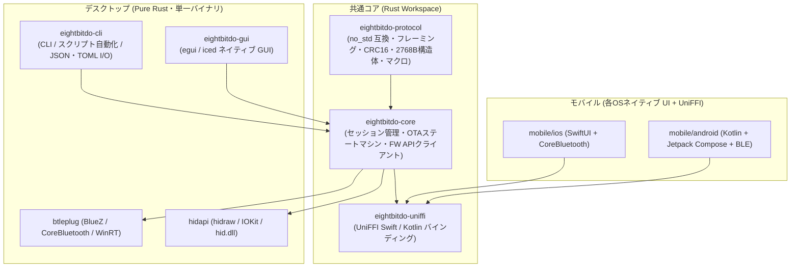

# 実装計画書（8BitDo Ultimate 2 Cross-Platform Suite）

## 1. プロジェクト目標

**8BitDo Ultimate 2 Bluetooth Controller（内部 PID `0x600F` / 2.4G レシーバー `0x6011`）** を、Nintendo Switch へ接続した状態を維持しながら、**Linux / macOS / Windows / Android / iOS** の各環境から BLE GATT（または USB/2.4G HID）経由でフル設定・マクロ編集・ファームウェアアップデートできるオープンソース実装を構築する。

### 解決する課題
- 公式アプリ（8BitDo Ultimate Software V2）は Linux に非対応であり、マクロのインポート／エクスポートや細かい 1ms・8-bit アナログ値の編集が制限されている。
- Switch と接続したまま PC やスマホからリアルタイムにマクロやプロファイルを調整したいケースで、統一されたネイティブ環境がない。
- モバイル（Android / iOS）も含めて、BLE OTA ブートローダー経由のファームウェア更新や公式同等の全設定項目を一貫したプロトコルコアで扱いたい。

---

## 2. アーキテクチャ設計

プロトコル処理・2768 バイト設定構造体・マクロシリアライザ・CRC 計算・OTA ステートマシンを単一の Rust コアライブラリ（`eightbitdo-core`）に集約し、各プラットフォームのネイティブ UI から利用する構成とする。



### 技術選定理由
| レイヤー | 採用技術 | 採用理由 |
| --- | --- | --- |
| 共通プロトコル＆コア | **Rust** | メモリ安全性、厳密なバイト列・ビットマスク処理、クロスプラットフォーム、OSS コミュニティの厚さ、`UniFFI` による iOS/Android ネイティブ連携の容易さ |
| デスクトップ BLE | `btleplug` | Linux (BlueZ D-Bus), macOS (CoreBluetooth), Windows (WinRT) を単一 API で扱える |
| デスクトップ USB/2.4G HID | `hidapi` | Linux (`hidraw`/`libusb`), macOS (IOKit), Windows (`hid.dll`) に対応 |
| デスクトップ GUI | **`egui` (`eframe`)** （代替候補: `iced`） | Pure Rust・Node.js/WebView 不要・軽量な単一バイナリ配布が可能・コントローラ入力のリアルタイム描画（60fps スティック/ボタンモニター・マクロタイムライン）と相性が良い |
| デスクトップ CLI | `clap` + `serde` (`serde_json` / `toml`) | マクロやプロファイルのバージョン管理・バッチ適用・CI テストに必須 |
| iOS アプリ | **Swift + SwiftUI + CoreBluetooth** | iOS での BLE バックグラウンド権限・GATT MTU 制御・OTA 再接続を最も安定して実装できるネイティブ構成。ロジックは `eightbitdo-uniffi` 経由 |
| Android アプリ | **Kotlin + Jetpack Compose + Android BLE / USB Host API** | BLE GATT と USB OTG HID の両方をネイティブ API で確実に制御できる。ロジックは `eightbitdo-uniffi` 経由 |

---

## 3. リポジトリ構成（2026-11-23 時点）

```text
8bitdo/
├── README.md
├── AGENTS.md                   # AI エージェント向け引き継ぎガイド（現在の状態は §6）
├── CLAUDE.md                   # AGENTS.md への参照
├── CONTRIBUTING.md
├── LICENSE-MIT / LICENSE-APACHE / NOTICE
├── THIRD_PARTY_LICENSES.md / TRADEMARKS.md
├── docs/
│   ├── PROTOCOL_SPEC.md        # BLE GATT / USB HID / CRC16 / OTA / FW API 完全仕様
│   ├── STRUCT_BT2_2768B.md     # 2768B 設定構造体 & 10B マクロステップ完全仕様
│   ├── IMPLEMENTATION_PLAN.md  # 本実装計画書
│   ├── OTA_BLE_EVIDENCE.md     # BLE OTA の解析証跡と未確認事項
│   ├── SESSION_OPERATIONS.md   # 常駐 session の運用（BLE ロック / degraded / SIGINT）
│   ├── REVIEW_TIERS.md         # 独立レビューの Tier / 故障リスト
│   └── BRANCH_PROTECTION.md    # main の ruleset と review-gate
├── Cargo.toml                  # Rust Workspace ルート
├── crates/
│   ├── eightbitdo-protocol/        # 純粋バイト列処理（I/O 非依存・単体テスト 100 + doc 4）
│   │   └── src/
│   │       ├── crc.rs          # ANSI_CRC_16_sh (0x8408) & Packet CRC16 (0xA001)
│   │       ├── header.rs       # 16B cumstom_header_t・BLE/HID フレーミング
│   │       ├── commands.rs     # App Mode & Bootloader コマンドビルダー/パーサー
│   │       ├── config_bt2.rs   # 2768B (0xAD0) record_ultimatebt2 構造体
│   │       ├── keymap.rs       # 32-bit KeyMap ビットマスク & 22キーインデックス
│   │       ├── macro_data.rs   # 10B MacroDatas・32Bアライン・JSON/TOML 変換
│   │       └── input_report.rs # cmd 0x0003 リアルタイム入力レポートパーサー
│   ├── eightbitdo-core/            # 非同期トランスポート抽象 + セッション + config/macro + OTA
│   │   └── src/
│   │       ├── transport.rs    # Transport trait (BLE / Mock)
│   │       ├── ble.rs          # btleplug 実装（desktop、`ble` feature）
│   │       ├── ble_lock.rs     # per-user BLE 単一所有者ロック（flock / O_NOFOLLOW）
│   │       ├── session.rs      # 接続・初期化・設定/マクロ読み書き・keepalive
│   │       ├── config_ops.rs   # 2768B full write / set / remap / read-back
│   │       ├── macro_ops.rs    # 3 slot × 4 macro の backup / write / restore
│   │       ├── ota.rs          # BLE OTA 状態機械（Mock のみ・未配線）
│   │       ├── mock.rs         # MockTransport
│   │       └── error.rs
│   ├── eightbitdo-cli/             # CLI ツール（実機検証・自動化・I/O。`src/main.rs` 単一）
│   ├── eightbitdo-gui/             # デスクトップ GUI (egui / eframe。3a 読み取り + 3b/3d 書込 UI)
│   └── eightbitdo-uniffi/          # Swift / Kotlin 向け UniFFI 公開レイヤー
├── mobile/                     # モバイルアプリ（iOS / Android）
│   ├── ios/                    # SwiftUI アプリ (CoreBluetooth Transport 実装)
│   ├── android/                # Jetpack Compose アプリ (BLE Transport 実装)
│   ├── README.md               # ビルド手順・到達点・制約
│   └── CHANGELOG.md
└── scripts/
    ├── mobile/                 # gen-bindings.sh / build-ios.sh / build-android.sh
    ├── session-loop.sh         # 常駐 session の再起動ループ
    └── post-review-status.sh   # review-gate の投稿
```

> **未実装の構成要素**: USB HID transport（`hid.rs`）とファームウェア配信 API クライアント（`firmware_api.rs`）はまだ存在しない。USB OTA は USB Boot TX フレーミングが未文書化のため保留。`packaging/linux/` の udev ルールも未作成。

> **クレート名について**: Cargo のパッケージ名は数字で開始できないため、正式名は `eightbitdo-*` とする（`8bitdo-*` は使用不可）。ディレクトリ名もパッケージ名に合わせる。

---

## 4. 機能スコープ

### 4.1 マクロ機能（最優先）
1. **リアルタイム入力録音**: `cmd 0x0007` でレポート有効化 → `cmd 0x0003` の通知からボタン・左/右アナログスティック・L2/R2 トリガー・経過ミリ秒を自動キャプチャし、ステップ列に変換。
2. **高精度 GUI ステップエディタ**:
   - ステップごとの **1ms 単位**の持続時間 (`ms_times`: `u16`) 編集
   - 16bit ボタン同時押しマスク編集
   - 左右スティックの **8-bit 精密座標** (`0x00..0xFF`, ニュートラル `0x7F`)・方向プリセット・角度/倒し量入力
   - L2/R2 アナログトリガー値 (`0x00..0xFF`) の個別設定
   - 実行モード (`once` / `hold` / `loop`)、繰り返し回数 (`cycles_num`)、間隔 (`interval_ms`)、トリガーボタン割り当て (`KeyMap`, P1/P2/L4/R4 等含む)
   - 最大 200 ステップ／マクロ、スロットあたり最大 4 マクロ × 3 スロット管理
3. **インポート／エクスポート**:
   - 人間が読める **JSON / TOML** 形式でのマクロ単体およびプロファイル一括の保存・読み込み・共有

### 4.2 コントローラ全設定（2768 バイト構造体パリティ）
- **プロファイル管理**: スロット 1〜3 の切り替え (`cmd 0x0015`)、プロファイル名（UTF-16BE 最大 32 バイト）、スロット初期化・コピー・バックアップ
- **ボタンリマッピング**: 22 物理ボタンの任意リマップ（Turbo / Swap / L4 / R4 / P1 / P2 / ScreenShot 等含む）
- **スティック＆トリガー**: デッドゾーン開始/終了値、特殊機能フラグ（反転・スワップ・ヘアトリガー等）、拡張カーブ領域の安全な保持および編集
- **振動（Rumble）**: 左右モーター強度 (`f32`)
- **6軸ジャイロ（SixAxis）**: トリガーボタン、発動モード、感度、デッドゾーン補正、マッピング先
- **RGB ライティング**: Dynamic / HotWheel (速度 `0..15`) / Single (24 LED カラー配列)

### 4.3 ファームウェアアップデート（PC / Android / iOS）
- 8BitDo 公式 API からの最新／ベータ版ファームウェア照会およびダウンロード
- ローカル `.dat` / `.bin` ファームウェアファイルの指定適用
- BLE Bootloader OTA（`cmd 0x000C` → `"8bt"` 再接続 → `0000FF20`/`0000FF21` → Flash 消去・書込・バージョン・APPID・JumpApp）
- USB HID 接続時のファームウェア更新（PC および Android USB OTG）
- **安全機構（ブリック防止）**: バッテリー残量確認警告、事前サイズ・CRC 検証、リトライ制御、書き込み中の電源断警告、中断時の `"8bt"` ブートローダー直接復旧モード

---

## 5. フェーズ別実装ロードマップ

> **2026-11-23 改訂（現状反映）**: Phase 1 / 2a / 2b / 2d / 3a は main にマージ済み。PR #16（`feat/gui-write`）で Phase 3b（マクロエディタ）と Phase 3d（設定タブ / リマップ）の GUI 書込を実装（実機未検証・Tier 3）。Phase 2c は core のみマージ済みで、実機 wire 未確定のため CLI / GUI / UniFFI に未配線。Phase 3c（OTA 画面）は未着手。Phase 5 は UniFFI と iOS / Android の雛形まで。USB OTA（Phase 4）は USB Boot TX フレーミングが未文書化のため保留を継続する。詳細な残課題は §5.4。

### 5.1 トラック構成（2026-11-23）

```text
Track A: コア / CLI（Linux・デスクトップ）
  Phase 1  protocol                 完了（単体 100 + doc 4）
  Phase 2a read-only + session      完了・実機確認済み
  Phase 2b macro write              完了・実機確認済み（S1 の M1/M2。M3/M4・S2/S3 は外挿）
  Phase 2c BLE OTA                  core のみ完了（Mock 52/55/58/61）。実機 wire 未確定・未配線
  Phase 2d config apply             完了・実機確認済み（BLE・MTU 200・74B chunk）
  Phase 2e USB / 2.4G transport     保留

Track B: GUI（egui / Pure Rust）
  Phase 3a read-only GUI            完了（PR #9）
  Phase 3b macro editor             実装済み（PR #16。実機未検証・Tier 3）
  Phase 3c OTA screen               2c の wire 確定後（未着手）
  Phase 3d settings tabs            実装済み（PR #16。実機未検証・Tier 3）

Track C: モバイル
  Phase 5  UniFFI + iOS / Android   雛形完了（PR #12）。JNI 同梱 APK・実機・配布は未着手
```

### 5.2 現状（2026-11-23、main `4004757`）

| 項目 | 状態 |
| --- | --- |
| Phase 1 | 完了。実機検証で判明した ReadVersion の 4B ペイロード、ReadConfig の `chunk_len = 0x0AD0`、1 要求 = 1 チャンク、最終 142B パディングは Phase 2a で補正した。`cargo test -p eightbitdo-protocol` は単体 100 + doc 4 |
| Phase 2a | 完了。実機で ReadVersion **200 (0xC8)**、2768B dump（SHA-256 `1dca47fa...59c600`）、20ms keepalive **128.9 秒**、`session` の info / config dump / backup / monitor を確認 |
| Phase 2b | 完了（PR #6）。実機（BLE・slot S1）でマクロ書込・読み戻し・restore を確認。Write `0x0103` の `total_len` は絶対終端が必須。**Switch 側でのマクロ発動は未確認**。M3/M4・S2/S3・USB HID は未確認 |
| Phase 2c | core 実装済み（PR #11）。Mock 55 テスト（既定 52）。**実機 btsnoop 未取得、CLI / GUI / UniFFI 未配線、実機書込未検証**。マルチセクション `.dat` 非対応が公式ファーム対応の blocker |
| Phase 2d | 完了（PR #7）。実機（BLE・MTU 200・74B chunk）で full 2768B write → Save → read-back 一致、`config remap` A→B→A を同一接続で確認。**実機確認は full write / remap のみ**で、`config set` 各フィールド・`--force-raw`・MTU 200 以外は未確認。USB config write は未実装 |
| Phase 3a | 完了（PR #9）。読み取り専用 GUI、日本語、燻しスレート。デバイス / ライブ入力 / 設定値 / ログの 4 タブ。 |
| Phase 3b | **実装（PR #16）**。マクロエディタ／20ms 録音／ステップ編集／既存非空マクロへの書込。pre-write backup・read-back・TOCTOU・録音中書込不可。**実機未検証・Tier 3** |
| Phase 3c | 未着手。Phase 2c の実機 wire 確定後に OTA 画面を実装 |
| Phase 3d | **実装（PR #16）**。設定タブ／22 ボタンリマップ／振動／スティック・トリガー／ジャイロ／LED。確認ダイアログ・pre-write backup・read-back。**実機未検証・Tier 3** |
| Phase 4 | 保留（USB Boot TX 未文書化） |
| Phase 5 | 雛形完了（PR #12）。UniFFI 公開 API、iOS unsigned IPA、Android Kotlin-only APK まで。Android JNI 同梱 APK・実機確認・App Store 配布は未着手。書き込み・OTA は意図的に未公開 |
| ライセンス | 完了（PR #13）。LICENSE-MIT / LICENSE-APACHE / NOTICE / THIRD_PARTY_LICENSES / TRADEMARKS |
| レビュー | 2a / 2b / 2c / 2d と書き込み系 GUI は **Tier 3**（3 セッション）。3a の表示のみの変更は Tier 2、`eightbitdo-core/**` に触れる場合は Tier 3 |

### Phase 1: `eightbitdo-protocol`（純粋プロトコル＆バイナリ層）
- **ゴール**: 実機なしで全パケット・CRC・2768B 構造体・10B マクロのエンコード／デコードを単体テストで検証する。
- **実装項目**:
  - `ANSI_CRC_16_sh` (poly `0x8408`) と Packet `crc16` (poly `0xA001`) の実装とテストベクタ検証
  - `cumstom_header_t` (16B LE) および BLE (`0x04`/`0x05`)・USB HID (`0x81 0x04` / `0x02 0x04`, 64B) フレーミング
  - `record_ultimatebt2` (2768B `0xAD0`) の双方向パース・シリアライズ（未知・予約バイトを一切破壊しないラウンドトリップ保証）
  - `MacroDatas` (10B) と 32B アラインされた Flash イメージ生成・パース、JSON/TOML スキーマ定義
  - `cmd 0x0003` リアルタイム入力レポートパーサー
- **完了条件**: `cargo test -p eightbitdo-protocol` がすべてパスすること。**実機なしの 100% 検証は達成できず**、Phase 2a の実機検証で読み取り経路の仕様補正を行った。

### Phase 2a: `eightbitdo-core` + `eightbitdo-cli` 読み取り専用 + `session`
- **ゴール**: 1 回の Profile 長押しで、Switch 接続を維持したまま version / 2768B config / backup / monitor を実行する。
- **実装項目**:
  - `Transport` トレイト（BLE / Mock、非同期 `send` / `recv` / `mtu` / `disconnect`）
  - BLE `"80ND"` スキャン、`FF10` + `FF11` 優先 / `FF13` フォールバック、`peripheral.mtu()` の読み取り（MTU ネゴシエーション自体は OS/BlueZ 任せ）
  - `Session`: operation lock（keepalive とコマンドの直列化）、ReadVersion（4B ダミーペイロード + `cmd=0x0004` エンベロープ）、ReadConfig（`chunk_len = total_len = 0x0AD0`、1 要求 = 1 チャンク、142B、最終チャンク切り詰め）、入力レポート
  - CLI: `scan` / `info` / `config dump` / `backup` / `monitor` / `keepalive` / **`session`**
  - `session`: 1 接続、`0x0007` enable（既定。`--no-report-enable` 時は起動時の enable(1) を送らず `0x0003` keepalive のみ。終了時の disable(0) は best-effort）+ 20ms `0x0003` keepalive + 受信ドレイン、operation lock でコマンド中は keepalive を停止、scan / connect / session と `BleTransport::connect` を使う全 CLI コマンドは BLE を触る前に **per-user** BLE 単一所有者 flock を取得し、取得できなければ「別プロセスが BLE を使用中」として失敗（環境非依存パス: `EIGHTBITDO_BLE_LOCK`（テスト用例外）→ NSS（`getpwuid_r`）の euid ホーム由来 `~/.cache/8bitdo/8bitdo-ble.lock` → ホーム不明時のみ temp の per-user dir。`XDG_RUNTIME_DIR` / `XDG_CACHE_HOME` は参照しない。symlink / 非通常ファイル / 他ユーザー所有は `O_NOFOLLOW` と fd 検証で拒否し、既定パスでは既存 parent が euid 所有 + group/other write なし + symlink でないことを検証し、Unix は dirfd（`openat`）で TOCTOU も閉じる。別ユーザー同士は排他しない。session は接続保持中ロックを保持し teardown 成功時のみ解放）、`info` / `config dump` / `backup` / `monitor` / `monitor stop` / `status` / `help` / `quit`。`monitor` 自身も 20ms `0x0003` を送り、その間は keepalive が止まる（monitor が keepalive を兼ねる）。`monitor stop` 後は keepalive が自動再開。トップレベルの `monitor` も同じ 20ms `0x0003` ポーリングを共有し、終了時に `0x0007` disable → 切断する。なお `monitor --count N` は公式 `ReadKeysAndJoy` と同様に投げっぱなしで、応答が 1 件も来ない場合も 20ms 周期で `0x0003` を送り続け、`--count` に達するまで Ctrl-C まで回り続ける。`status` は `monitor sent` / `monitor received` を表示し、終了時のロック待ち・切断はタイムアウト付きで有界にする。連続する keepalive I/O エラー 3 回または `Disconnected` で degraded 停止し、`session` は終了コード **3** で終了して自動再接続しない（無応答は failure に数えない。`keepalive degraded ...` のメッセージで、切断と同時に App Mode を抜けて `80ND` が広告されなくなること、Profile 約 3 秒押しでの再入が必要なことを案内する。常駐ループは 3 で再試行せず押下待ち停止）。degraded 以外でコマンドが `Disconnected` を観測した場合は exit 1。押下依頼前の `scan` 確認手順・per-user ロック・常駐ループは `docs/SESSION_OPERATIONS.md` を参照）。1 tick の受信ドレインは最大 4 レポート（`try_next_input` 自体も 1 回最大 16 フレーム + 1ms）に固定し、通知が途切れなくても operation lock を保持し続けない。設定の `--raw` / `--json` は同一ディレクトリの一時ファイルへ書いてから rename するアトミック書込で、同一ファイルを指す 2 つの出力パス（`.` / `..`、symlink、Unix の hard link）は端末にアクセスする前に拒否する。hard link の同一性検出は Unix のみ（device/inode）で、Windows は file identity 未実装のため hard link alias を事前拒否しない。ただし出力は一時ファイル + `rename` なので、JSON の `rename` が raw の内容を直接書き換えることはない。case-insensitive alias は raw 書き込み後の再検証で拾う。この再検証は偶発的な alias 用であり、出力ディレクトリに write 権限を持つ攻撃者による TOCTOU / 並行 rename は非保証である。REPL の 1 行は最大 4096 バイトで、超過分は読み捨てて次の行を正常に読む。`session` の Ctrl-C はコマンド実行中でも future を drop して REPL を抜け、セッションを終了する（終了直前に BLE 切断・`80ND` 消滅・Profile 約 3 秒押しが必要な旨を stderr に表示する。`--allow-macro-write` 有効時の macro write / restore は、準備（ファイル読込・pre-write / pre-restore backup）を含むコマンド全体が完了するまで Ctrl-C を遅延してから終了する。次項参照）。行リーダーのキャンセル耐性は `monitor` / keepalive の終了通知による中断で読みかけの行を壊さないためのもので、Ctrl-C 後の継続を意味しない。
  - `session` の macro 操作（2026-11-22 追加。REPL 経由の macro 書込は実機未検証）: REPL から `macro backup <DIR>`（読み取りのみ、常に利用可）/ `macro write <SLOT> <INDEX> <FILE> [--trigger <KEY>] [--chunk-size <32|64>]` / `macro restore <DIR> [--force]` を実行できる。`macro write` / `macro restore` は **`--allow-macro-write`（既定 OFF）** が必要で、無い場合は `restart with --allow-macro-write` を案内して拒否する。`session` は**既定で起動時に `0x0007 enable(1)` を送る（公式相当）**ため、**REPL の `macro write` は enable 状態で実行される**。`--no-report-enable` を指定すると起動時の enable(1) を送らずに `0x0003` keepalive を継続し（終了時の disable(0) は best-effort）、トップレベル `macro write` の既定（enable なし）と同じ書込条件で A/B できる。macro 操作中は operation lock により 20ms `0x0003` ポーリングが止まり、操作後に再開する（公式は書込中 `0x0003` なし）。**`--allow-macro-write` 有効時の `macro write` / `macro restore` は、準備（ファイル読込・pre-write / pre-restore backup）を含むコマンド全体が完了するまで Ctrl-C を遅延してから終了する**。非通常ファイル（FIFO / socket / directory）は読み取り前に拒否するためブロックせず、デバイス I/O は timeout で有界（SIGKILL・電源断は防げない）。REPL の `macro write` は `--backup-dir` 非対応（cwd の `macro-backup-<unix-nanos>-<pid>-<sequence>` を使う）、`macro restore` は `--chunk-size` 非対応（pre-restore backup は `<backup dir 名>-pre-restore-<unix-nanos>-<pid>-<sequence>`）。
  - `session` の config 書込（2026-11-23 追加）: `--allow-config-write` 付きで REPL から `config set <field> <value>` / `config remap <physical> <target>` / `config map show` / `config write --file <path>` を実行できる。各書込はトップレベルと同じ共通関数（`ConfigWritePlan` / `PreparedConfigWrite` / `raw` 検証 / pre-write backup / 前後 SHA-256 / read-back / `--accept-reserved-drift` / `--force-raw` / `--write-chunk`）を使い、`--yes`（対話確認なし）または REPL 上の `yes` 入力で確認する。REPL は二段階で実行する: (1) snapshot 読込・plan・pre-write backup・確認プロンプトはキャンセル可能フェーズ（operation lock は prepare 中のみ保持し、プロンプト待機中は解放して 20ms keepalive を継続。Ctrl-C で中止でき、backup は残る）、(2) `finish_config_prepared`（TOCTOU 再読込 → `0x0001` 連続 → Save → read-back）は operation lock 下の非キャンセルフェーズ（Ctrl-C は遅延 + notice）。終了後に keepalive を再開する。失敗時は backup path と復旧コマンド（top-level / REPL 双方）を表示する。REPL の引数は空白区切りのため、スペース入りプロファイル名は top-level `config set` を使う。`config map show` / `config dump` は `--allow-config-write` 不要。`session` は将来のデーモン化（常駐プロセス）への布石。1 回の Profile 長押しで複数操作を完結させる
  - docs: `FF13` 実機観測、`cmd=0x0004` エンベロープ、ReadConfig の `chunk_len`、keepalive 設計
- **完了条件**: 1 回の Profile で `session` 内の `info` → `backup` → `monitor` が通り、Tier 3 レビューと CI 4/4 を満たすこと。
- **状態**: **完了（2026-11-21〜22、実機確認済み）**。実機で `session` の info / config dump / backup / monitor / keepalive、BLE 単一所有ロック、degraded 終了コード 3 を確認した。

### Phase 2b: BLE マクロ読み書き（本命）
- **ゴール**: 3 スロット（`slot 0..2`）× 4 マクロ（`macro_idx 0..3`）のバックアップと、Header (`total_len=0xD8`) → Save → Erase → Write → Save の実機書き込み。slot 単位バッチ restore ではヘッダ + 最初の Save を 1 回、最終 Save を全マクロの後に 1 回送る。
- **実装項目**:
  - `0x0102` ReadBT2Macro（1 要求 = 1 チャンク 142B、`offset = (macro_idx << 12) + chunk_offset`, `total_len = chunk_len = steps * 10`。実機で `macro_idx=0 (M1)` / 500B と `macro_idx=1 (M2)` / 460B の応答 offset を確認）
  - 公式順序: **Header `0x0001` (`total_len = 0xD8`) → Save → Erase `0x0104` → Write `0x0103` → Save**
  - `0x0001` Header（`offset = 0x68C + slot * 0xD8`, `len = 0xD8`, `total_len = 0xD8`、216B を `min(142, max_payload)` で分割、2 秒/チャンク）
  - `0x0104` Erase（`total_len = chunk_len = 0x1000`, `crc16 = 0xFFFF`, ペイロードなし、2 秒）
  - `0x0103` Write（`max_payload = mtu - 3 - 17` に応じて 64B / 32B、`--chunk-size 32|64` で明示指定可能、32B アライン、チャンクごと CRC、2 秒、**`total_len = (macro_idx << 12) + align32(steps * 10)`（絶対終端、2026-11-22 実機確認。相対値では ACK のみで永続化されない）**）
  - `0x0006` Save（BLE `subcmd = 0x0067`、slot バッチごとにヘッダ後 1 回 + 全マクロ後 1 回、3 秒・リトライなし）
  - 3 スロット × 4 マクロのバックアップ（raw `.bin` + JSON/TOML + SHA-256 + config snapshot）
  - Mock でパケット列・CRC・チャンク境界・タイムアウト・fail-closed・読み戻し不一致を固定
  - CLI: `macro backup --dir <DIR>` / `macro write --slot N --index N --file <JSON/TOML> [--trigger M1..M4]` / `macro restore --dir <DIR> [--force]`。実験用フラグ `--poll-interval-ms <MS>`（既定 **0**。書込中に `0x0003` を送る間隔。公式はマクロ書込中に送らない）と `--report-enable`（既定 false。`0x0007` を送る）を `macro backup` / `macro write` / `macro restore` で受け付ける。`macro write` / `macro restore`（トップレベル CLI）と REPL の `macro write` は `--write-total-relative`（既定は絶対終端 `total_len`。旧 `align32` framing に戻す A/B 用）を持つ（REPL の `macro restore` は `--force` のみ）。Write offset の相対モードは提供しない（Erase は `macro_idx << 12` の sector を消すため、0 起点の Write は別 sector を破壊する。unit test で混在拒否を固定）
  - fail-closed（`MacroWriteState::{NotSaved, HeaderSaved, DataSaved}`: Header 失敗は Save/Erase 未送信、最初の Save 失敗は Erase/Write 未送信、Erase/Write 失敗はヘッダ Save 済みとして復元を案内、空 slot のヘッダのみ restore で Verify が失敗した場合は `HeaderSaved` として復元を案内）、`0x0002` の 216B ヘッダ検証 + `0x0102` の raw 検証、`--trigger` のヘッダ反映
  - 実機の旧順序 macro1 verify 失敗（部分書込）を受け、Erase ACK 後 100ms、全 Write 後 50ms、最終 Save 後 verify 300ms の暫定 delay を追加（Header Save → Erase は 0ms）
  - 空きマクロ（`max_steps == 0` / `0xFFFF`）への write を拒否（step data clear 未実装）
  - `macro write` は 12 マクロ完全バックアップ必須。対象 slot に読めないマクロがあれば `unreadable macro in target slot` で拒否
  - backup dir は空 path / symlink（末尾 `/` 含む）/ 既存の非空ディレクトリ / `.` を拒否（pre-write / pre-restore 含む）。失敗した `macro backup` / `macro write` の早期失敗は作成した空ディレクトリを削除
  - restore は「backup で空、現在は非空」を `--force` なしで拒否。`--force` は読めない現在マクロの skipped のみ許可し、pre-restore backup の書込み失敗は `--force` でも中止。全空 slot は 216B ヘッダのみ書込
  - `MacroFile.cycles_num` / `interval_ms` は省略可能（未指定は既存値保持）。`gamepad_mode` は無視
- **完了条件**: 実機で 1 マクロ書き込み → 読み戻し一致 → 元のマクロへ復元（**書込・読み戻し・復元は実機確認済み。Switch 側でのマクロ発動確認は未実施**）。
- **完了条件の変更（レビュー指摘）**: 当初の「Switch 側で発動」は未確認のため、実機で確認できた「書込 → 読み戻し一致 → 復元」を完了条件とし、**Switch 側の発動確認は未確認のまま完了扱い**として §5.4 の残課題に分離した。
- **Tier**: **3**（write-path / Flash / CRC / マクロ）。
- **状態**: **完了（実機で書込・読み戻し・復元まで確認。Switch 側でのマクロ発動は未確認）**。読み取り・バックアップ（142B チャンク、offset エコー）に加え、**2026-11-22 実機（BLE・slot S1・`macro_idx=0/1 (M1/M2)`）: Write `0x0103` の `total_len` を絶対終端 `(macro_idx << 12) + align32(steps * 10)` にすることで `macro_idx=1` の永続化を確認**（相対値 `align32(steps * 10)` では ACK のみで未永続。`macro_idx=0` は base 0 のため両者一致）。**restore も実行し、復元後の config SHA-256 が書込前の `1dca47fa...59c600` に一致した。** `macro_idx=2/3 (M3/M4)` と slot S2/S3 は式からの外挿で未確認。これが既定。CLI `--write-total-relative` は旧 framing に戻す A/B 用。USB HID の Write は未実装・未検証（BLE のみ実装）。残る未確定点は `PROTOCOL_SPEC.md` §6.5（ACK 形状 / total_len 照合、Save タイムアウト、config CRC 再計算、MTU 200 以外での実機挙動）。

### Phase 2c: Linux BLE OTA
- **ゴール**: Linux から BLE Bootloader 経由でファームウェア更新・復旧を行う。
- **実装項目**:
  - 公式 API またはローカル `.dat` の取得・検証（PID / バージョン / サイズ / CRC）
  - `0x000C` EnterBoot（`subcmd=0x0067`）→ `"8bt"`（`FF20` / `FF21`）へ再接続
  - `0x0008` readPID（5s）、`0x0005` readVersionInBoot（type 1 は `offset=0x01017040`）
  - `0x0004` EraseFlash（4KB、10s）、`0x0003` WriteFirmware（64B、1s）、`0x00C4` WriteVersion（3s）、`0x0006` JumpApp
  - バッテリー警告、途中失敗時の `"8bt"` 復旧、全セクタ消去 → 再書き込み
  - Mock で正常系・タイムアウト・CRC 不一致・途中切断を固定
- **完了条件**: 同一バージョン再書き込み → 最新版更新 → 復旧確認。
- **Tier**: **3**（OTA / Flash / セキュリティ境界）。
- **状態**: **core 実装済み（Mock テストのみ。CLI / GUI / UniFFI 未配線、実機未検証。実機書込は保留）**。2026-11-23 に PR #11 として main にマージ。解析証跡は [docs/OTA_BLE_EVIDENCE.md](OTA_BLE_EVIDENCE.md)。**次の実装は CLI 配線ではなく、実機 btsnoop による wire 確定と ACK `offset` / `total_len` 照合の追加（§8.5 未検証事項 13）を先に行う。**
  - `crates/eightbitdo-core/src/ota.rs`: BLE 専用の状態機械 `OtaUpdate`（`Idle` → `EnteringBoot` → `AwaitingBootReconnect` → `PreparingBoot` → `Ready` → `Erasing` / `Writing` / `Finalizing` → `Complete`、失敗時 `Failed`）。
  - **transport 結合**（PR #10 の単一所有者 BLE ロック対応を含む）: `prepare_boot` が boot transport を借用する `BootReady<'a, T>` ガードを返し、`write_firmware` はそのガードのみ受け付ける（生成元 `OtaUpdate` の ID も照合）。`OtaTransport` マーカーは sealed で、crate 内の Mock と boot 専用 `BleBootTransport`（`"8bt"` / FF20 / FF21・FF23）のみに実装。デスクトップでは App Mode `BleTransport`（`80ND` / FF10）と USB transport を型で拒否。UniFFI / モバイルは `#[cfg(feature = "mobile-boot")]` + `#[doc(hidden)]` の `MobileBootLink<T: Transport>` でネイティブ boot transport を包む（既定ビルドには型が存在しない。`eightbitdo-uniffi` が feature を有効化）。この経路は型で App Mode / USB を排除できず、フレーミング・単一所有・ロック契約は呼び出し側責任。
  - **app base の組み込み検証**: `OtaConfig::new` / `OtaUpdate::with_config` が base を type 1 の暫定 application ウィンドウ `0x0101_0000..0x0102_0000`（`UT2_TYPE1_APP_BASE_MIN..UT2_TYPE1_APP_FLASH_END`）内・4KB アラインに制限。`write_firmware` は `.dat +0x04` と期待 base の一致に加え、`expected_load_base + image_len <= UT2_TYPE1_APP_FLASH_END` を最初の Erase 前に検証し、外れたら `OtaInvalidFirmware` で拒否。`load_base = 0` / bootloader 領域 / type 0 領域は消去できない。ウィンドウは文書化済み type 1 アドレス（`0x01017040` / `0x01018000`）を含む暫定 64 KiB 範囲で、公式 `.dat` 実測後に確定する。
  - **単一所有者ロックと App Session 切断**: `BleBootTransport::connect` は `BleBootOptions::lock_path` を `BleOptions` に渡し、App Mode と同じ `BleLock` を取得する（PR #10 の `BleOptions.lock_path` と互換）。`enter_boot` 後に App Session を保持したままだと boot connect が `BleBusy` になるため、**先に App Session を drop / disconnect** する。`OtaUpdate::enter_boot_and_release(&Session<T>)` が EnterBoot + App リンク切断を行う。phase は Session に触れる前に検証し、phase 不正では Session を消費しない。EnterBoot 受理後（ACK / リンククローズ）は teardown の `Error::Ble` / `Error::Transport` / `Error::Disconnected` をすべて best-effort で許容し、ロックは Session の drop で解放する（ACK 直後に App リンクが閉じて `Ble teardown incomplete` になる実機経路を含む）。EnterBoot 失敗時も disconnect を試行する。`BleBusy` メッセージにも切断して再試行する旨を記載。
  - **MTU 事前検証**: 最初の Erase 前に `mtu - 3 >= 81`（`OTA_MIN_MTU = 84`）を検証。不足なら `MtuTooSmall` で停止。最大フレームは 64B WriteFirmware の 81B。Bootloader 実 MTU は未確認。
  - **未確認 wire ゲート**: `allow_unverified_wire` 既定 false。false の間は `write_firmware` がフラッシュフレームを送らない。Mock / ベンチ実験のみ明示的に opt-in。
  - **bench 用 段階実行 API（`ota-bench` feature、既定 OFF）**: `OtaUpdate::write_firmware_with_checkpoint` + `OtaCheckpoint::{AfterFirstErase, AfterWrites, AfterWriteVersion}` + `OtaBenchOutcome`（`write_state: OtaWriteState` / `phase: OtaPhase` を含む）+ `OtaPhase::BenchStopped`。通常経路用に `OtaUpdate::write_state()` も公開。`allow_unverified_wire` / PID / base / MTU の安全ゲートは通常経路と共通で迂回不可。最初の Erase ACK 採取など実機 btsnoop 用。既定ビルドには API が存在せず、`docs-ota-capture` の採取計画はこの API 名を参照する。
  - **ready/completion ACK**: 既定は仕様どおり最初の matching ACK を完了とみなす。`require_completion_ack = true` で Erase/Write/**WriteVersion** の最初の payload-less matching frame を ready ACK としてスキップし、完了 ACK を待つ（未検証前提のオプトイン、単独 ACK はタイムアウト）。Erase の payload-less direct echo（`cmd=0x0004, subcmd=0`）は envelope と区別できず ready ACK 扱い。ACK 形状確定まで CLI 配線は保留。
  - `gamepad_type` ゲート: `readPID 0x0008` が `0x600F` のときだけ type 1 として続行。非 type 1 は `OtaUnsupportedPid` で停止し、`readVersionInBoot` の offset を推測しない。`0x01017040` / `0x01018000` のみ実装。
  - 書込順序: 全フレームを最初の Erase 前に構築し、4KB セクタごとに `EraseFlash 0x0004`（10s）→ `WriteFirmware 0x0003` 64B + CRC（1s/チャンク）→ 最後に `WriteVersion 0x00C4`（24B、3s）→ `WriteFirmwareVersion 0x0002`（4B、send-only）→ `JumpApp 0x0006`（ACK またはリンククローズのみ成功、タイムアウトは失敗）。**リトライなし**。
  - `.dat` 検証: 28B ヘッダ、`image_len` 64B 倍数、`load_base_addr` 64B アライン、`28 + image_len` の厳密一致。**単一セクションのみ対応**。trailing data（マルチセクション）は明確なエラーで拒否し、公式 `.dat` がマルチセクションの場合は更新できない可能性がある。
  - fail-closed: `Error::Ota { stage, state, recovery }`（`OtaWriteState::{Untouched, EraseStarted, PartiallyWritten, Written}`、**送信試行**基準）。`sectors_erased` / `chunks_written` は ACK 数。進捗は `OtaProgress`。キャンセルされた Future は recovery を返さないため、フロントエンドはフラッシュ区間を非キャンセルにする契約。
  - MockTransport **52 テスト**（既定）/ **55**（`mobile-boot`）/ **58**（`ota-bench`）/ **61**（`--all-features`）: 全パケット列・CRC・チャンク/セクタ境界・部分セクタ・複数セクタ進捗・ACK 順序、Erase/Write/WriteVersion/WriteFirmwareVersion/Jump 失敗、送信失敗、ACK タイムアウト（リトライなし）、PID 不一致、ready/completion ACK ガード、MTU 不足、type 1 ウィンドウ外/`base + image_len` 上限超過/境界、transport 不一致、未確認 wire ゲート、`0x000E`、キャンセル、マルチセクション拒否メッセージ、`load_base + image_len` の 2^32 境界、WriteVersion の ready ACK 単独タイムアウト、`MobileBootLink` アダプタ（成功・受信エラー・into_inner）、`enter_boot_and_release`（App リンク切断・ACK 後の `Error::Ble` teardown・phase 不正で Session 非消費）、`BleLockSlot` の drop によるロック解放、`ota-bench` の checkpoint 停止・`write_state` 取得・base ゲート維持。
  - **未検証 / 残課題**: 遅延・重複 ACK の誤帰属（シーケンス番号なし。`require_completion_ack` は緩和のみ。**CLI 配線前に ACK の `offset`/`total_len` 照合を追加するのが必須**）、 `PROTOCOL_SPEC` §8.5 を参照。Bootloader RX フレーミング、`readPID` 応答形状、ready/完了 ACK 形状、PID→type 対応、Erase/Write のアドレス規約（仕様の `load_base+sector_off` と証跡のイメージ相対が矛盾）、`WriteVersion` の payload 長（24B vs 16B）、`WriteFirmware` の 64B payload（証跡の 16B 問題）、`EraseFlash` の chunk_len（0 vs 0x1000）、タイムアウト差（5s vs Android 2s）、Bootloader MTU は実機 btsnoop 待ち。USB OTA は `N/A + 理由（USB Boot TX 未文書化）`。バッテリー警告・ファームウェア取得/検証は未実装。
  - **次 PR の必須項目**: マルチセクション `.dat` 対応（または公式 `.dat` 非対応の明示。公式ファーム対応の **blocker**）、実機 btsnoop による wire / ACK / アドレス / MTU / `WriteVersion` payload の確定、公式 `.dat` 実測による type 1 ウィンドウ確定、CLI / GUI / UniFFI 配線（確定後）、バッテリー警告・バージョン/ダウングレード判定・ファームウェア取得/検証、成功時の `"80ND"` 再接続 + バージョン確認。

### Phase 2d: 設定書き込み（config apply）
- **ゴール**: 2768B 全体の書込み + Save を CLI から安全に実行する。
- **実装状況（2026-11-23、BLE のみ。実機 write / remap 確認済み）**:
  - core `config_ops`: デバイス snapshot に型付き編集を適用し、予約バイト（`0x1F4..0x68C` / `0x914..0x92C`）を保持、`ANSI_CRC_16_sh` を再計算して **2768B 全体を `0x0001` 分割送信 → `0x0006/0x0067` Save → `0x0002` read-back 検証**。CRC 不一致・ACK 失敗は `ConfigWriteStage`（Write/Save/Verify）+ `ConfigWriteState`（NotSaved/Saved）で fail-closed。失敗時は段階別の復旧文を返す。
  - 書込 chunk の既定は **`min(MTU ペイロード, 74)`**（RE: 公式書込上限 74B、`MAX_ATT_MTU 92 - 0x12`。静的解析。既定 74B での実機 write は確認済み）。`--write-chunk <BYTES>` は接続前に **1..=180**（観測 MTU 200 のペイロード上限）で検証し、任意サイズ（例: 180B、旧 MTU 連動の A/B）を指定可能。接続後は交渉 MTU の上限も検証する。
  - CLI: `config dump` / **`config write --file <2768B>`** / **`config set <field> <value>`** / **`config remap <physical> <target>`** / **`config map show`**。`config write` はファイル読込・既知フィールド検証を **BLE 接続前** に行う。
  - 安全策: **pre-write backup 必須**（`config.bin` + `config.json`、`REVIEW_TIERS` §6 の例外としてマクロ step sector は対象外）、`--yes` なしの対話確認、**前後 SHA-256 表示**、確認後の **TOCTOU 再読込**（変化時は中止）、read-back 検証、ゲームパッドモード / cur_slot 変更とマクロヘッダ（`0x68C..0x914`）変更の警告。
  - 復旧: `config write --file <backup>/config.bin --yes`。device が予約バイトを正規化した場合は `--accept-reserved-drift` で現在の device 予約バイトに合わせる。
  - **実機確認（2026-11-23、BLE・MTU 200・74B chunk）**: **確認範囲は `config write --file` の full 2768B write と `config remap` のみ**。full write は **38 write + 1 Save（合計 39 packets）**で送信し、Save 後の read-back SHA-256 が送信内容と一致した。device は送信した CRC を保持し（`stored` 一致、`in_place` 解釈とは不一致）、`config remap A B` の反映（read-back で A→B）と B→A への復帰を同一接続で確認した。書込前後で `config-backup-*` が作成され、各回の before / after SHA-256 が記録されている。**`config set` の各フィールド、`--force-raw` / `--accept-reserved-drift`、MTU 200 以外は未確認。**
  - 検証: `config set` は joy start `0..=127` / end `0..=128`、gyro sensitivity `1..=15`、hotwheel speed `0..=15`、rumble level `0..=5`、flag 類 `0/1`、`gyro.key` は `config remap` と同じ documented single-`KeyMap` ホワイトリスト（227・未知ビット・複合拒否）。
  - raw `config write --file` も同じ検証を行う: 22 `key[]` と `gyro[].key_map` は documented single `KeyMap`、各レコードの flag は raw では実機観測値集合（`0` / `1` / `0x20200911` / `0xFFFFFFFF`、gyro は `0x20190000`）のみ受理し、それ以外は `--force-raw` 必須（typed `config set` のみ 0/1）、マクロ `max_steps` は 0/0xFFFF/1..=200・`total_cnt <= 4`。**マクロ `key_map` は `macro write --trigger` と同じ任意 KeyMap を受理**する（複合トリガーの復旧経路を塞がないため）。数値範囲（joy/hotwheel/gyro/rumble）は **flag の値に関係なく常時検証**する（実機の完全消去 slot のみ例外）。消去例外は **slot 全体の条件**（joy 全 255 + rumble NaN + map_key 全 22 `0xFFFFFFFF`、各 flag が `0xFFFFFFFF`）でのみ成立し、record 単体の partial state は拒否する。`0xFFFFFFFF` の flag 値許可は全レコード共通だが payload の消去扱いにはならない。不明な `cur_slot`（実機観測 6 など）は警告して保持する。
  - 未文書値の復旧用に `config write --force-raw`（whitelist/range/enum を警告に降格。予約領域ガードは維持）を提供する。
  - **未実装 / 未確認**: USB HID config write（BLE のみ）、`config set` の各フィールド実機確認、`--force-raw` / `--accept-reserved-drift` の実機確認、MTU 200 以外の実機挙動、`config set` の joy/trigger flag=1・LED color flag=1 の副作用（help に明記）、公式 BLE Save の 2000ms / 2 再送との差（本実装は 3 秒 / リトライなし。`PROTOCOL_SPEC` §6.4 に記録）、device の予約バイト正規化（drift）の実例。
  - **実機 flag の扱い（修正済み）**: 実機の各レコード flag は `0x20200911` / `0xFFFFFFFF` / `0x20190000` で意味は未確定（opaque）。raw 検証は観測値集合のみ受理し、実機 dump は `--force-raw` なしで書き戻せる（未観測値は `--force-raw` 必須）。実機 slot2 の `0xFFFFFFFF` key sentinel は「全 22 key + flag が消去」の場合のみ受理する。typed `config set` の flag のみ 0/1。実バイト証跡は [DEVICE_CONFIG_EVIDENCE.md](DEVICE_CONFIG_EVIDENCE.md)。
- **完了条件**: 各セクションの書き込み → 読み戻し一致（**実機確認は full 2768B write と remap のみ。`config set` の各フィールドは未確認**）。
- **Tier**: **3**。
- **状態**: **完了（実機確認範囲: full 2768B write / remap。BLE・MTU 200・74B chunk）**。

### Phase 2e: USB HID / 2.4G トランスポート（保留）
- **ゴール**: USB 有線 / 2.4G レシーバ経由の App Mode。
- **状態**: 保留。USB App Mode の実機証跡と、USB Boot の TX フレーミング（`EraseFlash` / `WriteFirmware` 等）が未文書化のため、BLE 経路を優先する。

### Phase 3: `eightbitdo-gui`（デスクトップ ネイティブ GUI：Linux / macOS / Windows）
- **技術**: `egui` (`eframe`)、Pure Rust。Node.js / WebView / Electron / Tauri は使わない。
- **Phase 3a（read-only GUI、完了）**: 接続パネル、デバイス情報、ライブ入力、設定ビューア、マクロ一覧、バックアップ、ログの読み取り専用 GUI。日本語 UI・燻しスレートのテーマ・同梱 Noto Sans JP（OFL）。デバイス書込は行わない。**2026-11-22 に PR #9 で main にマージ済み**。既定は **Tier 2**、ただし `crates/eightbitdo-core/**`（`session` / transport / mock を含む）の変更を伴う場合は **Tier 3**。GUI 側だけで完結する場合も、`session` の読み取り契約（ドレインの fail-closed、応答 `total_len` / `crc16` 照合、`Instant` 上限）を検証するテストを変えるなら Tier 3。
- **Phase 3b（マクロエディタ、Phase 2b 後）**: タイムライン / テーブル、リアルタイム録音、1ms、8bit スティック、トリガー、JSON/TOML。Tier 3。**現状: PR #16 で実装済み（未マージ時点）。** 20ms ライブ録音、ステップ編集（削除・待ち時間挿入・値変更）、既存非空マクロへの Header → Save → Erase → Write → Save、read-back 検証、pre-write macro backup、TOCTOU（expected SHA-256 不一致で中止）。空マクロ作成は拒否。録音中は書込不可（確認ダイアログは非モーダルだが確定時に再検証、録音中のロードは停止通知）。**実機未検証。JSON/TOML 入出力は未実装。**
- **Phase 3c（OTA 画面、Phase 2c 後）**: バージョン確認、進捗、復旧モード。Tier 3。**Phase 2c の実機 wire 確定まで着手しない**。
- **Phase 3d（設定タブ、Phase 2d 後）**: プロファイル、リマップ、デッドゾーン、振動、6 軸、RGB。Tier 3。**現状: PR #16 で実装済み（未マージ時点）。** プロファイル名、`gamepad_mode`、有効プロファイル、22 ボタンリマップ（未変更の unsupported 値は保持、新規選択は単一文書化キーのみ）、振動、スティック / トリガー、特殊機能、ジャイロ、LED。確認ダイアログ、pre-write backup、read-back 検証、TOCTOU 付き。**実機未検証。**
- **完了条件**: Linux / macOS / Windows でビルド・起動し、実機と同期すること（現状の確認は Linux のみ）。

### Phase 4: USB OTA（保留）
- **状態**: **保留**。USB Boot の TX フレーミングが未文書化のため、証跡が `PROTOCOL_SPEC.md` に追加されるまで実装しない。
- BLE の `"8bt"` / prefix `0x05` を USB に流用しない。USB の復旧は再列挙 / 再接続。
- **Tier**: 3。

### Phase 5: `eightbitdo-uniffi` + モバイルネイティブアプリ（iOS SwiftUI & Android Jetpack Compose）
- **ゴール**: iOS / Android から BLE（および Android USB OTG）経由で PC 版と同等の設定・マクロ編集・OTA 更新を実現する。
- **実装項目**:
  - `eightbitdo-uniffi`: Callback Interface として `NativeTransport` を Rust 側へ注入できる設計にし、OS 固有の BLE/USB スタックをネイティブ（CoreBluetooth / Android BluetoothGatt・UsbManager）で駆動しつつ、プロトコル・構造体・OTA ロジックを 100% Rust で共有する。**USB OTG 用の callback は未実装**。
  - `mobile/ios`: SwiftUI UI + `CoreBluetooth` トランスポート + SwiftPM / xtool ビルド構成（`scripts/mobile/build-ios.sh`）
  - `mobile/android`: Kotlin + Jetpack Compose UI + Android BLE GATT トランスポート + `cargo-ndk` ビルド構成（`scripts/mobile/build-android.sh`）。USB OTG は未実装。
- **現状（2026-11-23、PR #12 で main にマージ済み）**:
  - `eightbitdo-uniffi`: `NativeTransport` callback、同期 `MobileSession`（version / config / macro backup / input / disconnect）、`describeConfig`、`prepareConfigWrite`（送信なしの書き込み準備のみ）。`cargo test -p eightbitdo-uniffi` は 14 テスト。
  - iOS: SwiftUI 雛形 + CoreBluetooth transport。Linux の xtool で **署名なし IPA の生成まで成功**。実機インストール・App Store / TestFlight 配布は macOS + Xcode が必要で未実施。
  - Android: Compose 雛形 + GATT transport。**Kotlin-only APK**（`assembleDebug`、JVM unit test 8 件）まで成功。**Rust JNI（`libeightbitdo_uniffi.so`）は NDK 不在のため未同梱**で、実機で Rust コアを動かすには NDK + cargo-ndk の完全ビルドが必要。
  - 設定書き込み・OTA は UniFFI に公開していない（バックアップ UI・Tier 3 レビュー待ち）。Android USB OTG は未実装。
- **完了条件**: iOS / Android 実機で `"80ND"` 接続・設定変更・マクロ編集・BLE OTA が動作すること（現状は実機未確認）。
- **Tier**: 3。

### 5.3 クリティカルパス（2026-11-23）

1. ~~Phase 2a `session` 完了 → Tier 3 レビュー → マージ~~ **完了**
2. ~~Phase 2b マクロ書き込み → Tier 3 レビュー → マージ~~ **完了（実機確認済み）**
3. **Phase 2c BLE OTA: 実機 btsnoop で wire / ACK を確定 → ACK `offset` / `total_len` 照合とマルチセクション `.dat` 対応 → Tier 3 → CLI / GUI / UniFFI 配線 → 実機書込**
4. ~~Phase 2d 設定書き込み → Tier 3 レビュー → マージ~~ **完了（実機確認済み）**
5. ~~Phase 3a GUI 読み取り専用~~ **完了** / ~~Phase 3b / 3d GUI 書き込み UI~~ **PR #16 で実装済み（実機未検証）**。次に着手するのは **Phase 3c OTA 画面**（Phase 2c の実機 wire 確定後）と、GUI 書込の実機確認（Tier 3）
6. Phase 5 モバイル: Android JNI 同梱 APK → 実機確認 → 配布（書き込み・OTA は後続）
7. Phase 2e / 4（USB / 2.4G）: 実機証跡と USB Boot TX フレーミングが揃うまで保留

### 5.4 残課題（優先順）

| # | 課題 | 影響 | Tier |
| --- | --- | --- | --- |
| 1 | OTA の実機 btsnoop 取得と wire 確定（RX フレーミング、ready / 完了 ACK、Erase / Write アドレス、`WriteVersion` payload、`WriteFirmware` フレーム長、Bootloader MTU） | 実機 OTA 不可 | 3 |
| 2 | OTA ACK の `offset` / `total_len` 照合（現状は cmd/subcmd のみ。遅延・重複 ACK を誤帰属し得る） | フラッシュ破損リスク | 3 |
| 3 | マルチセクション `.dat` 対応（公式 `.dat` がマルチセクションなら現実装は拒否する） | 公式ファーム更新の blocker | 3 |
| 4 | OTA の CLI / GUI / UniFFI 配線、バッテリー警告、バージョン / ダウングレード判定、SHA-256 検証 | OTA 未提供 | 3 |
| 5 | GUI 書込み UI（PR #16）の実機確認と、Phase 3c OTA 画面。backup 復元 UI・JSON/TOML 入出力 | GUI 書込が実機未検証 | 3 |
| 6 | Android NDK + cargo-ndk による Rust JNI 同梱 APK | Android 実機でコア不可 | 2–3 |
| 7 | iOS / Android 実機での BLE 読み取り確認、App Store 配布（macOS 必須） | モバイル未実証 | 3 |
| 8 | macOS / Windows の BLE 実機確認（現状は Linux のみ） | クロスプラットフォーム未実証 | 2–3 |
| 9 | マクロ M3/M4・slot S2/S3、MTU 200 以外、REPL 経由の書込の実機確認 | 外挿・未検証が残る | 3 |
| 10 | USB HID / 2.4G transport と USB OTA（USB Boot TX 未文書化） | Phase 2e / 4 保留 | 3 |

---

## 6. 開発・検証上の安全原則

1. **実機書き込み前の必須バックアップ**: 最初の書き込み実験前に必ず 2768 バイトの原本バイナリと既存マクロ 3 スロット × 4 マクロをダンプ保存する。
2. **未知フィールドの保全**: 2768 バイト構造体内の予約領域・未編集領域は `read -> modify -> recalculate CRC -> write` の流れで元のバイト列をそのまま保持する。
3. **OTA 開発時の注意**: Bootloader コマンド（特に `EraseFlash` / `WriteFirmware`）は、まずモックトランスポートとパケットダンプで公式アプリの通信ログと完全一致を検証してから実機に適用する。
4. **プロプライエタリ資産の非公開**: 解析に用いた公式 `.apk` / `.exe` / `.dll` や公式ファームウェアバイナリ自体は絶対にリポジトリへコミットしない。
