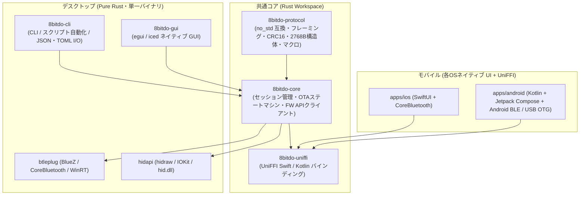

# 実装計画書（8BitDo Ultimate 2 Cross-Platform Suite）

## 1. プロジェクト目標

**8BitDo Ultimate 2 Bluetooth Controller（内部 PID `0x600F` / 2.4G レシーバー `0x6011`）** を、Nintendo Switch へ接続した状態を維持しながら、**Linux / macOS / Windows / Android / iOS** の各環境から BLE GATT（または USB/2.4G HID）経由でフル設定・マクロ編集・ファームウェアアップデートできるオープンソース実装を構築する。

### 解決する課題
- 公式アプリ（8BitDo Ultimate Software V2）は Linux に非対応であり、マクロのインポート／エクスポートや細かい 1ms・8-bit アナログ値の編集が制限されている。
- Switch と接続したまま PC やスマホからリアルタイムにマクロやプロファイルを調整したいケースで、統一されたネイティブ環境がない。
- モバイル（Android / iOS）も含めて、BLE OTA ブートローダー経由のファームウェア更新や公式同等の全設定項目を一貫したプロトコルコアで扱いたい。

---

## 2. アーキテクチャ設計

プロトコル処理・2768 バイト設定構造体・マクロシリアライザ・CRC 計算・OTA ステートマシンを単一の Rust コアライブラリ（`8bitdo-core`）に集約し、各プラットフォームのネイティブ UI から利用する構成とする。



### 技術選定理由
| レイヤー | 採用技術 | 採用理由 |
| --- | --- | --- |
| 共通プロトコル＆コア | **Rust** | メモリ安全性、厳密なバイト列・ビットマスク処理、クロスプラットフォーム、OSS コミュニティの厚さ、`UniFFI` による iOS/Android ネイティブ連携の容易さ |
| デスクトップ BLE | `btleplug` | Linux (BlueZ D-Bus), macOS (CoreBluetooth), Windows (WinRT) を単一 API で扱える |
| デスクトップ USB/2.4G HID | `hidapi` | Linux (`hidraw`/`libusb`), macOS (IOKit), Windows (`hid.dll`) に対応 |
| デスクトップ GUI | **`egui` (`eframe`)** （代替候補: `iced`） | Pure Rust・Node.js/WebView 不要・軽量な単一バイナリ配布が可能・コントローラ入力のリアルタイム描画（60fps スティック/ボタンモニター・マクロタイムライン）と相性が良い |
| デスクトップ CLI | `clap` + `serde` (`serde_json` / `toml`) | マクロやプロファイルのバージョン管理・バッチ適用・CI テストに必須 |
| iOS アプリ | **Swift + SwiftUI + CoreBluetooth** | iOS での BLE バックグラウンド権限・GATT MTU 制御・OTA 再接続を最も安定して実装できるネイティブ構成。ロジックは `8bitdo-uniffi` 経由 |
| Android アプリ | **Kotlin + Jetpack Compose + Android BLE / USB Host API** | BLE GATT と USB OTG HID の両方をネイティブ API で確実に制御できる。ロジックは `8bitdo-uniffi` 経由 |

---

## 3. リポジトリ構成（目標レイアウト）

```text
8bitdo/
├── README.md
├── AGENTS.md                   # AI エージェント向け引き継ぎガイド
├── CLAUDE.md                   # AGENTS.md への参照
├── docs/
│   ├── PROTOCOL_SPEC.md        # BLE GATT / USB HID / CRC16 / OTA / FW API 完全仕様
│   ├── STRUCT_BT2_2768B.md     # 2768B 設定構造体 & 10B マクロステップ完全仕様
│   └── IMPLEMENTATION_PLAN.md  # 本実装計画書
├── Cargo.toml                  # Rust Workspace ルート
├── crates/
│   ├── 8bitdo-protocol/        # 純粋バイト列処理（I/O 非依存・単体テスト網羅）
│   │   ├── src/
│   │   │   ├── crc.rs          # ANSI_CRC_16_sh (0x8408) & Packet CRC16 (0xA001)
│   │   │   ├── header.rs       # 16B cumstom_header_t・BLE/HID フレーミング
│   │   │   ├── commands.rs     # App Mode & Bootloader コマンドビルダー/パーサー
│   │   │   ├── config_bt2.rs   # 2768B (0xAD0) record_ultimatebt2 構造体
│   │   │   ├── keymap.rs       # 32-bit KeyMap ビットマスク & 22キーインデックス
│   │   │   ├── macro_data.rs   # 10B MacroDatas・32Bアライン・JSON/TOML 変換
│   │   │   └── input_report.rs # cmd 0x0003 リアルタイム入力レポートパーサー
│   ├── 8bitdo-core/            # 非同期トランスポート抽象 + セッション + OTA + FW API
│   │   ├── src/
│   │   │   ├── transport.rs    # Transport trait (BLE / USB HID / Mock)
│   │   │   ├── ble.rs          # btleplug 実装 (desktop feature)
│   │   │   ├── hid.rs          # hidapi 実装 (desktop feature)
│   │   │   ├── session.rs      # 接続・初期化・設定/マクロ読み書き・リアルタイム録音
│   │   │   ├── firmware_api.rs # 8BitDo ファームウェア配信 API クライアント
│   │   │   └── ota.rs          # Bootloader 遷移 & Flash 書き込みステートマシン
│   ├── 8bitdo-cli/             # CLI ツール（実機検証・自動化・I/O）
│   ├── 8bitdo-gui/             # デスクトップ GUI (egui / eframe)
│   └── 8bitdo-uniffi/          # Swift / Kotlin 向け UniFFI 公開レイヤー
├── apps/
│   ├── ios/                    # SwiftUI アプリ (CoreBluetooth Transport 実装)
│   └── android/                # Jetpack Compose アプリ (BLE / USB OTG Transport 実装)
└── packaging/
    └── linux/
        └── 99-8bitdo-ultimate2.rules  # USB HID 用 udev ルール
```

---

## 4. 機能スコープ

### 4.1 マクロ機能（最優先）
1. **リアルタイム入力録音**: `cmd 0x0007` でレポート有効化 → `cmd 0x0003` の通知からボタン・左/右アナログスティック・L2/R2 トリガー・経過ミリ秒を自動キャプチャし、ステップ列に変換。
2. **高精度 GUI ステップエディタ**:
   - ステップごとの **1ms 単位**の持続時間 (`ms_times`: `u16`) 編集
   - 16bit ボタン同時押しマスク編集
   - 左右スティックの **8-bit 精密座標** (`0x00..0xFF`, ニュートラル `0x7F`)・方向プリセット・角度/倒し量入力
   - L2/R2 アナログトリガー値 (`0x00..0xFF`) の個別設定
   - 実行モード (`once` / `hold` / `loop`)、繰り返し回数 (`cycles_num`)、間隔 (`interval_ms`)、トリガーボタン割り当て (`KeyMap`, P1/P2/L4/R4 等含む)
   - 最大 200 ステップ／マクロ、スロットあたり最大 4 マクロ × 3 スロット管理
3. **インポート／エクスポート**:
   - 人間が読める **JSON / TOML** 形式でのマクロ単体およびプロファイル一括の保存・読み込み・共有

### 4.2 コントローラ全設定（2768 バイト構造体パリティ）
- **プロファイル管理**: スロット 1〜3 の切り替え (`cmd 0x0015`)、プロファイル名（UTF-16BE 最大 32 バイト）、スロット初期化・コピー・バックアップ
- **ボタンリマッピング**: 22 物理ボタンの任意リマップ（Turbo / Swap / L4 / R4 / P1 / P2 / ScreenShot 等含む）
- **スティック＆トリガー**: デッドゾーン開始/終了値、特殊機能フラグ（反転・スワップ・ヘアトリガー等）、拡張カーブ領域の安全な保持および編集
- **振動（Rumble）**: 左右モーター強度 (`f32`)
- **6軸ジャイロ（SixAxis）**: トリガーボタン、発動モード、感度、デッドゾーン補正、マッピング先
- **RGB ライティング**: Dynamic / HotWheel (速度 `0..15`) / Single (24 LED カラー配列)

### 4.3 ファームウェアアップデート（PC / Android / iOS）
- 8BitDo 公式 API からの最新／ベータ版ファームウェア照会およびダウンロード
- ローカル `.dat` / `.bin` ファームウェアファイルの指定適用
- BLE Bootloader OTA（`cmd 0x000C` → `"8bt"` 再接続 → `0000FF20`/`0000FF21` → Flash 消去・書込・バージョン・APPID・JumpApp）
- USB HID 接続時のファームウェア更新（PC および Android USB OTG）
- **安全機構（ブリック防止）**: バッテリー残量確認警告、事前サイズ・CRC 検証、リトライ制御、書き込み中の電源断警告、中断時の `"8bt"` ブートローダー直接復旧モード

---

## 5. フェーズ別実装ロードマップ

### Phase 1: `8bitdo-protocol`（純粋プロトコル＆バイナリ層）
- **ゴール**: 実機なしで全パケット・CRC・2768B 構造体・10B マクロのエンコード／デコードを単体テストで 100% 検証する。
- **実装項目**:
  - `ANSI_CRC_16_sh` (poly `0x8408`) と Packet `crc16` (poly `0xA001`) の実装とテストベクタ検証
  - `cumstom_header_t` (16B LE) および BLE (`0x04`/`0x05`)・USB HID (`0x81 0x04` / `0x02 0x04`, 64B) フレーミング
  - `record_ultimatebt2` (2768B `0xAD0`) の双方向パース・シリアライズ（未知・予約バイトを一切破壊しないラウンドトリップ保証）
  - `MacroDatas` (10B) と 32B アラインされた Flash イメージ生成・パース、JSON/TOML スキーマ定義
  - `cmd 0x0003` リアルタイム入力レポートパーサー
- **完了条件**: `cargo test -p 8bitdo-protocol` がすべてパスし、2768B のゼロ破壊ラウンドトリップおよび CRC 一致が確認できること。

### Phase 2: `8bitdo-core` + `8bitdo-cli`（BLE / USB 実機通信＆安全検証）
- **ゴール**: 実機の Ultimate 2 Bluetooth（Switch 接続中 + BLE `"80ND"`）に対して CLI から読み出し・バックアップ・安全な書き込み・マクロ書き込み・入力モニターを完遂する。
- **実装項目**:
  - `Transport` トレイト定義（非同期 `send` / `recv` / `mtu` / `disconnect`）
  - `btleplug` による BLE `"80ND"` スキャン・`FF10`/`FF11` 接続・MTU ネゴシエーション・チャンク送受信
  - `hidapi` による USB/2.4G HID (`VID 0x2DC8`, `PID 0x310B`/`0x3208`) 接続と 64B レポート送受信
  - 読み取り専用コマンドから順に実機検証:
    1. `8bitdo-cli scan` / `info`（バージョン・内部 PID 取得）
    2. `8bitdo-cli config dump --raw backup.bin`（2768B ダンプ＆JSON 出力）
    3. `8bitdo-cli monitor`（`cmd 0x0007` → `0x0003` リアルタイム入力表示）
    4. `8bitdo-cli macro read / write / record`（Erase `0x104` → Write `0x103` → Header `0x01` → Save `0x06`）
    5. `8bitdo-cli config apply`（部分書込 + CRC 再計算 + Save）
  - Linux 用 udev ルール（`packaging/linux/99-8bitdo-ultimate2.rules`）作成
- **完了条件**: Switch で操作できる状態を維持したまま、Linux PC から BLE 経由でプロファイル読込・マクロ録音＆書込・Switch 側でのマクロ発動まで確認できること。

### Phase 3: `8bitdo-gui`（デスクトップ ネイティブ GUI：Linux / macOS / Windows）
- **ゴール**: `egui` (`eframe`) で公式アプリを超える操作性のデスクトップ GUI を構築する。
- **実装項目**:
  - デバイス接続パネル（BLE `"80ND"` / USB HID 自動検出、Switch 同時接続ガイド表示）
  - **マクロエディタ画面**: タイムライン／テーブル編集、リアルタイム録音ボタン、1ms 調整、アナログスティックの 2D 座標ピッカー、トリガーゲージ、JSON/TOML I/O
  - **コントローラ設定タブ**: プロファイル切替、ボタンリマップ、スティック/トリガーデッドゾーン可視化、振動テスト、6軸ジャイロ、RGB カラーピッカー（Dynamic/HotWheel/Single）
  - **ファームウェア更新画面**: バージョン確認、進捗バー、ブートローダー復旧モード
- **完了条件**: Linux / macOS / Windows でビルド・起動でき、全設定タブとマクロ編集が実機と同期すること。

### Phase 4: ファームウェアアップデート実装（BLE OTA & USB）
- **ゴール**: `8bitdo-core` 内に OTA ステートマシンと公式 API クライアントを実装し、安全にファームウェア更新・復旧できる状態にする。
- **実装項目**:
  - `firmware_api.rs`: 公式 API 照会・ダウンロード・ファイル検証
  - `ota.rs`: `cmd 0x000C` 遷移 → `"8bt"` (`0000FF20`/`0000FF21`) 再スキャン・接続 → `0x05` ブートローダーコマンド列（Erase / Write + CRC16 / WriteVersion / WriteAPPID / JumpApp）
  - モックトランスポートを使った異常系テスト（タイムアウト、CRC 不一致、途中切断からの `"8bt"` 復旧）
- **完了条件**: モックテスト全通過＋実機での同一バージョン再フラッシュまたは最新版更新の成功。

### Phase 5: `8bitdo-uniffi` + モバイルネイティブアプリ（iOS SwiftUI & Android Jetpack Compose）
- **ゴール**: iOS / Android から BLE（および Android USB OTG）経由で PC 版と同等の設定・マクロ編集・OTA 更新を実現する。
- **実装項目**:
  - `8bitdo-uniffi`: Callback Interface として `NativeBleTransport` / `NativeUsbTransport` を Rust 側へ注入できる設計にし、OS 固有の BLE/USB スタックをネイティブ（CoreBluetooth / Android BluetoothGatt・UsbManager）で駆動しつつ、プロトコル・構造体・OTA ロジックを 100% Rust で共有する。
  - `apps/ios`: SwiftUI UI + `CoreBluetooth` トランスポート + XcodeGen / SwiftPM ビルド構成（`XCFramework` 生成スクリプト含む）
  - `apps/android`: Kotlin + Jetpack Compose UI + Android BLE GATT / USB OTG トランスポート + `cargo-ndk` ビルド構成
- **完了条件**: iOS / Android 実機で `"80ND"` 接続・設定変更・マクロ編集・BLE OTA が動作すること。

---

## 6. 開発・検証上の安全原則

1. **実機書き込み前の必須バックアップ**: 最初の書き込み実験前に必ず 2768 バイトの原本バイナリと既存マクロ 4×3 スロットをダンプ保存する。
2. **未知フィールドの保全**: 2768 バイト構造体内の予約領域・未編集領域は `read -> modify -> recalculate CRC -> write` の流れで元のバイト列をそのまま保持する。
3. **OTA 開発時の注意**: Bootloader コマンド（特に `EraseFlash` / `WriteFirmware`）は、まずモックトランスポートとパケットダンプで公式アプリの通信ログと完全一致を検証してから実機に適用する。
4. **プロプライエタリ資産の非公開**: 解析に用いた公式 `.apk` / `.exe` / `.dll` や公式ファームウェアバイナリ自体は絶対にリポジトリへコミットしない。
