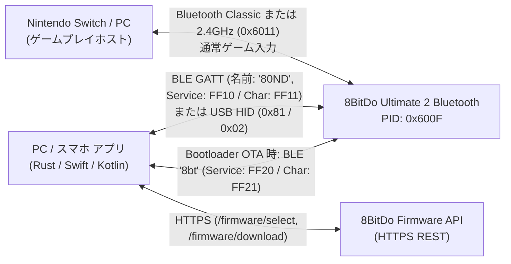
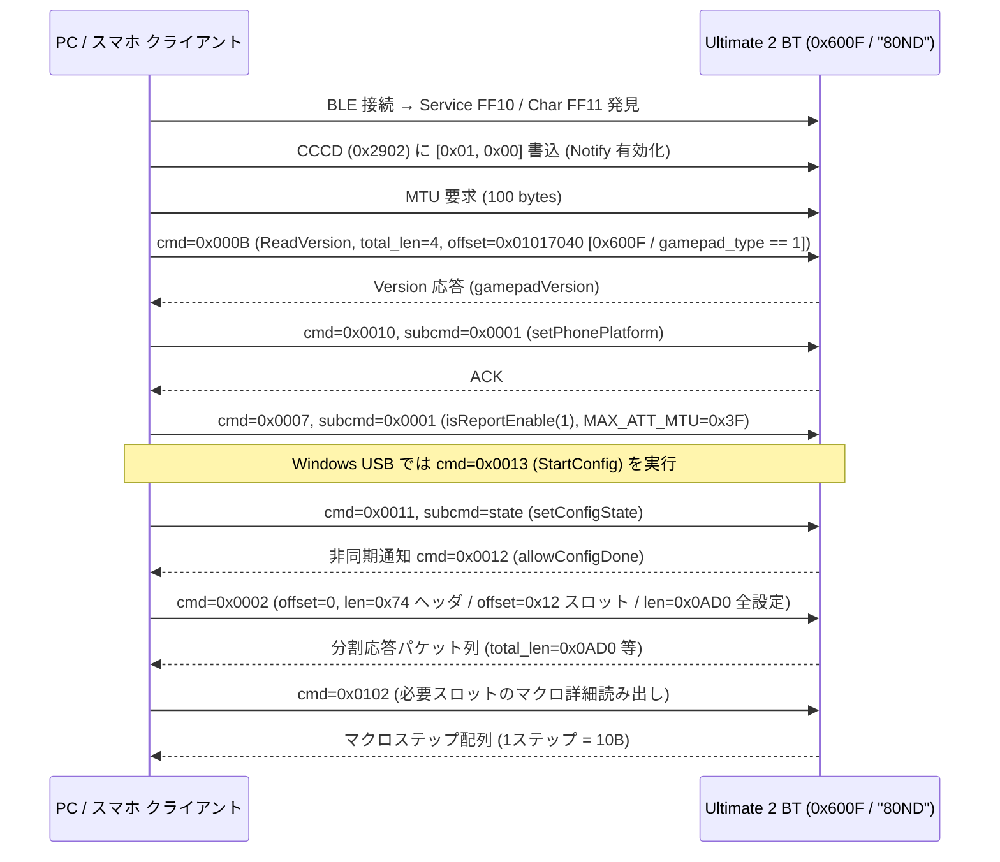
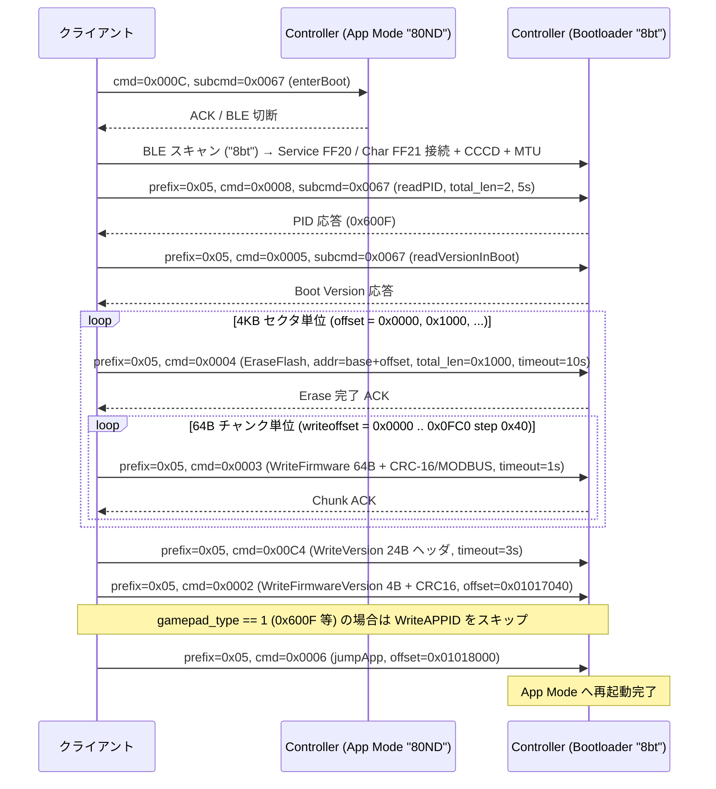

# 8BitDo Ultimate 2 Bluetooth Controller (PID `0x600F`) 通信プロトコル完全仕様書

本書は、8BitDo Ultimate Software V2（Android 版 `libadvancelib.so` / DEX、および Windows 版 `8BitDoAdvance.dll` / `8BitDo Ultimate Software V2.dll`）の静的解析に基づき、**8BitDo Ultimate 2 Bluetooth Controller (`PID 0x600F`)** を中心とした通信プロトコル・パケットフレーミング・CRC-16・設定コマンド・リアルタイム入力ストリーム・ファームウェア更新仕様を定義する。

---

## 1. 概要と同時接続トポロジー

### 1.1 デュアルリンク（Switch + BLE GATT 同時接続）の仕組み

8BitDo Ultimate 2 Bluetooth Controller は、ホスト（Nintendo Switch または 2.4GHz レシーバ `0x6011`）へゲームプレイ用の入力接続（Bluetooth Classic または 2.4GHz）を維持したまま、PC やスマートフォンから **BLE GATT 経由で同時に設定変更・プロファイル切替・リアルタイム入力監視・OTA ファームウェア更新** を行える構成になっている。

- **ゲーム入力プレーン**: Bluetooth Classic（Switch モード）または 2.4GHz レシーバ（`PID 0x6011`）経由で Switch / PC にコントローラとして接続。
- **設定・制御プレーン (BLE GATT)**: コントローラがアドバタイズ名 **`"80ND"`** としてペリフェラルアドバタイズを開始し、コンパニオンアプリ（PC / スマートフォン）が GATT サービス `0000FF10-...` へ接続する。
- **USB 有線接続**: PC 等へ USB ケーブルで直結した場合は、BLE GATT の代わりに USB HID インターフェース（Report ID `0x81` / `0x02`）上で同一の 16 バイトヘッダプロトコル（`cumstom_header_t`）をやり取りする。



### 1.2 コントローラ側の BLE 設定モード起動手順

コントローラの電源が入っている状態（または Switch 等へ接続中）で、以下の操作を行うことで BLE 設定用ペリフェラル（`"80ND"`）が起動する。

1. コントローラの電源をオンにする（Switch 等に接続済みでも可）。
2. **Profile ボタンを 3 秒間長押し**する（Status LED が高速点滅に変わるまで押し続ける）。
   - 解析済み文字列リソース（Android APK）: `"2. Press and hold the Profile button for 3 \nseconds until the Status LED will blink rapidly."`
3. Status LED の高速点滅開始後、コントローラが BLE アドバタイズ名 **`"80ND"`** を送出するため、クライアントからスキャン・GATT 接続を行う。

> **ユーザー観測（未検証）**: BLE 設定モードは、定期的な通信がないと一定時間で終了する可能性がある（ユーザーが実機で `80ND` が見つからなくなる事象を観測）。PC と USB 有線接続したまま BLE 接続すると持続しやすいというユーザー仮説もあるが、1 回の成功のみで因果は未検証である。実機実験用の `eightbitdo keepalive` サブコマンドを実装した（§1.2.1）。

#### 1.2.1 keepalive 設計ノート（プロトコル要件ではない）

**公式 Android v2.01 の観測（DEX 解析）**:

- 専用の keepalive コマンドは存在しない。
- `SetReportEnable`（`cmd 0x0007`）の状態遷移: **接続直後は disable(0)** を送り、**初期設定読取後に enable(1)** を送る。以後 UI 稼働中は enable のまま。**マクロ書込中も enable のまま**（UT2 では書込前に disable する処理が無い）。〔静的解析（2026-11-22、btsnoop 未取得）。実機未検証〕
- **20ms `ReadKeysAndJoy`**（`cmd 0x0003`, `total_len=0x0C`, `offset=0x0C`）は、周期タスクが `Const.background != 0 && mode.Const.m_isshow != 0` のときだけ試行する。ネイティブ `readKeysAndJoy` は `isSendCoustom(3)` が false の間（cmd 1/2/6 の in-flight 中）は送らず、応答タイムアウト 0・再送なしの投げっぱなしである。したがって **`m_isshow == 0` の書込中は 20ms `0x0003` を送らない**。〔静的解析（2026-11-22、btsnoop 未取得）。実機未検証〕
- `background == 0` または `m_isshow == 0` のときは送らない（背面時の挙動はユーザー観測ベースで未検証）。
- `ReadVersion`（`0x000B`）は keepalive には使わない。`session` の `info` 実行ごとに送る。2 回目以降の実機応答は未確認（公式 Android v2.01 は接続時に 1 回送る）。`0x0011` は Android v2.01 では未使用。`0x0010` は `gamepad_type == 1` で native が即 return するため UT2 では送られない。
- **ユーザー観測（未検証）**: 公式アプリをバックグラウンドにすると `80ND` が見えなくなることがある。前面時の 20ms `0x0003` が背面で止まることが原因の可能性が高いが、ファームウェア側の idle タイマー値・正確な条件は未確定である。
- したがって、CLI が長寿命セッションを維持するには、前面アプリ相当の定期通信（`0x0007` + 20ms `0x0003`）が必要になる可能性がある（未検証）。
- 推奨する keepalive は公式方式であり、`ReadVersion` を keepalive に使う案は採用しない。`ReadVersion` は `session` の `info` 実行ごとに送る。2 回目以降の実機応答は未確認である。
- 実機実験: `eightbitdo keepalive --interval-ms 20 --duration 120`。測定項目は、維持できた秒数、切断理由、USB 併用の有無、送信数 / 受信数、背面相当（送信停止）との比較である。
- **実機観測**: 20ms `0x0003` の keepalive では **128.9 秒**維持できた。一方、`config dump` を別プロセスで実行すると BLE 設定モードが切れて `Timeout waiting for reply` になった。BLE は 1 central しか接続できず、プロセスをまたいで接続を共有できないため、複数の読み取りは 1 接続にまとめる必要がある。
- **1 接続バックアップ**: `eightbitdo backup --raw backup.bin --json backup.json --hold N` は、1 回の接続で `ReadVersion`（`0x000B`）→ `read_config_snapshot()`（20 チャンク）→ 必要なら `0x0007` + 20ms `0x0003` の keepalive を N 秒実行する。`--hold` 中は他のコマンドを送らない。`N=0` なら読み終えて直ちに切断する。
- **1 接続 REPL (`session`)**: `eightbitdo session [--interval-ms 20] [--allow-macro-write] [--no-report-enable]` は 1 回の Profile 長押しで接続を保持し、`info` / `config dump` / `backup` / `monitor` / `status` を同一接続で実行する。アイドル時は `0x0007` enable 1 回 + 20ms `0x0003` + 受信ドレイン（既定。`--no-report-enable` 時は起動時の enable(1) を送らず `0x0003` keepalive のみ。終了時の disable(0) は best-effort で送る）。コマンド実行中は operation lock（単一フライト）で keepalive を止め、終了後に再開する。`monitor` は自身が `--interval-ms`（既定 20ms）周期で `0x0003` を送り、その応答（`cmd=0x0004, subcmd=0x0003`, 12B）を表示する。monitor がロックを保持している間は keepalive が止まるため、**monitor が keepalive を兼ねる**。`monitor stop` でバックグラウンド monitor を停止でき、停止後は keepalive が自動再開する。monitor 実行中は `info` / `config dump` / `backup` / `monitor --count` を拒否し、先に `monitor stop` を要求する。停止後は同じ接続で再実行できる。Ctrl-C は REPL を抜けてセッションを終了する（終了前に BLE 切断・`80ND` 消滅・Profile 約 3 秒押しが必要な旨を stderr に表示する。コマンド実行中でも実行中の future を drop して終了し、次の行は読まない。ただし `--allow-macro-write` 有効時の `macro write` / `macro restore` は、準備（ファイル読込・pre-write / pre-restore backup）を含むコマンド全体が完了するまで Ctrl-C を遅延してから終了する。次項参照）。トップレベルの `eightbitdo monitor [--count N]` も同じ 20ms `0x0003` ポーリングを共有し、終了時に `0x0007` disable → 切断を行う。なお `monitor --count N`（トップレベル / `session` 共通）は公式の `ReadKeysAndJoy` と同様に投げっぱなしで、応答が 1 件も来ない場合も既定の 20ms 周期で `0x0003` を送り続け、`--count` に達するまで Ctrl-C まで回り続ける。連続する keepalive I/O エラー 3 回または `Disconnected` で keepalive を degraded 停止し、`session` は終了コード **3** で終了する（無応答（入力レポート未着）は正常な idle として failure に数えない。自動再接続はしない。切断と同時に App Mode を抜けて `80ND` が広告されなくなるため、Profile 約 3 秒押しで再入するまで再接続は不可能である旨を表示する。常駐ループは 3 を受けて再試行せず押下待ちで停止する。押下を依頼する前に `scan` で `80ND` が見えるか確認する手順は `docs/SESSION_OPERATIONS.md` を参照）。degraded 以外でコマンドが `Disconnected` を観測した場合は exit 1（degraded の exit 3 とは区別する）。scan / connect / session および `BleTransport::connect` を使う全 CLI コマンド（info / config / macro / backup / monitor / keepalive）は BLE を触る前に **per-user** BLE 単一所有者 flock を取得し、取得できなければ「別プロセスが BLE を使用中」として失敗する。パスは環境非依存で、`EIGHTBITDO_BLE_LOCK`（テスト用例外）→ NSS（`getpwuid_r`）の euid ホーム由来 `~/.cache/8bitdo/8bitdo-ble.lock` → ホーム不明時のみ temp の per-user dir（`XDG_RUNTIME_DIR` / `XDG_CACHE_HOME` は参照しない）。symlink / 非通常ファイル / 他ユーザー所有ファイルは `O_NOFOLLOW` と fd メタデータ検証で拒否し、既定パスでは既存 parent が euid 所有 + group/other write なし + symlink でないことを検証し、Unix は dirfd（`openat`）で TOCTOU も閉じる。ロックは per-user スコープで、別ユーザー同士は排他しない。`session` は接続保持中ロックを保持し、teardown 成功時のみ解放する（失敗時は保持したまま Err。プロセス終了でカーネルが解放）。詳細は `docs/SESSION_OPERATIONS.md` を参照。1 tick の受信ドレインは最大 4 レポートに固定し、`try_next_input` 自体も 1 回あたり最大 16 フレーム + 1ms で打ち切るため、通知が途切れなくても operation lock を保持し続けない。行リーダーのキャンセル耐性は、`monitor` / keepalive の終了通知で読み取り future が中断されても、すでに消費した読みかけの行を壊さないためのものであり、Ctrl-C 後にセッションを継続する意味ではない。これは最小構成ではなく、`status` / `monitor stop` / 失敗方針を含む正式設計である。
- **`session` の macro 操作（2026-11-22 追加。REPL 経由の実機書込は未検証）**: REPL から `macro backup <DIR>`（読み取りのみ、常に利用可）/ `macro write <SLOT> <INDEX> <FILE> [--trigger <KEY>] [--chunk-size <32|64>]` / `macro restore <DIR> [--force]` を実行できる。`macro write` / `macro restore` は **`--allow-macro-write`（既定 OFF）** が必要で、無い場合は `macro write is disabled; restart with --allow-macro-write`（restore も同旨）を表示して拒否する。`session` は**既定で起動時に `0x0007 ReportEnable(1)` を送る（公式相当）**ため、**REPL の `macro write` は enable 状態で実行される**。`--no-report-enable` を指定すると起動時の enable(1) を送らずに `0x0003` keepalive を継続し（終了時の disable(0) は best-effort）、**REPL の macro write をトップレベル `macro write` の既定（enable なし）と同じ書込条件で A/B できる**。macro 操作中は operation lock により 20ms `0x0003` ポーリングが止まり、操作後に再開する（公式は書込中 `0x0003` なし）。**`--allow-macro-write` 有効時の `macro write` / `macro restore` は、準備（ファイル読込・pre-write / pre-restore backup）を含むコマンド全体が完了するまで Ctrl-C を遅延してから終了する**。非通常ファイル（FIFO / socket / directory）は読み取り前に拒否するためブロックせず、デバイス I/O は timeout で有界（SIGKILL・電源断は防げない）。REPL の `macro write` は `--backup-dir` 非対応（既定名は cwd の `macro-backup-<unix-nanos>-<pid>-<sequence>`。pre-write backup も同じ命名規則）、`macro restore` は `--chunk-size` 非対応（pre-restore backup は `<backup dir 名>-pre-restore-<unix-nanos>-<pid>-<sequence>`）。
- **これは設計ノートであり、プロトコル要件ではない。**

---

## 2. デバイス VID / PID・モデル対応表

8BitDo 製品の共通ベンダー ID は **`VID = 0x2DC8`** である。  
`PIDVID`（Android）および `AdvanceSuper.Hid.VIDPID` / `8BitDoAdvance.dll::enum_hid`（Windows）から確認された対応表を示す。

### 2.1 Ultimate 2 ファミリーおよび関連デバイス

| モデル名 | 内部 PID (App / Boot) | 10進数 | BLE アドバタイズ名 | Firmware API `firmware_type` | 備考 |
| --- | --- | --- | --- | --- | --- |
| **Ultimate 2 Bluetooth Controller** | **`0x600F`** (`PID_UltimateBT2` / `UT2_PID`) | `24591` | **`"80ND"`** (App) / **`"8bt"`** (Boot) | **`97`** (`0x61`) | 本仕様書の中心対象。Windows USB 接続時は XInput モードで `0x310B` (`xinput == 2`)、更新時 `0x3208` として列挙される場合がある |
| **Ultimate 2 Bluetooth 2.4G Receiver** | **`0x6011`** (`PID_UltimateBT2RR`) | `24593` | — | **`98`** (`0x62`) | Ultimate 2 Bluetooth 付属 2.4GHz レシーバ |
| **Ultimate 2 Wireless Controller** | **`0x6012`** (`PID_Ultimate2`) | `24594` | — | **`94`** (`0x5E`) | XInput 時 `0x310B` (`xinput == 1`) |
| **Ultimate 2 Wireless Adapter** | **`0x6013`** (`PID_Ultimate2RR`) | `24595` | — | **`95`** (`0x5F`) | Ultimate 2 Wireless 用ドングル |
| **Ultimate 2C Bluetooth** | **`0x301A`** (`PID_UltimateBT2C`) | `12314` | — | **`108`** (`0x6C`, App) / **`96`** (`0x60`, Boot) | Bluetooth 2C モデル |

### 2.2 その他の同一プロトコル系 VID / PID・USB 列挙 PID

| 項目 / 定数名 | PID (Hex) | 用途・モデル |
| --- | --- | --- |
| `PID_Xinput` | **`0x310B`** | Windows XInput 列挙 PID（HID `UsagePage = 0xFF7A`, `Usage = 0x0001` のサブインターフェースを併用） |
| Boot / Update 切替用 USB PID | **`0x3208`** | Windows `enum_hid` / `HIDManage.readGamePadNewVersion` で使用される更新・切替時 USB PID（検出時は内部フラグ設定後 `getDevicePID1` で内部 PID を照会） |
| `PID_IDLE` | **`0x3109`** | USB アイドル / 待機状態 PID |
| `PID_USB_Ultimate` / `Classes` / `2` / `BTRR` / `USB2_IDLE` | `0x3100` / `0x3104` / `0x3105` / `0x3106` / `0x3107` | USB 有線・ドングル群 |
| `PID_QINGCHUN2` / `PID_QINGCHUN2RR` | `0x310A` / `0x301C` | 青春版 2 / レシーバ |
| `PID_UltimateBT` | `0x6007` | 初代 Ultimate Bluetooth |
| `PID_Pro3` / `PID_Pro3USB` / `PID_Pro3DOCK` | `0x6009` / `0x600A` / `0x600D` | Pro 3 シリーズ |
| `PID_Pro2` / `PID_Pro2_CY` | `0x6003` / `0x6006` | Pro 2 シリーズ（`_CY` は BLE Characteristic `FF13`/`FF23` を使用） |
| `PID_Ultimate2_4` / `PID_Ultimate2_4RR` | `0x3012` / `0x3013` | Ultimate 2.4G シリーズ |
| `PID_HitBox` / `PID_HitBoxRR` | `0x600B` / `0x600C` | Arcade HitBox 2 (`firmware_type`: `129` / `130`, `BootPID 0x600B` は `101`) |
| `PID_N64BT` / `PID_N64` / `PID_N64RR` | `0x3019` / `0x3004` / `0x9028` | N64 シリーズ (`firmware_type`: `78` / `71` / `103`) |
| `PID_Lashen` | `0x301E` | Lashen シリーズ (`firmware_type`: `100`) |

### 2.3 Windows HID 列挙時の UsagePage / Usage フィルタ (`8BitDoAdvance.dll::enum_hid`)

Windows の `FindHid` / `enum_hid` は `HidD_GetPreparsedData` + `HidP_GetCaps` により複合 HID デバイスから制御用インターフェースを選別する。

| 対象 USB PID (`VID = 0x2DC8`) | `UsagePage` | `Usage` | 備考 |
| --- | --- | --- | --- |
| `0x310B` (`PID_Xinput`), `0x2084`, `0x3004` | **`0xFF7A`** | **`0x0001`** | XInput 併用時のベンダー制御インターフェース |
| `0x5205`, `0x5206` | **`0xFF00`** | **`0x0001`** | Vendor-defined UsagePage `0xFF00` |
| `0x5201`, `0x5209`, `0x520A`, `0x520B`, `0x520C` | **`0x008C`** | **`0x0001`** | — |
| `0x2039`, `0x2054`, `0x2056` | **`0x000C`** | **`0x0001`** | Consumer Control インターフェース |
| `0x600F`, `0x6009`, `0x6013`, `0x301A`, `0x600B`, `0x3208` 等 | フィルタなし（VID/PID 直接一致） | — | `enum_hid` 上で `VID/PID` 一致後そのまま `CreateFile` で開かれる |

> **実装上の注意**: Windows 環境で `0x600F` が XInput モード（`0x310B`）として見えている場合は **`UsagePage = 0xFF7A, Usage = 0x0001`** のデバイスノードを開く必要がある。また `ReadHidAdvance` / `WriteHid_reportID` のバッファサイズは **64 バイトペイロード + Report ID 1 バイト = 65 バイト (`0x41`)** 固定で動作する。

---

## 3. BLE GATT トランスポート仕様

### 3.1 アドバタイズ名・UUID 一覧

| モード | アドバタイズ名 | Service UUID | Characteristic UUID (Write / Notify) | CCCD UUID |
| --- | --- | --- | --- | --- |
| **App Mode** (`0x600F`) | **`"80ND"`** | `0000FF10-0000-1000-8000-00805F9B34FB` | `0000FF11-0000-1000-8000-00805F9B34FB` | `00002902-0000-1000-8000-00805F9B34FB` |
| **App Mode** (`_CY` 系) | モデル依存 | `0000FF10-0000-1000-8000-00805F9B34FB` | `0000FF13-0000-1000-8000-00805F9B34FB` | `00002902-0000-1000-8000-00805F9B34FB` |
| **Bootloader Mode** (`PID=2`) | **`"8bt"`** | `0000FF20-0000-1000-8000-00805F9B34FB` | `0000FF21-0000-1000-8000-00805F9B34FB` | `00002902-0000-1000-8000-00805F9B34FB` |
| **Bootloader Mode** (`_CY` 系) | `"8bt"` | `0000FF20-0000-1000-8000-00805F9B34FB` | `0000FF23-0000-1000-8000-00805F9B34FB` | `00002902-0000-1000-8000-00805F9B34FB` |

- Characteristic (`FF11` / `FF21`) は **Write と Notify の双方**を担う単一キャラクタリスティック。
- 接続後、必ず CCCD (`00002902-...`) へ `[0x01, 0x00]`（Enable Notification）を書き込んでからコマンド送信を開始する。

> **実機観測メモ（Ultimate 2 Bluetooth、2026-11 時点）**: 検証個体はアドバタイズ名 `"80ND"` と service `FF10` を公開するが、characteristic は **`FF13`**（write + notify）であり、`FF11` は存在しなかった。上表の `_CY` 系レイアウトに該当する。クライアントは `FF11` を優先し、存在しなければ `FF13` にフォールバックして解決すること。これは実装上の観測であり、プロトコル仕様の変更ではない。

### 3.2 MTU ネゴシエーションとチャンクサイズ制御

`SHBLEUtils` および `libadvancelib_pkt.c`（`Generate_CustomDataCmd` / `Send_CustomCmdPacket`）の制御仕様は以下の通り。

1. **初期 MTU リクエスト**:
   - Android クライアントは GATT 接続時に `requestMtu(100)` (`0x64`) を要求する。
   - `MAX_ATT_MTU` グローバル変数はネゴシエート結果またはモード切替によって更新される。
2. **1 パケットあたりの最大ペイロード長 (`chunk_len`)**:
   - 通常コマンド（`PID != 0x202F, 0x0553`）:
     - パケット総送信バイト上限: `MAX_ATT_MTU - 2`（先頭 1B プレフィックス含むため、ヘッダ 16B + ペイロードの合計上限は `MAX_ATT_MTU - 2` とみなされる、実質ペイロード上限は **`MAX_ATT_MTU - 0x12`**（`MAX_ATT_MTU - 18`）バイト）。
     - 例: `MAX_ATT_MTU = 100` のとき最大ペイロード `82` バイト。`MAX_ATT_MTU = 64` のとき `46` バイト。
   - **`cmd == 0x0103`（マクロデータ書き込み）**:
     - プロトコル上の `chunk_len` 上限は BLE **`0x40`（64 バイト）** / USB HID **`0x20`（32 バイト）**。BLE は `min(chunk_len, 0x40)` でクランプされる。
     - 呼び出し元の `getBT2_WriteMacro(slot, macro_idx)` では、マクロの `total_len` を `0x20`（32 バイト）単位に切り上げて転送する。**実機 2026-11-22 確認（BLE・slot S1・`macro_idx=0/1`）**: wire `total_len` は `(macro_idx << 12) + align32(steps * 10)`（絶対終端）でなければ永続化されない（§6.5 手順 4）。静的解析では `getBT2_WriteMacro` が 32B 切り上げのみを行うように見えるが、公式が sector base を別経路（呼び出し元や `Generate_CustomDataCmd`）で足している可能性があり、静的解析だけでは断定できない。
     - 本クレートの `write_macro_payload` API は **32B / 64B のみ**を受け付ける（最終チャンクを 32B アラインに保つため）。46B などの交渉済みサイズは将来拡張であり、現在は `UnsupportedChunkSize` を返す。
   - **`cmd == 0x0104`（マクロデータ消去）**:
     - チャンク上限クランプをスキップし、`bVar5 = true` としてそのまま送信する。
   - **`cmd == 0x0007`（`SetReportEnable`）実行時**:
     - `getSetReportEnableChannel()` 実行時に `MAX_ATT_MTU` を **`0x3F`（63 バイト）** へ変更する。これはリアルタイム入力ストリーム（12 バイト通知）中の MTU / パケットサイズを固定するためである。
   - 例外 PID (`0x202F`): `MAX_ATT_MTU = 0x3E` (62)、チャンク上限 `MAX_ATT_MTU - 0x13`。
   - **書込側の分割長（RE・2026-11-22）**: 公式 Android の `Generate_CustomDataCmd` は書込系でも `min(残り, MAX_ATT_MTU - 0x12)` を使い、`MAX_ATT_MTU` は初期値 **`0x5C` (92)** のまま `0x600F` 用に変更されない。したがって **公式書込のペイロード上限は 74B**（静的解析。実機書込キャプチャは未確認）。**142B は読み出し応答側の実機観測値**であり、書込側の分割長ではない。本実装の full config write は既定で `min(MTU ペイロード, 74)` を使い、`--write-chunk <BYTES>` は接続前上限 **180**（観測 MTU 200 のペイロード上限）まで明示指定できる（A/B 用）。接続後は交渉 MTU の上限も検証する。

---

## 4. パケットフレーミングと 16 バイトヘッダ (`cumstom_header_t`)

### 4.1 16 バイトヘッダ (`cumstom_header_t`) 定義

全マルチバイト整数は **Little-Endian (LE)**。

| オフセット | サイズ | 型 | フィールド名 | 説明 |
| --- | --- | --- | --- | --- |
| `+0x00` | 2B | `u16` | `cmd` | コマンド ID（例: `0x0001` Write, `0x0002` Read, `0x000B` Version） |
| `+0x02` | 2B | `u16` | `subcmd_or_param` | サブコマンド・引数・スロット指定（例: `0x0067` / `0x0123` Save, `(mode << 8) \| slot`） |
| `+0x04` | 2B | `u16` | `chunk_len` | このパケットのペイロード長。**読み取り要求ではペイロードがなくても要求データ長を宣言する**（`ReadConfig` / `ReadMacro` は `chunk_len = total_len`。§4.1.1） |
| `+0x06` | 2B | `u16` | `crc16` | ペイロードに対する CRC-16/MODBUS（条件付き、未使用時は `0x0000`） |
| `+0x08` | 4B | `u32` | `total_len` | 転送全体の総バイト数（または読み出し要求総長）。`0x000B` ReadVersion では `gamepad_type == 1` (`0x600F`) は `4`、`gamepad_type == 2` は `0x01020030` |
| `+0x0C` | 4B | `u32` | `offset` | 分割転送時の開始オフセット。ただし `cmd == 0x0001` / `0x0066`（`PID == 0x600F, 0x6009, 0x202F, 0x2072`）では `total_len` 側の値が設定される。`cmd == 0x000B` ReadVersion は `gamepad_type == 1` (`0x600F`) で `0x01017040`、`gamepad_type == 2` で `0x01020030`（`total_len` と同値） |

> **例外 (`cmd = 0x0104` `EraseBT2Macro`)**: このコマンドはペイロードを持たないが、公式実装 (`getBT2_EraseMacro`) はチャネルの `total_len` と `chunk_len` をともに `0x1000` に設定し、`Generate_CustomDataCmd` が `chunk_len` フィールドを wire header `+0x04` に書く。実際のペイロードは `len = 0` である。`chunk_len` の一般則（ペイロード実長）だけから `0` と解釈しないこと。`gamepad_type == 1` の CRC 計算は空ペイロードに対して行われ、`crc16` は長さ `<= 0` で `0xFFFF` を返すため、wire header `+0x06` は `0xFFFF` となる。

#### 4.1.1 読み取り要求の `chunk_len`（実機 ACK で判明した訂正）

`ReadConfig` (`0x0002`) と `ReadMacro` (`0x0102`) は **ペイロードを送らないが、`chunk_len` に要求データ長を宣言する**。Phase 1 の仕様・実装で `chunk_len = 0` としていたのは見落としであり、実機で `chunk_len = 0` の ReadConfig がデータを返さず ACK だけを返したことで判明した。

証拠（x86_64 `libadvancelib.so`）:

- `getUT2_ReadCofigChannel` **0x29ea0** は `0x1d5f0` の 16 バイトをチャネル `+0x3c` にロードする。`objdump -s --start-address=0x1d5f0 --stop-address=0x1d600` の内容は `00000000 d00a0000 d00a0000 d00a0000`:
  - `+0x3c = 0`（`offset`）
  - `+0x40 = 0x0AD0`（`total_len`）
  - `+0x44 = 0x0AD0`（`chunk_len`）
  - `+0x48 = 0x0AD0`（追加長 / 残り長）
- `getBT2_head_CofigChannel` **0x2a000** は `+0x3c = 0`, `+0x40 = 0x74`, `+0x44 = 0x74`（ヘッダ読み）。
- `getBT2_ReadMacro` **0x2bd90** は `+0x40 = +0x44 = +0x48 = steps * 10` を設定し、`+0x38 = macro_idx << 12`（4 KB セクタベース）を wire `offset` として使う。`cmd = 0x0102`。

したがって wire request は次の 17B（ペイロードなし）になる:

```text
ReadConfig full:  04 02 00 00 00 D0 0A 00 00 D0 0A 00 00 00 00 00 00
ReadConfig head:  04 02 00 00 00 74 00 00 00 74 00 00 00 00 00 00 00
```

応答は 1 要求につき 1 チャンクである。実機の ReadConfig は 142B (`0x8E`) を返し、残りは `offset += payload.len()` で再要求する必要がある（§4.3.1）。

> **実機 ACK**: `chunk_len = 0` の旧要求では `04 00 02 00 00 00 FF FF D0 0A 00 00 00 00 00 00` の ACK だけが返った（実機観測）。`chunk_len = 0x0AD0` に修正した後、142B のデータ応答を実機で確認済み（§4.3.1）。

```text
 0      1 2      3 4      5 6      7 8            11 12           15
+--------+--------+--------+--------+---------------+---------------+
|  cmd   | subcmd |chunklen| crc16  |   total_len   |    offset     |  (16 bytes, LE)
+--------+--------+--------+--------+---------------+---------------+
```

### 4.2 BLE 送信フォーマット (`Send_CustomCmdPacket`)

`0x600F` を含む標準 BLE デバイスでは、16 バイトヘッダの前に 1 バイトのパケット種別プレフィックス（`cmd_packet`）を付与して GATT Characteristic (`FF11` / `FF21`) へ Write する。

- **App Mode 送信 (`cmd_packet = 0x04`)**:
  ```text
  [0x04] (1B) + cumstom_header_t (16B) + payload (chunk_len B)
  ```
- **Bootloader Mode 送信 (`cmd_packet = 0x05`)**:
  ```text
  [0x05] (1B) + cumstom_header_t (16B) + payload (chunk_len B)
  ```
- **送信長上限**: `1 + min(16 + chunk_len, MAX_ATT_MTU - 2)` バイト（ただし `cmd == 0x0103` のとき `chunk_len <= 0x40`）。
- **例外 (`cmd == 0x0104` `EraseBT2Macro`)**: ヘッダ `+0x04` には `chunk_len = 0x1000` が入るが、ペイロードは送らない（実際の送信長は 1B プレフィックス + 16B ヘッダ = 17B（プレフィックス込み））。このコマンドに上の `16 + chunk_len` の式を適用しない。

### 4.3 BLE 受信フォーマット (`HIDChannel_readBleHidData`)

`readBleHidData` は `PIDVID` に応じて受信 Notify バッファの先頭オフセットと照合ルールを切り替える。**`0x600F`（Ultimate 2 Bluetooth）では送信時と異なり、受信パケットに先頭 `0x04` プレフィックスが付かない点に注意が必要である。**

1. **先頭オフセットの分岐**:
   - `PID == 0x202F` / `0x3019` / `0x9023`: 先頭 **2 バイトをスキップ**（`ptr = rx + 2`）して `cumstom_header_t` として扱う。
   - **`PID == 0x600F` (Ultimate 2 BT) および `0x6009` (Pro 3) を含むその他の機種**: 先頭バイトをスキップせず、**`rx[0..16]` をそのまま 16 バイト `cumstom_header_t`**、`rx[16..]` をペイロードとして解釈する。
2. **応答・通知のディスパッチ規則**:
   - **App チャネル応答一致**: 先頭 `u16` が `0x0004`（またはチャネル比較一致）のルートでは、`pkt[2]`（またはヘッダ側 `cmd` 下位バイト）が進行中チャネルの識別子 `Channel[+0x32]` と一致し、かつ `*(u32*)(pkt + 8)` が `Channel[+0x40]` と一致した場合に `handleChannel()` へ渡す。
   - **非同期（Unsolicited）通知**:
     - `cmd == 0x0012`: 設定許可完了通知。`HIDChannel.allowConfigDone()` を発火。
     - `cmd == 0x0003` または `subcmd == 0x0003`: リアルタイム入力レポート。ペイロード 12 バイトを `KeysAndJoy` コールバックへ通知。
     - `cmd == 0x000E`: コントローラ側エラー通知。
   - **Bootloader チャネル応答一致**: Bootloader 応答では `*(u16*)pkt == 0x00F5` 等（`0xF5` を含む先頭タグ）や `pkt[2] == Channel[+0x32]` により進行中 Boot チャネルと照合する。

#### 4.3.1 FF13 個体の実機観測（2026-11-21）

実機 Ultimate 2 Bluetooth（BLE 設定モード `80ND`、GATT characteristic は `FF11` ではなく **`FF13`**、MTU 200）で次を観測した。これは仕様変更ではなく、受信エンベロープと `ReadVersion` 要求形状に関する**観測・実装ノート**である。

- 旧実装が送った `ReadVersion`（17B、ペイロードなし）:
  ```text
  04 0B 00 00 00 00 00 00 00 04 00 00 00 40 70 01 01
  ```
  - `0x04` は BLE App プレフィックス。続く 16B は `cmd=0x000B`, `subcmd=0`, `chunk_len=0`, `crc16=0`, `total_len=4`, `offset=0x01017040`。
- その応答（16B、プレフィックスなし）:
  ```text
  04 00 0B 00 00 00 FF FF 00 00 00 00 00 00 00 00
  ```
  - `cmd=0x0004`（汎用応答エンベロープ）, `subcmd=0x000B`（要求 `cmd` のエコー）, `chunk_len=0`, `crc16=0xFFFF`, `total_len=0`, `offset=0`。
  - これはデータ 0 バイトの **ACK** であり、`ReadVersion` のデータ応答ではない。
- USB 給電併用（`lsusb` で `057e:2009` を確認）状態で、修正後の 21B 要求を送ったところ、次の **20B データ応答**を取得した:
  ```text
  04 00 0B 00 04 00 3E 44 04 00 00 00 00 00 00 00 C8 00 00 00
  ```
  - `cmd=0x0004`, `subcmd=0x000B`, `chunk_len=4`, `crc16=0x443E`（`C8 00 00 00` の CRC-16/MODBUS と一致）, `total_len=4`, `offset=0`。
  - ペイロード `C8 00 00 00` は LE の `i32` で **200**（`0x000000C8`）。CLI 表示は `version value: 0x000000C8`。

**確定したこと**:

- `0x600F` の応答は `cmd=0x0004` の汎用エンベロープで、`subcmd` に要求 `cmd`（この個体では `0x000B` / `0x0002`）が入る。`total_len`（`+0x8`）は要求側チャネルの `total_len` と一致する必要がある（`readBleHidData` 0x29030 の照合）。
- `chunk_len=0` のフレームはデータを持たない ACK / ready であり、データ応答として扱ってはならない。観測された形状は 2 種類ある:
  - `ReadVersion`: `total_len=0`
  - `ReadConfig`: `total_len=0x0AD0`（要求した転送長）
- データ応答は `chunk_len > 0` かつ `total_len == 要求 total_len`。`ReadVersion` の実測は `chunk_len=4`, `total_len=4`, `offset=0`。
- `ReadVersion` の要求には **4 バイトのダミーペイロード**が必要である。公式 `getVersionChannel`（0x2c7a0）はチャネル `+0x34 = 4`, `+0x40 = 4`（`total_len`）, `+0x44 = 4`（`chunk_len`）, `+0x50 = gamepadVersion` を設定し、`Generate_CustomDataCmd`（0x27620）は `+0x50` の 4 バイトを要求へコピーする。`gamepadVersion` は初回 0 初期化である。
- その結果、正しい要求は 21B になる（CRC は 4 バイトのゼロに対して計算され `0x2400`）。実機で送信・応答とも確認済み:
  ```text
  04 0B 00 00 00 04 00 00 24 04 00 00 00 40 70 01 01 00 00 00 00
  ```
  - 内訳: `04` + `cmd=0x000B` + `subcmd=0` + `chunk_len=4` + `crc16=0x2400` + `total_len=4` + `offset=0x01017040` + 4B ゼロ。
- `ReadConfig` の最初の応答は `chunk_len=0`, `total_len=0x0AD0`, `crc16=0xFFFF` の ready ACK である:
  ```text
  04 00 02 00 00 00 FF FF D0 0A 00 00 00 00 00 00
  ```
  - このフレームをエラーにせず読み飛ばし、後続のデータチャンクを待つ必要がある。
- `ReadConfig` の要求は、旧実装の `chunk_len=0` ではなく **`chunk_len = total_len = 0x0AD0`**（ヘッダ読みは `0x74`）で送る（§4.1.1）。`chunk_len=0` では実機が ACK だけを返した。
- **ReadConfig は 1 要求 = 1 チャンク**である。実機では `offset=0` の要求に対して 142B（`0x8E`）のデータ応答が 1 つ返り、次の通知は来なかった。残りを読むには `offset += payload.len()` で再要求する。2768B は 19 × 142B + 70B = 20 要求になる。
- 実機の最初のデータ応答（ヘッダ 16B + 142B ペイロード）:
  ```text
  04 00 02 00 8E 00 71 A9 D0 0A 00 00 00 00 00 00 + <142 bytes>
  ```
  - `cmd=0x0004`, `subcmd=0x0002`, `chunk_len=0x008E` (142), `crc16=0xA971`, `total_len=0x0AD0`, `offset=0`。
- 最終要求は `offset=0xA8A` (2698)、残り 70B だが、デバイスは**最終チャンクも 142B 固定**で返す:
  ```text
  04 00 02 00 8E 00 22 32 D0 0A 00 00 8A 0A 00 00 + <70 valid bytes> + <72 padding bytes>
  ```
  - 応答ヘッダは `cmd=0x0004`, `subcmd=0x0002`, `chunk_len=0x008E`, `total_len=0x0AD0`, `crc16=0x3222`, `offset=0xA8A`。
  - `crc16=0x3222`（LE `22 32`）は **142B 全体**（有効 70B + 72B ゼロパディング）の CRC-16/MODBUS（init `0xFFFF`, poly `0xA001`）と一致する。有効 70B のみでは `0x8EF7` となり一致しない。
  - 検証元: 実機 `eightbitdo backup --raw` で取得した 2768B ダンプ（SHA-256 `1dca47facfc1c0394a8893ac0a5b7ef80678c51081001886a4bf17ce2f59c600`）の末尾 70B + 72B ゼロ。
  - 2768B を超える末尾 72B はパディングであり、ホスト側で `CONFIG_SIZE - offset = 70B` に切り詰めてコピーする。パディングは破棄する。
  - **実装は最終チャンクも 142B 全体で CRC を検証する**（70B に切り詰める前に、受信ペイロード 142B の `crc16` を照合する）。
- ReadConfig の応答 `offset` は、**最初のデータチャンク応答のみ `0`** を「逐次チャンクの印」として許容し、要求 `offset` に配置する。**2 回目以降は要求 `offset` をエコー**するため、要求値と一致しなければ `UnexpectedResponse` とする。実機の 20 応答では `0, 142, 284, 426, 568, 710, 852, 994, 1136, 1278, 1420, 1562, 1704, 1846, 1988, 2130, 2272, 2414, 2556, 2698` を観測した。
- 単一応答（ReadVersion）では `offset=0` を前提とし、非 0 は転送範囲外または未完成として失敗する。汎用の `read_transfer` は範囲内の複数フレームを組み立て得るため、この前提は単一応答の読み取りに限る。
- データ応答の `total_len` は要求した転送長と一致しなければならない（`ReadConfig` は `0x0AD0`、`ReadVersion` は `4`）。`cmd=0x0004` エンベロープだけでなく、`cmd == 要求 cmd` の直接応答でも同じ検査を行い、`total_len = 0` の直接エコーだけは互換のため許容する。
- データ応答の `crc16` が非ゼロなら、ペイロードの CRC-16/MODBUS（poly `0xA001`、初期値 `0xFFFF`）と一致することを検証する（例: `C8 00 00 00` → `0x443E`、142B チャンク → `0xA971`）。`crc16 = 0` は「未使用」として検査しない。`chunk_len = 0` の ACK（`crc16 = 0xFFFF` を含む）はデータ応答ではないため対象外である。
- `session` は `0x0007` を有効化するため、読み取り中に `cmd=0x0004, subcmd=0x0003` の入力レポート、`subcmd=0x0007, chunk_len=0` の ACK、`cmd=0x0012`（設定許可完了）などの notice が届く。`ReadVersion` / `ReadConfig` は、`chunk_len=0` の ACK、入力エンベロープ、`RESPONSE`（`0x0004`）以外の `cmd` を読み飛ばす。要求 cmd の直接応答と残った `RESPONSE` エンベロープをデータ応答として扱い、`subcmd` / `total_len` / CRC を検証する。`chunk_len>0` で `subcmd` が要求と異なるデータ応答はエラーにする。
- 公式 `baseCumstomChannel` は 1 回だけ要求を送り、`readCustomConfig_unfinished`（0x2e3d0）は受信バイト数をログするのみである。実機では 1 チャンクで次の通知が止まるため、CLI 側で offset を進めた再要求ループを実装する。

**ユーザー仮説の検証（USB 併用）**:

- 「PC と USB 有線接続したまま `80ND` へ BLE 接続すると設定モードが持続する」というユーザー仮説について、今回は `057e:2009` の USB 接続がある状態で BLE 接続と `ReadVersion` に成功した（1 回）。
- ただし、親エージェントの以前の試行も USB 併用状態で、旧 17B 要求の応答待ちにタイムアウトしている。今回の成功は **4B ペイロード修正**によるものであり、USB 併用が設定モード持続に寄与したかは**未検証**である。

**未確定のこと**:

- `ReadConfig` のデータチャンクは実機で 142B (`0x8E`) を 1 要求につき 1 つ返す。`offset` を進めた再要求で 20 要求（19 × 142B + 最終 142B のうち有効 70B）を組み立てる。最終チャンクが 142B 固定で返り、ホスト側で 70B に切り詰めることは実機確認済みである。142B が MTU 依存で変化するかは未確定。応答 `offset` は最初のデータチャンク応答のみ 0、2 回目以降は要求 `offset` をエコーする（§4.3.1 の照合規則）。
- `getBT2_ReadMacro` の公式 `Generate_CustomDataCmd` 経路は `16 + chunk_len` バイト（ペイロードはゼロ埋め）を送ると読める。本実装は 17B の payloadless 要求を送る。実機（2026-11-22、slot 0）では次の 2 マクロを確認した：
  - `macro_idx=0 (M1)`（sector base `0x0000`、`max_steps = 50`、500B）: 応答 `chunk_len = 0x8E (142)`, `total_len = 500`、応答 offset は **`[0, 142, 284, 426]`**。
  - `macro_idx=1 (M2)`（sector base `0x1000`、`max_steps = 46`、460B）: 応答 `chunk_len = 0x8E (142)`, `total_len = 460`、応答 offset は **`[4096, 4238, 4380, 4522]`**。
  - したがって **1 要求 = 1 チャンク（142B）** であり、2 チャンク目以降の応答 `offset` は **要求した絶対 offset をエコー**する。`total_len` は `steps * 10` のまま変化しない。
  - 要求は `offset = (macro_idx << 12) + chunk_offset` で 1 チャンクずつ前進させ、`total_len` / `chunk_len` は全長のまま維持する。実装は互換のため 0（逐次）とセクタ相対 offset も受け入れるが、`macro backup` のログと `macros.json` の `response_offsets` に実際の値を記録する。
  - 142B が MTU 依存で変化するかは未確定。
- 公式アプリは要求ペイロードに直前の `gamepadVersion` を再利用する。本実装は常にゼロを送る。`session` REPL では `monitor` 停止後、同一接続で `info` / `config dump` / `backup` / `monitor` を再実行できる。`monitor` 実行中は `info` / `config dump` / `backup` / `monitor --count` を拒否し、先に `monitor stop` が必要である。`info` は実行ごとに新しい 4B ゼロペイロードで `ReadVersion` を送り直す（実機での 2 回目以降の応答は未確認）。
- USB 給電併用が BLE 設定モードの持続時間を延ばすかは、1 回の成功では判断できない（ユーザー仮説・未検証）。

### 4.4 USB HID / 2.4G HID フレーミング（Windows `8BitDoAdvance.dll` / Android USB）

USB 有線接続および 2.4GHz ドングル経由の HID 通信は、**65 バイト固定（Report ID 1 バイト + 64 バイトレポート）** で行われる。

- **送信 (`WriteHid_reportID(..., reportID = 0x81, len = 0x40)`)**:
  - `8BitDoAdvance.dll::send_16B_inner` は `tx[0] = 0x81` を設定し、PID が `{0x600F, 0x6012, 0x6009, 0x600B, 0x2028, 0x2062}` の場合にペイロード長バイトを挟まず以下を送信する（残余バイトは `0x00` パディングで合計 65 バイト）:
    ```text
    [0x81, 0x04] (2B) + cumstom_header_t (16B) + payload (最大 0x20 = 32B) + [0x00 padding]
    ```
  - 補足: `send_custom_inner` では USB HID パケットあたりの `chunk_len` を最大 **`0x20`（32 バイト）** に制限する（`0x04`(1B) + `header`(16B) + `32B` = `49B <= 64B`）。
  - Bootloader 時の USB HID PID 読み出し（`getDevicePID1_inner`）では、**受信** レポートの先頭 `[0x00 (Report ID), 0x05, ...]` を検証する。`[0x00, 0x05]` は **RX 専用** であり、USB Boot の **TX** フレーミングではない。
  - **USB Boot の TX フレーミングは未文書化**: `EraseFlash` `0x0004` / `WriteFirmware` `0x0003` / `WriteVersion` `0x00C4` / `WriteAPPID` `0x0002` / `JumpApp` `0x0006` を USB Boot で送る際の framing は、現時点の解析では確定していない。USB OTA 書込を実装・検証する PR は、この節に TX フレーミングの証跡を追加するまで **停止** し、該当項目を `N/A + 理由（USB Boot TX 未文書化）` とする。BLE の `"8bt"` / prefix `0x05` を USB に流用しない。USB の復旧は再列挙（re-enumeration）/再接続であり、BLE の `"8bt"` 再接続ではない。

- **受信 (`wait_ack` / `read_hid_64` / `StepActivity`)**:
  - `ReadFile` で `0x41`（65）バイトを読み取り、先頭の Report ID 1 バイトを除いた 64 バイトバッファ `rx[0..64]` に対して以下を検証する:
    - App Mode: `rx[0] == 0x02 && rx[1] == 0x04` であることを確認し、`rx[2..18]` を `cumstom_header_t`、`rx[18..]` をペイロードとして解釈する。
    - Bootloader Mode (`getDevicePID1_inner`): 生読み取り `0x41` バイトの先頭が `[0x00, 0x05]` かつ `cmd == 0x0000, subcmd == 0x0008` であることを検証し、`+0x12` オフセットから PID（2B LE）を読む。

---

## 5. チェックサム / CRC-16 アルゴリズム（2 種類）

プロトコルでは用途の異なる **2 種類の独立した CRC-16** が使われている。両者とも初期値 `0xFFFF`、LSB-first（右シフト）、最終 XOR なしだが、**生成多項式が異なる**ため混同に注意すること。

| 関数名（`libadvancelib.so`） | 標準規格相当 | 初期値 | 方向 | 多項式（反転表記） | 最終 XOR | テストベクタ (`"123456789"`) | 主な用途 |
| --- | --- | --- | --- | --- | --- | --- | --- |
| `ANSI_CRC_16_sh` | **CRC-16/MCRF4XX** | `0xFFFF` | LSB-first | **`0x8408`** (`0x1021` 反転) | `0x0000` | **`0x6F91`** | 2768B 設定構造体 (`record_ultimatebt2`) の整合性チェック（`+0x0C` 格納） |
| `crc16` | **CRC-16/MODBUS** | `0xFFFF` | LSB-first | **`0xA001`** (`0x8005` 反転) | `0x0000` | **`0x4B37`** | パケットヘッダ `+0x06` (`crc16` フィールド) および Bootloader 書込データ検証 |

### 5.1 設定構造体用 `ANSI_CRC_16_sh` (`0x8408`)

`record_ultimatebt2`（全長 `0x0AD0` = 2768 バイト）の書き込み・マクロ更新前にバッファ全体に対して計算し、計算結果を `record_ultimatebt2[0x0C..0x10]` (`u32 LE`) に格納する。入力長 `0` の場合は `0xFFFF` を返す。

```rust
/// 設定構造体用 CRC-16 (libadvancelib.so::ANSI_CRC_16_sh / CRC-16/MCRF4XX)
/// テストベクタ: ansi_crc16_sh(b"123456789") == 0x6F91
pub fn ansi_crc16_sh(data: &[u8]) -> u16 {
    if data.is_empty() {
        return 0xFFFF;
    }
    let mut crc: u16 = 0xFFFF;
    for &b in data {
        crc ^= b as u16;
        for _ in 0..8 {
            let lsb = crc & 1;
            crc >>= 1;
            if lsb != 0 {
                crc ^= 0x8408;
            }
        }
    }
    crc
}
```

> **部分書込の注意**: マクロヘッダの 216B 部分書込 (`cmd 0x0001`, `offset = 0x68C + slot * 0xD8`) は `+0x0C` の config CRC を含まない。ホストは 2768B 全体の CRC を計算するが、wire に載るのは 216B だけで `+0x0C` は送らない。Save 時に device が CRC を再計算するかは実機未確認。

### 5.2 パケット / ブートローダー用 `crc16` (`0xA001`)

- **適用条件（App Mode）**:
  - `libadvancelib_pkt.c`: `gamepad_type == 1` のとき計算し、ヘッダ `+0x06` へ格納する（ただし `cmd == 7 && PID == 0x2072`、および `(cmd & 0xFFFE) == 8 && flag == 0` の場合は計算をスキップ）。
  - Windows `8BitDoAdvance.dll::send_custom_inner`: `PID` が `{0x6006, 0x3010, 0x3011, 0x6007, 0x3109, 0x6009, 0x6012, 0x600F, 0x600B, 0x2062}` に一致する場合に計算しヘッダ `+0x06` へ格納。
- **適用条件（Bootloader Mode）**:
  - `cmd == 0x0002`（バージョン書き込み）および `cmd == 0x0003`（64 バイトファームウェアチャンク書き込み）でペイロードに対する CRC を計算してヘッダ `+0x06` へ格納。
- バイナリ `.rodata` (`0x1d554`) にはルックアップ配列 `[0x0000, 0xA001]` がそのまま配置されている。入力長 `<= 0` の場合は `0xFFFF` を返す。

```rust
/// パケットヘッダ / ブートローダー用 CRC-16 (libadvancelib.so::crc16 / CRC-16/MODBUS)
/// テストベクタ: packet_crc16(b"123456789") == 0x4B37
pub fn packet_crc16(data: &[u8]) -> u16 {
    if data.is_empty() {
        return 0xFFFF;
    }
    let mut crc: u16 = 0xFFFF;
    for &b in data {
        crc ^= b as u16;
        for _ in 0..8 {
            let lsb = crc & 1;
            crc >>= 1;
            if lsb != 0 {
                crc ^= 0xA001;
            }
        }
    }
    crc
}
```

---

## 6. App Mode 全コマンド一覧とシーケンス

### 6.1 接続・初期化シーケンス

Android 版（`StepActivity` + `GamepadManager` + `Ultimate2AdvanceUI`）および Windows 版に基づく標準初期化シーケンスは次の通り。



### 6.2 App Mode コマンド一覧

送信時は先頭 `0x04` プレフィックス + 16 バイト `cumstom_header_t` + ペイロード。

| `cmd` | `subcmd_or_param` | `total_len` / `offset` | 方向 | 機能・用途 |
| --- | --- | --- | --- | --- |
| **`0x0001`** | `0x0000` | `total_len = 0x0AD0`（通常は全体長。**例外**: マクロヘッダ `getBT2_WriteMacroi` は `0xD8`、§6.5）、`chunk_len` = このパケットの実データ長（例: 部分書込 `0x74` / `0x0C`）、`offset` = 構造体内オフセット | Host → Ctrl | **設定構造体書き込み**（全体 `2768B` または各項目差分書き込み。下記 6.3 参照） |
| **`0x0002`** | `0x0000` | 全体: `offset=0, total_len = chunk_len = 0x0AD0`<br/>ヘッダ: `offset=0, total_len = chunk_len = 0x74`<br/>現在スロット: `offset=0x12, total_len = chunk_len = 2` | Host → Ctrl | **設定構造体読み出し**。ペイロードなしだが `chunk_len` に要求長を宣言する（§4.1.1）。**1 要求 = 1 チャンク**（実機 142B）で、`offset += payload.len()` の再要求が必要。最終チャンクも 142B で返り、残り 70B に切り詰める（§4.3.1） |
| **`0x0003`** | `0x0000` | `total_len=0x0C`, `offset=0x0C` | Ctrl ↔ Host | **リアルタイム入力レポート取得 / 通知**（12 バイト、セクション 7 参照） |
| **`0x0006`** | **`0x0067`** (BLE)<br/>**`0x0123`** (Windows USB) | `total_len=0, offset=0` | Host → Ctrl | **Save（Flash 永続化）**。書き込み系（`0x0001` / `0x0103`）完了後に必ず発行。**BLE(Android) と USB(Windows) でサブコマンドが異なる点に注意**（6.4 参照） |
| **`0x0007`** | `0x0000` (無効) / `0x0001` (有効) | `total_len=0, offset=0` | Host → Ctrl | **`SetReportEnable`**。リアルタイム入力通知の開始/停止。発行時にクライアント側 `MAX_ATT_MTU = 0x3F` へ設定 |
| **`0x000B`** | `0x0000` | `0x600F` (`gamepad_type == 1`): `total_len = 4`, `chunk_len = 4`, `offset = 0x01017040`, 4B ダミーペイロード（`gamepadVersion`、初回ゼロ。CRC-16/MODBUS = `0x2400`）<br/>`gamepad_type == 2`: `total_len = offset = 0x01020030` | Host → Ctrl | **`ReadVersion`**。ファームウェアバージョン読み出し。`0x01020030` は `gamepad_type == 2` の variant。応答は `cmd=0x0004, subcmd=0x000B` エンベロープ（§4.3.1） |
| **`0x000C`** | **`0x0067`** | `total_len=4, offset=4` | Host → Ctrl | **`EnterBoot`**。App Mode から Bootloader Mode (`"8bt"`) へ再起動遷移 |
| **`0x000E`** | — | — | Ctrl → Host | エラー応答通知（`readBleHidData` でエラーコードログ出力） |
| **`0x000F`** | **`0x000F`** | `total_len=0, offset=4` | Host → Ctrl | **`DisConnectBluetooth`**。Bluetooth 設定接続の明示的切断 |
| **`0x0010`** | **`0x0001`** | `total_len=0, offset=0` | Host → Ctrl | **`SetPhonePlatform`**。UT2 接続開始時 (`enterUT2`) にホスト種別を通知 |
| **`0x0011`** | `state` (`int`) | `total_len=0, offset=0` | Host → Ctrl | **`SetConfigState`**。設定状態の遷移通知（`Channel+0x31 = 0x0A`） |
| **`0x0012`** | `0x0000` | — | Ctrl → Host | **`AllowConfigDone`**。コントローラが設定受付可能になった際の非同期通知 |
| **`0x0013`** | `0x0000` | `total_len=0, offset=0` (Windows `StartConfig` flag=`1`) | Host → Ctrl | **Windows USB HID 用 `StartConfig`**（最大 30 回リトライし `cmd=0x13` ACK を待機） |
| **`0x0015`** | `slot` (`0..2`) | `total_len=0, offset=0` | Host → Ctrl | **`WriteSLOT`**。アクティブプロファイルスロット切替 |
| **`0x0102`** | `(mode << 8) \| slot` | `total_len = chunk_len = steps * 10`, `offset = macro_idx << 12` (`macro_idx * 0x1000`) | Host → Ctrl | **`ReadBT2Macro`**。指定スロット・マクロ番号のステップ列を読み出し（1 ステップ = 10B）。ペイロードなしだが `chunk_len` に要求長を宣言する（§4.1.1） |
| **`0x0103`** | `(mode << 8) \| slot` | `total_len = (macro_idx << 12) + align32(steps * 10)`（絶対終端。`align32(x) = (x + 0x1F) & ~0x1F`。**BLE・slot S1・`macro_idx=0/1 (M1/M2)` で実機確認**。`macro_idx=2/3` と他 slot は外挿、USB HID は未実装・未検証）, `offset = (macro_idx << 12) + chunk_index * chunk_size`（`chunk_index` はパケットごとに進む。プロトコル上限は BLE `0x40` / USB HID `0x20`。本クレートの API は 32B / 64B のみで、46B などは `UnsupportedChunkSize`。64B 超は 64B にクランプ） | Host → Ctrl | **`WriteBT2Macro`**。BLE 最大 **`0x40` (64B)** / USB HID 最大 **`0x20` (32B)** 分割でマクロを書き込み、完了後に `0x0006` (Save) を実行。API の chunk サイズは 32B / 64B のみ（32B アライン保証） |
| **`0x0104`** | `(mode << 8) \| slot` | `total_len = 0x1000`, `chunk_len = 0x1000`（wire header `+0x04`。公式実装のチャネル設定値。ペイロードなし `len = 0`）, `crc16 = 0xFFFF`（空ペイロードの CRC-16/MODBUS）, `offset = macro_idx << 12` | Host → Ctrl | **`EraseBT2Macro`**。指定スロット・マクロ領域（4KB 単位）を消去 |

> ※ `mode` は `record_ultimatebt2` 内オフセット `+0x10` の `GamepadMode` 値。
>
> **実機ソースでの再確認（x86_64 `libadvancelib.so`）**: 設定読み出しは **`cmd=0x0002` / `subcmd=0x0000`**、設定書き込みは **`cmd=0x0001` / `subcmd=0x0000`**。`STRUCT_BT2_2768B.md` 旧版にあった `subcmd=0x0101` / `0x0102` は誤記であり、`getUT2_ReadCofigChannel` / `getBT2_WriteCofigChannel` のチャネル構造体 `+0x4E` はどちらも `0` である。
>
> **`EraseBT2Macro` の CRC 証跡**: 公式 `getBT2_EraseMacro` (x86_64 `libadvancelib.so` 0x2bb70) は `total_len = chunk_len = 0x1000`、ペイロードなしでチャネルを初期化する。`Generate_CustomDataCmd` (0x27620) は `gamepad_type == 1` で空ペイロードに対しても `crc16` を計算してヘッダ `+0x06` に格納し、`crc16` (0x28540) は入力長 `<= 0` で `0xFFFF` を返す。したがって `0x0104` のワイヤ `crc16` は `0` ではなく **`0xFFFF`** である。

### 6.3 Ultimate 2 Bluetooth 設定データ構造体 (`record_ultimatebt2`, `0x0AD0` = 2768 バイト) 部分書き込みオフセット一覧

`cmd = 0x0001` は構造体全体 (`0x0AD0` B) の一括送信だけでなく、機能別の部分オフセット書き込みにも対応している。部分書込でも **`total_len` は通常 `0x0AD0`** で、部分的なデータ長は `chunk_len` に載せる。ただしマクロヘッダ `getBT2_WriteMacroi` は **`total_len = 0xD8`** の例外である（§6.5）。いずれの場合も事前に `ANSI_CRC_16_sh(buf, 0x0AD0)` を計算し `+0x0C` へ格納するが、216B のマクロヘッダ wire には `+0x00C` を含めない（§6.5）。

| 機能 / セッター (`libadvancelib.so`) | 先頭オフセット | サイズ | 備考 |
| --- | --- | --- | --- |
| ヘッダ / CRC / モード / 現スロット | `0x0000` .. `0x0073` | `0x74` (116B) | `+0x0C`: `u32` `ANSI_CRC_16_sh`, `+0x10`: `u16/u32` `GamepadMode`, `+0x12`: `u16` `Curslot` |
| プロファイル名 (`getBT2_WriteFileName`) | `0x0014 + slot * 0x20` | `0x20` (32B) | スロット別プロファイル名（UTF-16BE、詳細は [STRUCT_BT2_2768B.md](STRUCT_BT2_2768B.md)） |
| 振動 (`getBT2_WriteRumble`) | `0x0074 + slot * 0x0C` | `0x0C` (12B) | スロット別バイブレーション設定 |
| スティック (`getBT2_WriteJoyStick`) | `0x0098 + slot * 8` | `0x08` (8B) | デッドゾーン / カーブ等 |
| トリガー (`getBT2_WriteTrigger`) | `0x00B0 + slot * 8` | `0x08` (8B) | L2/R2 デッドゾーン・範囲等 |
| 特殊設定 (`getBT2_WriteSpecial`) | `0x00C8 + slot * 8` | `0x08` (8B) | 各種トグル設定 |
| キーマッピング (`getBT2_WriteMapKey`) | `0x00E4 + slot * 0x5C + key_idx * 4` | `0x04` (4B) | `total_len` 指定には `0x0AD0` 併用、スロットあたり `0x5C` = 92B |
| マクロ要約 (`getBT2_WriteMacroi(slot)` / `writeBT2Macro`) | `0x068C + slot * 0xD8` | `0xD8` (216B) | スロット内 4 マクロ × `0x34` (52B)。各マクロの `+0x22`（構造体 `0x06B6 + slot*0xD8 + macro*0x34`）に `u16` ステップ数 |
| ジャイロ / 6軸 (`getBT2_WriteSixAxis`) | `0x092C + slot * 0x0C` | `0x0C` (12B) | 6 軸設定（※ Android 版 `libadvancelib.so` には `offset=0` を送るバグがあり、Windows 版の `0x092C + slot * 0x0C`・`total_len=0x0AD0` が正規） |
| ダイナミック照明 (`getBT2_WriteDyNamic`) | `0x0950 + slot * 0x0C` | `0x0C` (12B) | Fire Ring LED 動的テーマ |
| ホットホイール照明 (`getBT2_WriteHotWheel`) | `0x0974 + slot * 0x10` | `0x10` (16B) | カラーホイール等 |
| シングル照明 (`getBT2_WriteSingle`) | `0x09A4 + slot * 0x64` | `0x64` (100B) | 単色・24 LED カラー配列 |

> **キーマッピング（mapKey）書込の確定仕様（RE・2026-11-22）**:
> `MapKeyRecord` = `0x0E0 + slot * 0x5C`（`flag` u32 + `key[22]` の 22 × u32）。22 index 順は `A, B, X, Y, L1, R1, L2, R2, L3, R3, Select, Start, Share, Logo, Up, Down, Left, Right, P1/PL, P2/PR, P3/L4, P4/R4`。
> 単一エントリ書込は `offset = 0x0E4 + slot * 0x5C + idx * 4`, `len = 4`, `total_len = 0x0AD0` で `0x0001` を送り、完了時に共通 onfinished から **`0x0006/0x0067` Save**（Android。Windows USB は `0x0123`）。公式は書込後の read-back を行わない。
> 変更するのは対象 4B のみで、`flag`（静的解析では `0` = 無効。**実機値は 0/1 ではなく、意味は未確定**）は変更しない。`flag` を 1 にするのは `setMapKey` の全 22 + flag 一括コピー経由。全体 2768B 書込でも同じ領域を更新できる（本実装は全体書込 + Save + read-back 検証を使用）。
> 無効値は `KeyMap_N = 0`。`KeyMap_My_NUll = 227` は書込・表示経路から参照されず用途未確認のため書かない。1 ボタン = 1 つの 32-bit `KeyMap` 値で、ビット合成は確認されていない。
> **raw 2768B 書込経路も同じ検証を行う**: `config write --file` は 22 個の `key[]` と `gyro[].key_map` を documented single `KeyMap` ホワイトリストで検証し、227・未知ビット・複合値を拒否する（mapKey のビット合成は未確認のため単一値のみ許可）。全レコードの flag は 0/1、マクロ `max_steps` は 0/0xFFFF/1..=200、`total_cnt <= 4` も検証する。**マクロ `key_map` だけは `macro write --trigger` と同じ任意 KeyMap を受理**する（複合トリガーの dump / 復旧を拒否しないため）。数値範囲（joy/hotwheel/gyro/rumble）は flag==1 のときのみ検証し、key_map / flag は常時検証する。未文書値の復旧用に `--force-raw`（検証を警告に降格、予約領域ガードは維持）がある。
>
> **実機の `map_key.flag` は 0/1 ではない（2026-11-23）**: 実機バックアップでは **slot 0/1 = `0x20200911`、slot 2 = `0xFFFFFFFF`**。flag の意味は未確定（opaque）であり、`0` = 無効という解釈も未確認である。現行コードの raw 検証は `flag = 0/1` のみ許可するため、実機 dump の書き戻しには **`--force-raw` が必要**（実機値と不整合。コード側の修正は別 PR 予定）。`config remap` は flag を変更しない。実バイト証跡（`slot_flags` / 全レコードの flag / remap の差分 / `--force-raw` エラー）は [DEVICE_CONFIG_EVIDENCE.md](DEVICE_CONFIG_EVIDENCE.md) を参照。

- **マクロ詳細ステップ (`MacroDatas`, 1 ステップ = 10 バイト)**:
  - `S_UltimateBT2Advance.setMacroStruct` より、1 ステップは以下の `5 x u16` (Little-Endian, 計 10 バイト) で構成される:
    - `+0x00` (`u16`): `msTimes`（保持/待機時間 ms）
    - `+0x02` (`u16`): `keys`（ボタン入力ビットまたはマップキーID）
    - `+0x04` (`u16`): `triggerValue`（トリガー入力値）
    - `+0x06` (`u16`): `leftJoy`（左スティック座標パック値）
    - `+0x08` (`u16`): `rightJoy`（右スティック座標パック値）

### 6.4 USB HID と BLE での Save サブコマンド差異

> **タイムアウト / 再送の実装差（2026-11-22 RE 追記）**: 公式 Android の BLE Save は **2000 ms・最大 2 回再送**（`getSaveCustomConfigChannel` のチャネル設定 `+0x64 = 2000.0f`、`+0x31 = 2`。静的解析）。Windows USB HID は **3 秒**。本リポジトリの config write / macro write は **3 秒・リトライなし**で実装しており、公式 BLE の 2 秒 / 2 再送とは異なる（未確定・暫定方針）。この差は許容し、実機検証で再送が必要と判明した場合にのみ変更する。
>
> **USB HID の設定書込は本リポジトリ未実装**: `config write` / `config set` / `config remap` と full 2768B 書込は **BLE のみ**。USB App Mode の実機証跡と transport が揃うまで、USB config write は提供しない（`Save 0x0123` の実装は macro/Save の既存定数のみ）。
>
> **実機確認（2026-11-23、BLE・MTU 200・74B chunk）**: full 2768B `config write` は **38 write + 1 Save（合計 39 packets）** で送信され、Save 後の read-back SHA-256 が送信内容と一致した。device は送信した CRC を `stored` として保持し、`in_place` 再計算値とは一致しない（CLI は `sent` / `stored` / `in_place` の 3 解釈を表示する）。`config remap A B` の read-back 反映（A→B）と B→A への復帰も同一接続で確認した。MTU 200 以外の実機挙動は未確認。

- **BLE (Android `getSaveCustomConfigChannel`)**: `cmd = 0x0006`, **`subcmd = 0x0067`** を使用。BLE の `Save` タイムアウトは仕様書に記載がないため、本実装は暫定 3 秒・リトライなしとする（§6.5）。
- **Windows USB HID (`8BitDoAdvance.dll::saveUltimateBT2`)**: `cmd = 0x0006`, **`subcmd = 0x0123`** を使用（**USB HID の Save タイムアウトは `3` 秒**）。
- いずれも応答で `cmd == 0x0006` と対応する `subcmd` の ACK が返る。プラットフォームやトランスポートに応じて適切な `subcmd` を選択すること（誤った `subcmd` では Flash 保存が確定しない可能性がある）。**USB の 3 秒は Windows USB HID の値であり、BLE の正式値ではない。BLE は §6.5 の暫定 3 秒・リトライなしを使う。**

### 6.5 マクロ書き込み / restore 実装ノート（Write `total_len` は絶対終端。BLE・slot S1・`macro_idx=0/1` で実機確認）

`eightbitdo-core` の `write_macro` と `write_macro_slot` は次の順序を固定する。`macro restore` は slot ごとに 1 回の `write_macro_slot` を呼び、**ヘッダ × N → Save → 各マクロの Erase/Write → 最終 Save 1 回** とする。旧順序（Erase → Write → Header → Save）は実機で試行済み（`macro_idx=0 (M1)` は成功、`macro_idx=1 (M2)` の 460B は verify 失敗）。新順序 + Write `total_len = (macro_idx << 12) + align32(steps * 10)`（絶対終端）で **2026-11-22 に実機で永続化を確認**した（確認範囲は **BLE・slot S1・`macro_idx=0/1 (M1/M2)` のみ**。`macro_idx=2/3 (M3/M4)` と slot S2/S3 は式からの外挿で未確認。USB HID の Write は未実装・未検証）。詳細は手順 4 と実機結果。

1. **Header (`0x0001`)**: `offset = 0x68C + slot * 0xD8`, `len = 0xD8`, **`total_len = 0xD8` (216)**。公式 `getBT2_WriteMacroi`（`writeBT2Macro` から呼ばれる）は descriptor `+0x40` に 216 を設定し、`Generate_CustomDataCmd` の `cmd 0x0001` 特例で `+0x04` の descriptor offset を使う。216B は `chunk_len = min(142, max_payload)` で分割し、`offset` を実チャンク長だけ進める。各チャンクの ACK は 2 秒。
   - MTU 200: `max_payload = 180` → **142 + 74**（159B / 91B フレーム）
   - MTU 64: `max_payload = 44` → **44 × 4 + 40**（61B / 61B / 61B / 61B / 57B フレーム）
   - MTU 23: `max_payload = 3` → **3 × 72**（20B フレーム）。全空 slot の header-only restore はこのまま実行できる。非空マクロを書く `macro write` / restore は `0x0103` の 32B チャンクを作れないため、書き込み対象がある場合だけ `Error::MtuTooSmall` で中止する。
   - 216B の Header 部分書込には config CRC (`+0x00C`) を含めない。これは公式の 216B 部分書込と同じである。Save 時に device が CRC を再計算するかは**実機未確認**。検証では full config の `stored_crc` / `computed_crc` も読み、`config_crc_valid` として返す。invalid でも書き込みは失敗させず、CLI が「config CRC is invalid; a full 2768B config write may be required」と警告する。
2. **Header Save (`0x0006`)**: BLE `subcmd = 0x0067` のみ。ACK は 3 秒・リトライなし。公式は `writeBT2Macro_onfinished` でヘッダ書込完了時に Save を送る。Header またはこの Save が失敗した場合、**Erase は送らない**（データを消さない）。Header Save 成功後、Erase までの settle delay は **0ms**（現行公式実装に合わせる）。
3. **Erase (`0x0104`)**: `total_len = chunk_len = 0x1000`, `offset = macro_idx << 12`, `crc16 = 0xFFFF`, ペイロードなし。ACK は 2 秒。ACK 後 **100ms** の settle delay を置いてから Write を送る（`MACRO_ERASE_SETTLE_DELAY`。Erase 完了を待つための暫定値で、実測で調整する）。
   - 実機 Erase ACK（2026-11-22）は **16B ヘッダのみ**で、`04 00 04 01 00 10 01 01 00 10 00 00 00 00 00 00`（`cmd=0x0004`, `subcmd=0x0104`, `chunk_len=0x1000`, `crc16=0x0101`, `total_len=0x1000`, `offset=0`）。`chunk_len` をエコーしていてもペイロードはない。ACK 判定はヘッダ先行で行い、`chunk_len` / `total_len` のエコーを許容する（`decode_app_response` のペイロード長検査を ACK に適用しない）。
4. **Write (`0x0103`)**: **`total_len = (macro_idx << 12) + align32(steps * 10)`（絶対終端）**、`offset = (macro_idx << 12) + chunk_index * chunk_size`、各チャンクの CRC-16/MODBUS。ACK は 2 秒。`total_len` が `align32(steps * 10)` だけ（相対値）だと **ACK は返るが Flash に永続化されない**（`macro_idx=0` は sector base 0 のため一致して成功する）。**実機確認範囲は BLE・slot S1・`macro_idx=0/1 (M1/M2)` のみ**で、`macro_idx=2/3 (M3/M4)` と slot S2/S3 は式からの外挿、USB HID は未実装・未検証。実機確認済みフレーム: `macro_idx=1 (M2)`・46 steps (460B → 0x1E0) → `total_len = 0x11E0`, `offset = 0x1000`（read-back SHA 一致）／`macro_idx=1 (M2)`・2 steps → `0x1020`。一般式による算術例: 115 steps (1150B → 0x480) → `0x1480`。チャンクは MTU 連動で、`max_payload = mtu - 3 - 17` が `64` 以上なら 64B、`32` 以上なら 32B、それ未満は `Error::MtuTooSmall`。`MacroWritePlan.chunk_size` / CLI `--chunk-size 32` で **32B 均一**を明示できる（460B → 480B = 15 × 32B、500B → 512B = 16 × 32B、最終も 32B）。`--chunk-size 64` は 64B 基本で、最終チャンクが 32B になることがある（**均一になるのは 32B 指定のみ**）。32/64 以外は `UnsupportedChunkSize`、MTU 不足は `MtuTooSmall`。**全マクロの最終 Write ACK 後 50ms** 待ってから最終 Save を送る（`MACRO_WRITE_SETTLE_DELAY`、暫定値）。実験用の `--write-total-relative` は旧 `align32(steps * 10)` に戻す（A/B 用。`macro_idx=1` では永続化されない）。Write offset の相対モードは提供しない（Erase は `macro_idx << 12` の sector を消すため、0 起点の Write は別 sector を破壊する）。
5. **Final Save (`0x0006`)**: BLE `subcmd = 0x0067` のみ。slot バッチ内の全マクロを Erase/Write した後に **1 回だけ**送る。ACK は 3 秒・リトライなし。公式は `EraseMacroDataDone` / `WriteMacroDataDone` の連鎖後に Save を送る。
6. **Read-back**: 最終 Save ACK 後に **300ms** 待ってから `0x0002` で 2768B config を読み、対象 slot の **216B ヘッダ**を送信した `header_bytes` とバイト比較する。続けて `0x0102` でバッチ内の各 `(slot, macro_idx)` を読み、`steps * 10` バイトが一致することを確認する。ヘッダ + データを書いた `macro write` / 非空 slot の restore では、どちらの不一致も `Error::MacroWrite { stage: Verify, state: DataSaved }` になる。ヘッダのみを書く空 slot の restore は step data を送っていないため、Verify 不一致は `state: HeaderSaved` になる。ヘッダ不一致のメッセージは、flag / total_cnt / 予約バイトのどこが違うかと「device が正規化した可能性、Save 送信済みなので再書き込みしない」を含む。300ms は暫定値で実機未確認。
   - 公式順序の RE 根拠: `writeCustomConfig`（ヘッダ書込）→ `writeCustomConfig_onfinished` で **Save** → Java `writeCustomConfigDone` → `Erase(0) → Write(0) → Erase(1) → Write(1) …` → 最後に Save（`EraseMacroDataDone` / `WriteMacroDataDone`）。本実装はこの順序に合わせた。
   - 実機観測（2026-11-22、BLE・slot S1）: 旧順序（Erase → Write → Header(total_len=0x0AD0) → Save）で `macro_idx=0 (M1)`（500B）は成功し、`macro_idx=1 (M2)`（460B）だけが全 ACK 後に `0x0102` zeros で Verify 失敗した。216B ヘッダは一致していた。新順序でも step data が `0x00` のままだった原因は **Write `0x0103` の `total_len`** と特定した。`align32(steps * 10)`（相対値）では `macro_idx=1` の sector base が載らず、ACK は返るが永続化されない。`total_len = (macro_idx << 12) + align32(steps * 10)`（絶対終端）に変えたところ **read-back SHA が期待値と一致**した（`macro_idx=1 (M2)`・46 steps: `0x11E0`。`macro_idx=0 (M1)` は base 0 のため従来値と一致）。`macro_idx=2/3` と他 slot は未検証の外挿。最終 32B チャンク仮説に対しては `--chunk-size 32` も指定できる。

**公式実装との差分（2026-11-22、Android APK の静的解析。実機での `0x0003` 送出有無は未検証 / btsnoop 未取得）**:

- **書込中の `0x0003` は送らない**: 公式は 20ms 入力ポーリングの Runnable を `m_isshow != 0` で止め、`m_isshow` は初回 Save の ACK で 0 に落ちる。ネイティブ `isSendCoustom(3)` も type 1/2/6 の in-flight 中は `0x0003` を拒否する。`0x0003` は入力読み取り専用（12B）で、Flash commit には関与しない（commit は `Save 0x0006`）。本実装は `--poll-interval-ms` の既定 **0** で書込中に `0x0003` を送らない。
- **`0x0007` の状態**: 公式はマクロ書込中も enable のまま（接続時 disable(0) → 初期設定読取後 enable(1)）。本実装の既定は enable を送らない（後方互換の保守的選択であり、公式再現ではない）。`--report-enable` は操作前に enable(1) を送るが、接続時 disable(0) は送らないため部分再現。A/B は enable あり/なしの比較であり、この差を踏まえて解釈する。〔静的解析（2026-11-22、btsnoop 未取得）〕
- **タイムアウトと再送**: 公式のマクロ系（Header `0x0001` / Erase `0x0104` / Write `0x0103` / Save `0x0006`）はすべて **2 秒**で、タイムアウト時は最大 **2 回**まで同一チャネルを再送する〔静的解析ノート（2026-11-22）でタイムアウト 2 秒・再送上限 2 を確認。実機で再送が実際に発火するかは未検証〕。本実装は Header / Erase / Write が 2 秒で一致するが、Save のみ **3 秒・リトライなし**で相違（未確定。実害は不明）。
- **読み戻し検証は本プロジェクト独自**: 公式は最終 Save の完了コールバックでカウンタと `m_isshow` を戻すだけで、書込後の読み戻し検証を行わない（手順 6 の検証は独自拡張）。
- **ACK 照合**: 公式は `(subcmd, total_len)` の 2 要素で照合する。本実装は cmd/subcmd のみで `total_len` を照合せず、`offset` / `chunk_len` も見ない（残存リスク。未確定点の ACK 項目）。
- **実機結果（2026-11-22、BLE・slot S1・`macro_idx=0/1 (M1/M2)` のみ）**: 新順序（Header 0xD8 → Save → Erase/Write → Save）に加えて Write `total_len` を絶対終端 `(macro_idx << 12) + align32(steps * 10)` にしたところ、`macro_idx=1 (M2)`（46 steps）の read-back SHA が期待値と一致し、永続化を確認した。`align32(steps * 10)` だけでは ACK のみで永続化されない（`macro_idx=0 (M1)` は base 0 のため差が出ない）。`macro_idx=2/3 (M3/M4)`・slot S2/S3 は式からの外挿で未確認、USB HID は未実装・未検証。CLI `--write-total-relative` はこの旧 framing に戻す A/B 用。

**Fail-closed / 状態**: `Error::MacroWrite` は `MacroWriteState` で 3 段階を区別する。

- `NotSaved`（stage `Header`）: Save も Erase も送っておらず、マクロ sector は未変更。config を再読込して再試行してよい。
- `HeaderSaved`（stage `HeaderSave` / `Erase` / `Write`、およびヘッダのみの restore の `Verify`）: ヘッダ Save は送信済み。`HeaderSave` 失敗では Erase/Write 未送信で sector は未変更、Erase/Write 失敗では sector が消去済み/部分書込の可能性がある。12 マクロ backup から復元する。
- `DataSaved`（stage `FinalSave` / `Verify`）: ヘッダ + データ送信済み。再読込し、必要なら backup から復元する。この状態になるのは step data を送った書き込みだけであり、ヘッダのみを書く空 slot の restore で Verify が失敗した場合は `HeaderSaved` になる。

Header または最初の Save が失敗した場合、Erase は送らない。復旧文は段階ごとに固定し、テストで文字列と state を assert する。

**書き込み対象とヘッダ**:

- **空きマクロ（`max_steps == 0` / `0xFFFF`）への `macro write` は拒否する**（`Error::EmptyMacroWrite`）。step data の clear が未実装であり、`macro write` で新規作成できないため。既存の非空マクロだけを対象にする。`macro restore` はバックアップが非空なら現在のマクロが空でも書ける（pre-restore backup と 216B ヘッダ更新を使う）。
- `macro write` は **12 マクロ全部の完全バックアップ**を前提とする。1 マクロでも読めない場合は書き込まない。特に対象 slot 内に読めないマクロがある場合は、その slot の 216B ヘッダ書込が未読マクロを消すため、必ず拒否する（`unreadable macro in target slot; use macro restore or official app`）。
- `max_steps` は常に新しい `steps.len()`。
- `key_map` / `cycles_num` / `interval_ms` / `flag` / `total_cnt` は指定がなければバックアップ時点の値を保持する。`cycles_num` / `interval_ms` は `MacroFile` で省略可能（`None` = 保持）。
- 名前は `MacroWritePlan.name = None` のとき、バックアップの raw ヘッダ名（UTF-16BE バイト列）を再エンコードせずに保持する。
- `MacroFile.gamepad_mode` は現状**無視**され、現在の device mode が `subcmd` に使われる。CLI は 0 以外のとき警告を表示する。
- `--trigger` は M1..M4 / KeyMap 名 / `0xHEX` / 10 進数を受け付ける。
- 書き込み中は Ctrl-C しないよう CLI が **stderr** に警告し、backup path と復旧コマンドを表示する。critical section 中も SIGINT を無視する実装はしていない。

**restore**:

- `macro restore` は `--force` なしで「バックアップでは空、現在は非空」のマクロがあれば、対象を列挙して書き込み前に中止する。
- `--force` は「読めない現在マクロを skipped として続行する」ためだけに使う。**pre-restore backup の書込み自体が失敗した場合は `--force` でも中止**する（complete recovery backup を作成できないため）。読めないマクロがある場合、pre-restore backup の `config.bin` はそのマクロの `max_steps` だけを 0 にした合成値であり、device の元のヘッダそのものではない。合成値の `flag` / `total_cnt` は元のままで、非空マクロ数と一致しない場合がある（best-effort の限界）。不完全な backup で `--force` 続行する場合、CLI は `recover with` を出さず「complete recovery backup なし」「skipped: ...」を表示する。
- 空エントリのステップデータは書かない（消去もしない）。ただし slot に 1 つでも非空マクロがあれば、その slot のバッチ書き込みで **216B ヘッダ全体**がバックアップ値に上書きされ、空エントリの `max_steps` は 0 になる。バッチは slot ごとに `Header × N → Save → (Erase → Write) × 非空マクロ → 最終 Save 1 回` の順で送る。全マクロが空の slot は、現在のヘッダと差分がある場合だけ `0x0001` + `0x0006` のヘッダのみ書込で上書きする（stale step data は flash に残る）。非空マクロを含む slot に `write_macro_header` を使うことはできない。
- 216B ヘッダの更新では、既存の予約バイト（slot `+0x05..+0x07`、record `+0x26..+0x27`）を保持する。既知フィールドだけを変更する。`total_cnt` が 5 以上になる更新は拒否する。
- restore 前には現在の 3 スロット × 4 マクロを pre-restore backup に保存する（`--force` 時は best-effort）。backup dir は既存の非空ディレクトリを拒否する。
- 非 skipped エントリの `raw_sha256` は manifest に必須。欠落は restore 前に拒否する。
- restore の最後に config を再読込し、**全 slot の 216B ヘッダ**と**非空マクロの raw steps** を比較する。不一致は `Error::UnexpectedResponse` で、pre-restore backup の path を含む。**Verify 失敗は書込み失敗ではない**。`DataSaved`（または空 slot のヘッダのみ restore で `HeaderSaved`）の場合は再書き込みせず、再読込と restore で確認する。2768B 全体の SHA-256 は device の CRC 再計算で変わり得るため、情報表示のみ。`config_crc_valid == false` も CLI の警告に留める。
- USB 32B 書き込みは未実装。`SaveTransport::Usb` は `Error::Unsupported` で拒否し、CLI は BLE のみを使う。

**バックアップ出力**: `macro backup` / `macro write` の pre-write backup / `macro restore` の pre-restore backup は、**空の path**、既存の**非空ディレクトリ**（`config.bin` などが 1 つでもある）、symlink（末尾 `/` / `.` を含む）を拒否する。空ディレクトリまたは新規ディレクトリだけを使い、既存バックアップを上書きしない。`macro backup` が読み取り途中で失敗し、作成した最終ディレクトリが空のままなら削除する。相対パス `.` / `./` はバックアップ先として拒否するので、絶対パスを使う。symlink 検査は最終コンポーネントのみで、中間 symlink は対象外。

**未確定点**:

- Header / Write のチャンク長は MTU 連動（`max_payload = mtu - 3 - 17`）。実機書き込みで使う想定は MTU 200（Header 142B / Write 64B）。**Write `0x0103` の `total_len` は絶対終端 `(macro_idx << 12) + align32(steps * 10)` が必須**（2026-11-22、BLE・slot S1・`macro_idx=0/1` で実機確認。相対値では ACK のみで永続化されない。`macro_idx=2/3` と他 slot は外挿、USB HID は未実装・未検証）。新順序（Header 0xD8 → Save → Erase/Write → Save）は 2026-11-22 に実機で永続化まで確認した（旧順序は `macro_idx=0` 成功、`macro_idx=1` は Verify 失敗）。`--write-total-relative` は旧 framing に戻す実験用フラグで、既定は絶対終端。MTU 64 / 23 は Mock のみ。
- BLE Save のタイムアウトは公式 2 秒・再送最大 2 回だが〔静的解析ノート（2026-11-22）〕、本実装は 3 秒・リトライなし（相違。実害は未確定）。Save ACK の実際の `cmd` / `subcmd` 形状（`0x0006` 直か `0x0004, subcmd=0x0006/0x0067` か）。
- Erase / Write / Header の ACK 形状（`0x0004` エンベロープか直接エコーか）。実装は両方を受け入れる。`0x600F` の BLE App チャネルでは受信フレームに prefix は付かない（§4.3）。USB HID の `[0x02,0x04]` や BLE Boot の `0x05` は別 framing である。先頭 16B をヘッダとして解析し、payload が付いていても ACK 判定に影響させない。`0x04` で始まる frame は先頭 2 バイトで cmd が決まり、`04 00` は `cmd=0x0004`（RESPONSE）、`04 01` は `cmd=0x0104`（Erase の直接 ACK）である。ACK は cmd/subcmd で判定し、envelope は `subcmd = 要求コマンド ID`（Header `0x0001` / Erase `0x0104` / Write `0x0103`）、Save は `0x0067` も許容する。envelope の `subcmd` として `macro_subcmd` は受理しない（Switch slot 0 の裸 envelope と区別できないため）。direct ACK は `cmd` のみで判定し、`subcmd` を見ない。実機観測は Erase の `cmd=0x0004, subcmd=0x0104` のみで、Header / Write の envelope 形状は未確認。公式は `(subcmd, total_len)` の 2 要素で照合するが、本実装は cmd/subcmd のみで `total_len` を照合せず、`offset` / `chunk_len` も見ないため重複・遅延 ACK を区別しない（残存リスク）。実機で ACK が offset を echo するなら照合追加を検討する。
- Save 時の device による config CRC 再計算。
- 最終 Save 後の読み戻し待機は暫定 300ms（実機未確認）。Header Save → Erase の settle は 0ms。実機でまだ verify が落ちる場合、次の候補はこの区間への settle delay 追加と `--chunk-size 32` の再確認。データが `0x00` のままの場合は、まず `0x0007` enable の有無（`--report-enable`）と `--poll-interval-ms` の A/B を優先する。
- 216B Header 部分書込後の device 側 `flag` / `total_cnt` の解釈。
- `macro restore` は `gamepad_mode` が一致しない場合に書き込み前に中止する。restore 後の config SHA は情報表示のみ。
- 空マクロの clear / ステップデータの消去は未実装。


---

## 7. リアルタイムコントローラ入力ストリーム（マクロ録音・ボタンテスト用）

### 7.1 ストリームの有効化 / 無効化

- **開始**: `cmd = 0x0007`, `subcmd = 0x0001` (`SetReportEnable(1)`) を送信する。この際、クライアント内部の `MAX_ATT_MTU` は `0x3F` (63) に切り替えられる。
- **停止**: `cmd = 0x0007`, `subcmd = 0x0000` (`SetReportEnable(0)`) を送信する。
- **手動ポーリング**: `cmd = 0x0003`, `subcmd = 0x0000`, `total_len = 0x0C`, `offset = 0x0C` (`readKeysAndJoy`) でも同一フォーマットの 12 バイトを取得できる。
- 有効化中、コントローラ側に入力変化があると `cmd == 0x0003`（または `subcmd == 0x0003`）の 12 バイト通知パケットが Notify で連続送信される。

### 7.2 12 バイト入力レポートの完全バイト定義 (`StepActivity.readKeyWith`)

受信ペイロード（12 バイト、Little-Endian）の各フィールド定義は以下の通り。

| オフセット | サイズ | 型 | フィールド | 計算式・値域・補足 |
| --- | --- | --- | --- | --- |
| `0x00..0x03` | 4B | `u32 LE` | **`Key`** | 32-bit ボタン押下ビットマスク（下表 7.3 参照） |
| `0x04` | 1B | `u8` | **`LeftStick_X`** | 中心値 `127` / `128`。アプリ側正規化値 = `val - 127`（※ `LX` と `LY` が共に `{127, 128}` なら `(0, 0)` とみなす不感帯判定あり） |
| `0x05` | 1B | `u8` | **`LeftStick_Y`** | 中心値 `127` / `128`。アプリ側正規化値 = `val - 127` |
| `0x06` | 1B | `u8` | **`RightStick_X`** | 中心値 `127` / `128`。アプリ側正規化値 = `val - 127`（※ `RX` と `RY` が共に `{127, 128}` なら `(0, 0)` とみなす） |
| `0x07` | 1B | `u8` | **`RightStick_Y`** | 中心値 `127` / `128`。アプリ側正規化値 = `val - 127` |
| `0x08` | 1B | `u8` | **`Trigger_R`** | アナログ右トリガー値 (`0..255`) ※ `is3E` / `is3Xbox` 機種のみここが `Trigger_L` となる |
| `0x09` | 1B | `u8` | **`Trigger_L`** | アナログ左トリガー値 (`0..255`) ※ `is3E` / `is3Xbox` 機種のみここが `Trigger_R` となる |
| `0x0A` | 1B | `u8` | **`Battery`** | バッテリー残量値（`!is3E()` で有効） |
| `0x0B` | 1B | `u8` | `Reserved` | 予約 / 未使用（`0x00`） |

### 7.3 `Key` ビットマスク (`u32 LE`, `KeyMap`)

| ビットマスク (Hex) | ビット位置 | ボタン名 (`KeyMap_*`) | ビットマスク (Hex) | ビット位置 | ボタン名 (`KeyMap_*`) |
| --- | --- | --- | --- | --- | --- |
| `0x0000_0001` | bit 0 | `Start` (`+`) | `0x0001_0000` | bit 16 | `Turbo` |
| `0x0000_0002` | bit 1 | `L3` | `0x0002_0000` | bit 17 | `Home` |
| `0x0000_0004` | bit 2 | `R3` | `0x0004_0000` | bit 18 | `BT_CON` |
| `0x0000_0008` | bit 3 | `Select` (`-`) | `0x0020_0000` | bit 21 | `P3` |
| `0x0000_0010` | bit 4 | `X` | `0x0040_0000` | bit 22 | `ScreenShot` |
| `0x0000_0020` | bit 5 | `Y` | `0x0080_0000` | bit 23 | `Turbo_3` |
| `0x0000_0040` | bit 6 | `Right` (D-Pad) | `0x0100_0000` | bit 24 | `Turbo_Auto` |
| `0x0000_0080` | bit 7 | `Left` (D-Pad) | `0x0200_0000` | bit 25 | `P1` (背面パドル) |
| `0x0000_0100` | bit 8 | `Down` (D-Pad) | `0x0400_0000` | bit 26 | `P2` (背面パドル) |
| `0x0000_0200` | bit 9 | `Up` (D-Pad) | `0x0800_0000` | bit 27 | `Swap` |
| `0x0000_0400` | bit 10 | `L1` | `0x4000_0000` | bit 30 | `P4` |
| `0x0000_0800` | bit 11 | `R1` | — | — | — |
| `0x0000_1000` | bit 12 | `B` | — | — | — |
| `0x0000_2000` | bit 13 | `A` | — | — | — |
| `0x0000_4000` | bit 14 | `L2` | — | — | — |
| `0x0000_8000` | bit 15 | `R2` | — | — | — |

---

## 8. BLE OTA / USB ファームウェアアップデート仕様

### 8.1 8BitDo ファームウェア配信 API (`HttpsUtils` / Windows `ReadHttp`)

#### ベース URL
- **英語圏・グローバル (`en`)**: `https://support.8bitdo.com/restapi/link/v1/client`
- **中国語圏 / デフォルト (`zh`)**: `https://support.8bitdo.cn/restapi/link/v1/client`
- *(Windows クライアント内別エンドポイント参照例: `dl.8bitdo.com:8080`, `dl.8bitdo.cn:8080`)*

#### ファームウェア一覧・最新情報取得エンドポイント
- **メソッド / パス**:
  `POST {base_url}/firmware/select?firmware_type={type}&beta={beta}&soft_type=5`
  - **`firmware_type`**: **`97`** (`0x61`, Ultimate 2 Bluetooth `0x600F` / `XInput=2` / `BootPID=0x600F`)、`98` (レシーバ `0x6011`)、`94` (Ultimate 2 Wireless `0x6012`)、`95` (Adapter `0x6013`)、`108` / `96` (Ultimate 2C BT `0x301A`)
  - **`beta`**: `1`（ベータ版含む、または設定依存で `0`/`1`）
  - **`soft_type`**: `5`（Ultimate Software V2 系クライアント識別子）
- **HTTP ヘッダ & ボディ**:
  - ヘッダ: **`Content_Type: application/x-www-form-urlencoded`**（※ 実装上アンダースコア `_` 表記がハードコードされている）
  - ボディ: 空の FormBody
- **レスポンス JSON 構造**:
  `{"data": "[{...}]"}`（`data` 文字列内に JSON 配列がシリアライズされているため 2 段階パースが必要）
  - **`Firmware` オブジェクト主要フィールド**:
    - `beta` (`int`), `m_beta` (`int`)
    - `created_at` (`string`)
    - `exists` (`int`/`bool`)
    - `fileName` (`string`)
    - `fileSize` (`long`)
    - `fileURL` (`string`, ダウンロード URL。Windows では `/firmware/download?firmware_key=...` 形式も併用)
    - `file_version` (`string`), `ic_version` (`string`)
    - `firmware_key` (`string`)
    - `firmware_type` (`int`)
    - `md5` (`string`)
    - `readme` (`string`, 中国語), `readme_en` (`string`, 英語)

> **Android 版 MD5 検証クセ（実装上の注意）**:  
> `HttpsUtils$2`（`getDownloadFirwamre`）では、レスポンスの `firmware.md5` を **ダウンロードしたファイル本体バイト列の MD5 ではなく、`String.valueOf(contentLength)` の MD5**（`Const.getMD5(String.valueOf(contentLength))`）と比較している箇所がある。サードパーティ製アップデータを自作する際は、API の `md5` 値が「実ファイルバイナリの MD5」か「`fileSize` 文字列の MD5」かを実レスポンスで確認すること（実ファイル整合性は `.dat` 内部ヘッダ＋Bootloader 書込時 CRC-16 でも保護される）。

### 8.2 ファームウェアバイナリ (`.dat`) 構造と OTA シーケンス

ダウンロードした `.dat` ファイルは先頭 **`0x1C` (28 バイト) のイメージヘッダ** + 実データ部で構成される（マルチセクションイメージでは後続セクションに別の 28B ヘッダが続く）。

> **本リポジトリの実装範囲（2026-11-23）**: `crates/eightbitdo-core/src/ota.rs` の `.dat` パーサは **先頭 1 セクションのみ**対応し、`28 + image_len` とファイル長が一致しない trailing data（マルチセクション）を `OtaInvalidFirmware` で拒否する。公式 `.dat` がマルチセクションの場合、この実装ではファームウェア更新を実行できない（公式ファーム対応の **blocker**。§8.5「未検証事項」12 と「CLI / GUI / UniFFI 配線時の必須検証」3 を参照）。

- **先頭 28 バイトイメージヘッダ (`header[0..0x1C]`)**:
  - `+0x00` (`u32`): `firmwareFile_Version`（ファームウェアバージョン値）
  - `+0x04` (`u32`): `load_base_addr`（書き込み先 Flash ベースアドレス）
  - `+0x08` (`u32`): `image_data_len`（このセクションの有効イメージサイズ）
  - `+0x0C..0x17`: 付加メタデータ（`WriteVersion` `cmd=0x00C4` では `+0x00..0x18` の 24 バイトを送付）



### 8.3 Bootloader コマンド一覧 (`cmd_packet = 0x05`)

Bootloader Mode (`"8bt"`, Service `0000FF20-...`, Char `0000FF21-...`) では先頭 1 バイトを **`0x05`** とする。

| `cmd` | `subcmd` | `offset` | `total_len` / `chunk_len` | `crc16` | タイムアウト | 機能 (`libadvancelib_boot.c`) |
| --- | --- | --- | --- | --- | --- | --- |
| **`0x0002`** | `0x0000` | `0x01017040` (`gamepad_type==1`)<br/>または `0x08014034` | `total_len = 4`, `chunk_len = 4` | あり (`crc16`) | 即時 (`0`ms設定) | **`WriteFirmwareVersion`**: `firmwareFile_Version` (`.dat` 先頭 4B) を書き込み |
| **`0x0002`** | `0x0000` | `0x0801401C` | `total_len = 0x0C` (12B) | あり | `5000 ms` | **`WriteAPPID`**: 12B `Device_Serial` を暗号化して書き込み（※ **`gamepad_type == 1` のときスキップ**） |
| **`0x0003`** | `0x0000` | `load_base_addr + sector_off + chunk_off` | `total_len = image_len` (`header+8`), `chunk_len = 0x40` (64B) | **あり** (`0x40`B 分の `crc16`) | `1000 ms` | **`WriteFirmware`**: 64B チャンク単位で Flash 書込。`.dat` 内参照元は `sector_off + chunk_off + 0x1C` |
| **`0x0004`** | `0x0000` | `load_base_addr + sector_off` | `total_len = 0x1000` (4096B) | なし (`0`) | **`10000 ms`** | **`EraseFlash`**: 4KB セクタ単位で Flash 消去 |
| **`0x0005`** | **`0x0067`** | `0x01017040` (`gamepad_type==1`) | `total_len = 4` | なし | `5000 ms` | **`readVersionInBoot`**: Bootloader 内から現ファームウェアバージョン取得 |
| **`0x0006`** | `0x0000` | `0x01018000` (`gamepad_type==1`) | `total_len = 0` | なし | `5000 ms` (送信設定 `0`) | **`jumpApp`**: アプリケーション領域へジャンプして通常モードへ復帰 |
| **`0x0008`** | **`0x0067`** | `0x00000000` | `total_len = 2` | なし | `5000 ms` (5s) | **`readPID` (BLE Boot)**: Bootloader でのデバイス PID 読み出し（※ Windows USB Boot では `cmd=0x0000, subcmd=0x0008`、5s） |
| **`0x00C4`** | `0x0000` | `0x00000000` | `total_len = header[8]` (イメージ総長), `chunk_len = 0x18` (24B) | なし | **`3000 ms`** | **`WriteVersion`**: 24B イメージヘッダメタデータを書き込み |

> **実装側の安全ガード（デバイス要件ではない）**: `eightbitdo-protocol` の OTA builder は、実機を危険な書込順序に導かないために次の入力を拒否する。
> - 空イメージ / `image_len == 0`（`EmptyFirmwareImage`）
> - `image_len` が 64 の倍数でない（`UnalignedImageLength`）
> - base address が 64B アラインでない（`UnalignedAddress { alignment: 64 }`）
> - chunk address が `u32` を overflow する（`AddressOverflow`）
> - `WriteFirmware` の chunk が 64B ちょうどでない（`InvalidLength`）
> - `WriteVersion` の `image_len` が `header[8..12]`（`image_data_len`）と一致しない（`ImageLengthMismatch`）

### 8.4 エラー復旧・ブリック防止の重要設計ポイント

1. **4KB セクタ単位の消去と書込の厳守**:
   - `EraseFlash` (`cmd=0x0004`) は必ず **`0x1000` (4096 バイト) 境界**で実行し、消去タイムアウトを **10 秒 (`10000 ms`)** 確保する。消去完了 ACK を受け取る前に `WriteFirmware` (`cmd=0x0003`) を送ってはならない。
2. **64B 固定チャンクと `crc16` 付与**:
   - `WriteFirmware` は 1 チャンク **`0x40` (64 バイト)** 固定、必ずペイロード 64 バイトに対する **CRC-16/MODBUS (`0xA001`)** をヘッダ `+0x06` に設定する。
3. **2 段階バージョン確定の順序**:
   - 全 4KB セクタ書き込み後、`WriteVersion` (`cmd=0x00C4`) → `WriteFirmwareVersion` (`cmd=0x0002`, `0x01017040`) → （非 `gamepad_type==1` のみ `WriteAPPID`）→ 最後に `jumpApp` (`cmd=0x0006`) の順序を崩さないこと。`WriteFirmwareVersion` 完了前に電源断してもコントローラは Bootloader (`"8bt"`) に留まるため再試行が可能。
4. **`gamepad_type == 1` (`0x600F` 等) での `WriteAPPID` スキップ**:
   - `libadvancelib_boot.c::WriteAPPID` は `gamepad_type == 1` の場合に APPID 暗号化書き込みを明示的にスキップする。`0x600F` に対して不要な APPID 書込を行わないこと。
5. **中断時のリカバリ**:
   - BLE: `EraseFlash` または `WriteFirmware` の途中で切断された場合、コントローラは App 領域が無効なため電源投入後も Bootloader (`"8bt"`) として起動し続ける。クライアントは `"8bt"` へ再接続して `readPID` (`cmd=0x0008`, 5s) → 最初から全セクタ消去・再書込を行うことで復旧できる。
   - USB: BLE の `"8bt"` 再接続は使わない。USB は再列挙（re-enumeration）/再接続で Bootloader に入り直す。ただし USB Boot の TX フレーミング（`EraseFlash` / `WriteFirmware` / `WriteVersion` / `WriteAPPID` / `JumpApp`）は未文書化のため、USB OTA 書込を行う PR は §4.4 の停止規則に従い、`PROTOCOL_SPEC` に証跡を追加するまで実装しない。

### 8.5 実装状況 — core の BLE OTA 状態機械（2026-11-23）

`crates/eightbitdo-core/src/ota.rs` に **BLE 専用**の OTA 状態機械を実装した。CLI / GUI / UniFFI への配線はまだ無い（別 PR）。Android v2.01 の解析証跡は [docs/OTA_BLE_EVIDENCE.md](OTA_BLE_EVIDENCE.md) を参照。

#### 実装済み API

- `OtaUpdate` の段階: `Idle` → `EnteringBoot`（`0x000C`）→ `AwaitingBootReconnect`（`"8bt"` への再接続はフロントエンドの責務）→ `PreparingBoot`（`readPID 0x0008` → `gamepad_type` 判定 → 任意で `readVersionInBoot 0x0005`）→ `Ready` → `Erasing` / `Writing` / `Finalizing` → `Complete`（失敗時は `Failed`）。
- `prepare_boot` は **`BootReady<'a, T>` ガード**を返し、`write_firmware` はそのガードのみを受け付ける。ガードは PID 読みに使った boot transport を借用し、生成元 `OtaUpdate` の ID も保持するため、「PID 確認後のリンク」と「書込リンク」を別にできない（型 + 実行時 ID 照合）。
  - **デスクトップ**: boot 専用 `BleBootTransport`（`"8bt"` / service `FF20` / characteristic `FF21`・`FF23`）のみを使う。`OtaTransport` マーカーは sealed で、crate 内の Mock とこの型だけに実装される。App Mode `BleTransport`（`"80ND"` / `FF10`）と USB transport はこの経路では型で排除される。
  - **モバイル / UniFFI**: sealed のため外部 crate は `OtaTransport` を実装できない。代わりに crate 内の **`MobileBootLink<T: Transport>`**（`#[cfg(feature = "mobile-boot")]` + `#[doc(hidden)]`、`from_native`）でネイティブ boot transport を包む。**デスクトップ既定ビルドにはこの型が存在しない**。`eightbitdo-uniffi` だけが `eightbitdo-core/mobile-boot` を有効化する。有効化したビルドでは任意の `Transport` を受け取るため、**App Mode / USB transport を型では排除できない**。`"8bt"`/FF20/FF21 への接続、TX への追加 prefix なし、RX の 16B ヘッダ先頭、MTU、単一所有、ロック取得は **呼び出し側の契約責任**（アダプタはロックを取らない）。
  - **順序**: App Mode の `enter_boot` 後、`"8bt"` に接続する前に App `Session` を drop / disconnect する。両リンクは同じ single-owner BLE ロックを取るため、生きた App Session があると `BleBootTransport::connect` は `BleBusy` を返す。`OtaUpdate::enter_boot_and_release` が EnterBoot + App リンク切断をまとめて行う。`BleBusy` には「App Mode セッションを切断してから再試行」が含まれる。
  - `enter_boot_and_release(&Session<T>)` は Session を借用し、phase を検証してから App リンクを切断する（phase 不正の `InvalidRequest` では Session に触れない）。**teardown は完全 best-effort**: EnterBoot が ACK またはリンククローズで受理された後は、`disconnect()` の `Error::Ble` / `Error::Transport` / `Error::Disconnected` のいずれも許容して次へ進む（実機で ACK 直後に App リンクが閉じ `Error::Ble("BLE teardown incomplete ...")` になる正常経路を含む）。ロックは Session の drop で解放されるため、呼び出し側は helper 後に Session を drop する。EnterBoot 自体が失敗した場合も disconnect を試行し、その失敗は EnterBoot のエラーとして返す。
- 期待 app base の組み込み検証: `OtaConfig::new(expected_load_base)` と `OtaUpdate::with_config` は、base が **type 1 の暫定 application ウィンドウ `0x0101_0000..0x0102_0000`**（`UT2_TYPE1_APP_BASE_MIN..UT2_TYPE1_APP_FLASH_END`）内で 4KB アラインであることを要求する。さらに `write_firmware` は `.dat +0x04` の `load_base_addr` が `expected_load_base` と厳密一致し、`expected_load_base + image_len <= UT2_TYPE1_APP_FLASH_END` であることを **最初の Erase 前**に検査し、外れたら `OtaInvalidFirmware` で停止する。`load_base = 0` / bootloader 領域 / type 0 の `0x0801_xxxx` は拒否される。
  - このウィンドウは、文書化された type 1 のアドレス（`readVersionInBoot`/`WriteFirmwareVersion` = `0x01017040`、`JumpApp` = `0x01018000`）を含み、0 番地・bootloader・type 0 領域を除外する **暫定の 64 KiB アライン範囲**である。公式 `.dat` の `load_base_addr` と実フラッシュサイズは未測定のため、実機と公式 `.dat` で確定するまで暫定値として扱い、CLI 配線は保留する。
- MTU 事前検証: 最初の Erase 前に `mtu - 3 >= 81`（`OTA_MIN_MTU = 84`）を検証し、不足なら `MtuTooSmall` で停止する。最大フレームは 64B WriteFirmware の **81B**（1B prefix + 16B header + 64B payload）。Erase 17B / WriteVersion 41B / WriteFirmwareVersion 21B / JumpApp 17B はこれに収まる。App Mode の観測 MTU は 92 だが、**Bootloader の実 MTU は未確認**。
- 未確認 wire の実行時ゲート: `OtaConfig::allow_unverified_wire` は既定 **false**。false の間は `write_firmware` がフラッシュフレームを 1 つも送らず `InvalidRequest` で拒否する。Mock テストと、復旧可能な実機でのベンチ実験のみ `with_unverified_wire_allowed(true)` を明示する。**この時点で実機書込に使わないこと。**
- 書込順序: セクタごとに `EraseFlash 0x0004` ACK（10s）→ `WriteFirmware 0x0003` 64B + CRC-16/MODBUS ACK（1s/チャンク）を繰り返し、最後に `WriteVersion 0x00C4`（24B ヘッダ、3s）→ `WriteFirmwareVersion 0x0002`（4B、send-only）→ `JumpApp 0x0006`。全フレームは最初の Erase 前に構築・検証する。
- リトライなし: いずれかの ACK / 応答がタイムアウトした時点で即 fail-closed。同じコマンドの再送は行わない。復旧は新しい `OtaUpdate`（`Idle`）→ `"8bt"` へ `prepare_boot` → 全セクタ消去・全チャンク再書込。
- JumpApp: **ACK またはリンククローズを観測したときだけ成功**（`JumpOutcome::{Acknowledged, LinkClosed}`）。タイムアウトは `OtaFailureStage::Jump` / `OtaWriteState::Written` の失敗とし、App Mode 復帰確認とバージョン確認を案内する。仕様表の「5000ms（送信設定 0）」は送信側タイマ 0 の意味と解釈し、本実装は最大 5 秒の best-effort 待機として使う。
- 進捗コールバック `OtaProgress`（phase / sector / chunk / bytes）。`sectors_erased` / `chunks_written` / `bytes_written` は **ACK 済み**の数、`OtaWriteState` は **送信試行**を基準に判定する。
- `.dat` 検証: 28B ヘッダ、`image_len` 64B 倍数、`load_base_addr` 64B アライン、`28 + image_len` の厳密一致。4KB アラインと app base の一致は write 時検査。
- `read_version_in_boot` は既定 **ON**。読み取り失敗はフラッシュ書込前に中止する（`OtaWriteState::Untouched` 相当）。
- 部分セクタ: `image_len` が 4KB 倍数でない場合、セクタ数は `ceil(image_len / 4096)` で、最終セクタは部分書き込みになる（例: `0x1040` は 2 セクタ・65 チャンク）。
- キャンセル契約: `write_firmware` の Future を drop した場合、その時点までのフラッシュ操作はロールバックされず、構造化された recovery エラーも返らない。フロントエンドは erase / write / finalize 区間を非キャンセルにし、強制キャンセル後は `"8bt"` へ再接続して `prepare_boot` → 全消去・再書込を行うこと。
- `OtaUnsupportedPid` は `OtaWriteState::Untouched` を保持する。`OtaInvalidFirmware` / `MtuTooSmall` / unverified-wire 拒否もすべて **最初のフラッシュフレーム前**（`Untouched` 相当）。

#### ready ACK と完了 ACK の区別（未検証・オプトインガード）

payload-less の ready ACK が完了 ACK より先に届く場合、Erase 完了前に Write を送る / チャンク完了前に次を送る危険がある。ACK 形状は実機未確認のため:

- 既定（`require_completion_ack = false`）は仕様どおり最初の matching ACK を完了として扱う。**この既定のまま実機書込に使わない。**
- `OtaConfig::with_completion_ack_required(true)` で、**EraseFlash / WriteFirmware / WriteVersion** の最初の payload-less `cmd=0x0004` matching frame を ready ACK としてスキップし、次の matching ACK を待つ。1 個しか ACK が来ない場合はタイムアウトで fail-closed。
- **payload-less direct echo の扱い**: EraseFlash の要求 `cmd` は `0x0004`（応答 envelope と同値）なので、`cmd=0x0004, subcmd=0` の直接 echo は envelope と区別できず、completion モードでは ready ACK としてもスキップされる。その他のコマンドでは直接 echo の `cmd` が `0x0004` ではないため、即座に完了 ACK として扱う。この非対称性は実 wire 形状が未確認であることによる。
- 実機 btsnoop で ACK 形状が確定するまで、CLI / GUI / UniFFI の OTA 配線は保留する。

#### N/A（実装しない）

- **USB OTA**: `N/A + 理由（USB Boot TX フレーミング未文書化）`。`[0x00,0x05]` は RX 専用であり、BLE の `"8bt"` / prefix `0x05` を流用しない。USB の復旧は再列挙 / 再接続。`OtaTransport` マーカーも USB transport には実装しない。

#### 未検証事項（実機 btsnoop 待ち）

証跡と関数アドレスは [docs/OTA_BLE_EVIDENCE.md](OTA_BLE_EVIDENCE.md) を参照。

1. **Bootloader RX フレーミング**: 応答は App Mode 同様「16B ヘッダ + payload、先頭 prefix なし」を仮定。`0x05` が TX のみかは未確認。
2. **`readPID` / `readVersionInBoot` の応答形状**: `cmd=0x0004` envelope（要求 `cmd` を `subcmd` にエコー）または `cmd` 直エコーを受理。payload 長は 2B / 4B を要求。
3. **ready ACK と完了 ACK の区別**: 上記オプトインガードの前提となる実 wire 形状が未確認（WriteVersion を含む。payload-less direct echo の扱いも上記のとおり）。
4. **PID → `gamepad_type` の対応**: 本実装は `0x600F` → type 1 のホワイトリスト（プロジェクト規約）。証跡 §6 はキャラクタリスティック index 由来と報告。
5. **Erase / Write のアドレス規約**: 仕様 §8.3 の `load_base_addr + sector_off (+ chunk_off)` を実装。証跡 §3 / §7 は Android 実装がイメージ相対 `sector_off` を wire に載せると報告しており矛盾する。
6. **`WriteVersion 0x00C4` の payload**: 仕様どおり 24B ヘッダを送る。証跡 §2 は Android 実装が payload 0B（16B フレーム）と報告。
7. **`EraseFlash` の `chunk_len`**: 既存 protocol builder は `chunk_len = 0`。証跡 §3 は宣言 `0x1000` と報告。
8. **`WriteFirmware` の実フレーム長**: 仕様どおり 64B payload。証跡 §7.1 の「Android は 16B ヘッダのみ送る」というコード事実（3 ABI 一致）は実 wire 未確認。
9. **`enterBoot 0x000C`**: ACK と App リンク切断の両方を受理。Android APK では dead code（証跡 §4）。`"8bt"` の `readPID` 成功までフラッシュには触れない。
10. **タイムアウト差**: `readPID` / `readVersionInBoot` は仕様の 5s を実装。証跡 §5 は Android 実装が 2s と報告。
11. **Bootloader の MTU**: 81B フレームが通るかは未確認。`MTU >= 84` は `mtu - 3` の host 側推論であり、デバイス要件として確認されていない。
12. **マルチセクション `.dat`（blocker）**: 単一セクションのみ対応。証跡 §8 のとおり公式 `.dat` がマルチセクションである可能性が高く、その場合この実装は更新を拒否する。**公式ファームウェア対応の blocker であり、次 PR の必須項目**。
13. **遅延 / 重複 ACK の誤帰属**: Bootloader ACK にシーケンス番号はなく、前チャンクの遅延 ACK を次チャンクの ACK として消費し得る。`require_completion_ack` は 2 フレーム消費でリスクを下げるが排除できない。**CLI 配線前に、ACK の `offset` / `total_len`（可能なら `chunk_len`）を要求コマンドと照合する実装を追加することを必須項目とする**。実機 btsnoop で ACK 順序を確認するまでフラッシュ経路を使わない。
14. **`load_base_addr` の来歴**: 本実装は `expected_load_base` との厳密一致だけを検証し、`.dat` の署名・ハッシュ・配信元は検証しない。呼び出し元が信頼できる `.dat` と期待 base を渡す trust boundary である。
15. **バッテリー / ダウングレード / ファームウェア取得・検証**: 本 PR の範囲外。

#### CLI / GUI / UniFFI 配線時の必須検証（配線は保留）

1. 実機 btsnoop で Bootloader RX フレーミング、ready/完了 ACK（WriteVersion 含む）、Erase/Write のアドレス規約、`WriteVersion` payload 長、`WriteFirmware` 実フレーム長、Erase の `chunk_len`、Bootloader MTU を確定する。**そのうえで ACK の `offset` / `total_len` 照合を実装し、遅延 ACK の誤帰属を防ぐ。**
2. 公式 `.dat` の `load_base_addr` / `image_len` / セクション数を実測し、`UT2_TYPE1_APP_BASE_MIN` / `UT2_TYPE1_APP_FLASH_END` の暫定ウィンドウを確定値に置き換える（外れた画像は Erase 前に拒否する）。
3. マルチセクション `.dat` をサポートするか、公式 `.dat` 非対応を明示する（blocker 解消）。
4. `require_completion_ack` の既定値を実 wire に合わせて確定し、`allow_unverified_wire` を削除または明示的なベンチ専用に限定する。
5. バッテリー残量、バージョン / ダウングレード判定、ダウンロード整合性（SHA-256 / 署名）を追加する。
6. デスクトップは boot 専用 `BleBootTransport` のみを使う（App Mode / USB は型で排除）。モバイルは `mobile-boot` feature を有効化したビルドでのみ `MobileBootLink` を使い、ネイティブ boot transport（`"8bt"`/FF20/FF21）を包む。型では App Mode / USB を排除できないため、フレーミング・単一所有・ロック・App Session 切断の契約をレビューで確認する。既定 feature のビルドに `MobileBootLink` が存在しないことも CI で確認する。
7. 成功判定は ACK だけでなく、`"80ND"` への再接続と App Mode のバージョン読み出しで確認する。

#### テスト

MockTransport による **55 テスト**（`mobile-boot` 有効時。既定ビルドは 52）: 正常系の全パケット列・CRC・チャンク境界・セクタ境界・複数セクタ進捗・部分セクタ、Erase/Write/WriteVersion/WriteFirmwareVersion/Jump の失敗、送信失敗、ACK タイムアウト（リトライなし）、PID 不一致、ready/completion ACK ガード（スキップ成功・単独 ACK タイムアウト）、MTU 不足、type 1 ウィンドウ外・`base + image_len` 上限超過・境界ちょうど、transport 不一致（ガード）、未確認 wire ゲート、`0x000E` 応答、キャンセル、マルチセクション拒否メッセージ、`load_base + image_len` の 2^32 境界、WriteVersion の ready ACK 単独タイムアウト、`MobileBootLink` アダプタ（成功・受信エラー・into_inner）、`enter_boot_and_release`（App リンク切断・ACK 後の `Error::Ble` teardown・phase 不正で Session 非消費）、`BleLockSlot` の drop によるロック解放。
