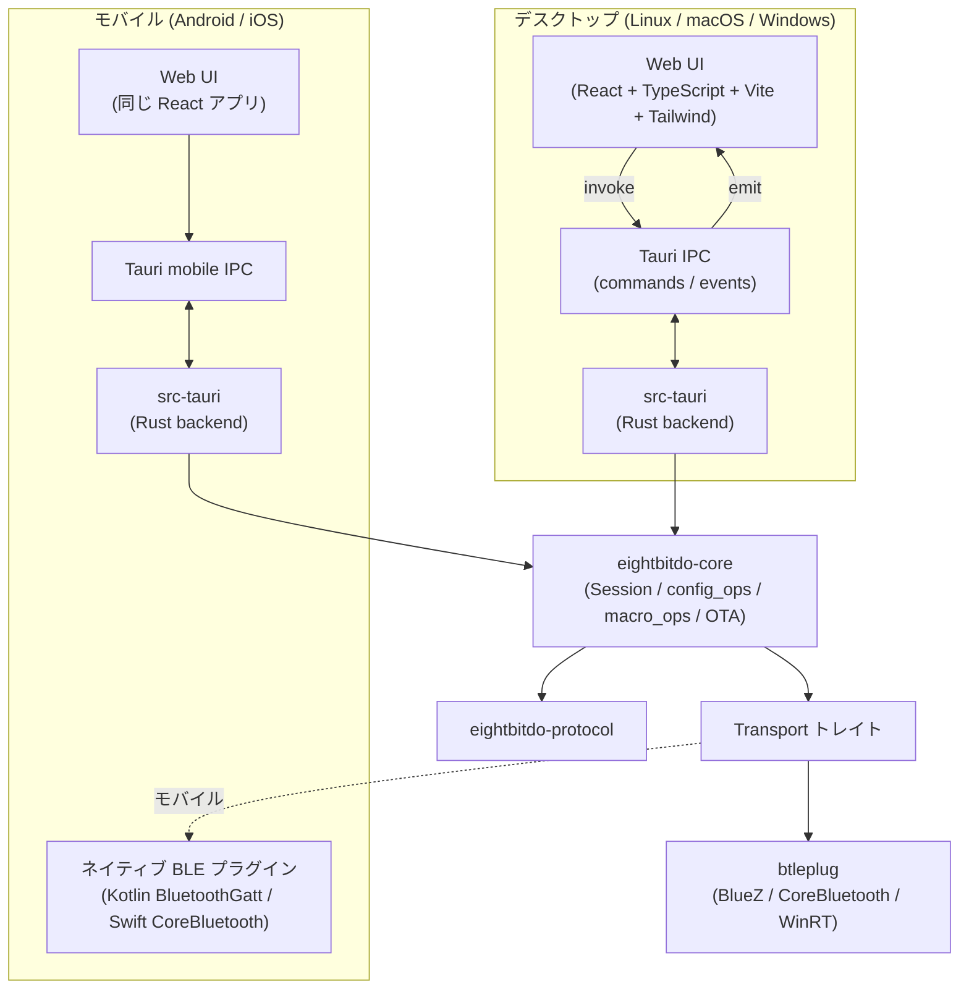

# Tauri v2 GUI 移行計画とクロスプラットフォーム方針

- 決定日: **2026-11-23**
- 状態: **計画 + P0/P1 実装済み**（2026-11-23。`apps/desktop` の雛形・デザイン・CI・CSP まで追加済み。P2 以降は未着手。詳細は §5 の状態注記）
- 対象: デスクトップ GUI とモバイル GUI の実装方式、配布形式、検証方針、日本語 UI の用語
- 正本の範囲: この文書は **GUI の実装方式と移行手順** の正本です。ライセンス・配布の決定は [DISTRIBUTION_POLICY.md](DISTRIBUTION_POLICY.md)、レビュー Tier は [REVIEW_TIERS.md](REVIEW_TIERS.md)、プロトコルは [PROTOCOL_SPEC.md](PROTOCOL_SPEC.md) を正本とし、この文書では変更しません。

---

## 1. 目的と背景

### 1.1 決定

デスクトップ GUI は **Tauri v2（Rust backend + Web frontend）でゼロベースに作り直す**。既存の egui 版（`crates/eightbitdo-gui`）は削除せず、比較と撤退用に残す。

移行の対象は GUI 層だけです。プロトコル層（`eightbitdo-protocol`）、コア（`eightbitdo-core`）、CLI（`eightbitdo-cli`）はそのまま再利用し、BLE 接続・2768 バイト設定・マクロ・OTA のロジックを書き直しません。

### 1.2 なぜ egui から移行するか

現行の egui 版は 6 タブ（デバイス / 入力モニター / 現在値 / 設定 / マクロ / ログ。画面名は Tauri 版の用語集 §8 に合わせて表記する）と書き込み UI まで実装済みですが、画面の見た目を詰めるほど、ウィジェット単位の見た目・余白・タイポグラフィを個別に実装するコストが増えます。次の 4 点を理由に、UI 層を Web 技術へ移します。

1. **デザイン品質**: CSS でレイアウト・余白・字・色・状態・モーションをまとめて制御できる。デザイントークンを 1 か所で定義し、全画面へ適用しやすい。
2. **反復速度**: ブラウザの DevTools とホットリロードで、見た目の確認と修正を短い周期で回せる。スクリーンショットや DOM 検査もそのまま使える。
3. **表現の幅**: グラデーション・影・トランジション・グリッドといった Web の表現を、独自ウィジェットを増やさずに使える。
4. **モバイルとの UI 共通化**: Tauri v2 は同じ Web UI をモバイルでも動かせるため、デスクトップとモバイルで部品と用語を共有できる（モバイルの BLE は別途ネイティブプラグイン。§3）。

### 1.3 egui の利点（正直な併記）

移行は egui が劣っているからではありません。次の利点は失われます。

- **単一バイナリ・Pure Rust**: Node.js / WebView / OS の WebView ランタイムに依存しない。
- **Linux で WebKitGTK を要求しない**: 依存パッケージが少なく、AppImage も小さく済む。
- **即時モード描画**: 入力モニターの毎フレーム表示と相性が良く、状態管理が単純。IPC 境界がないため型とエラー処理がそのまま通る。
- **デバッグが Rust 1 言語で完結**: フロントとバックエンドをまたぐ追跡が要らない。
- **起動時間・バイナリサイズで有利**（本リポジトリでは未計測）。

この利点を手放してでも、デザイン品質と反復速度を優先する判断です。撤退が必要になった場合は egui 版をそのまま使えます（§7）。

### 1.4 移行しないもの

- 配布・ライセンス・マネタイズの方針（[DISTRIBUTION_POLICY.md](DISTRIBUTION_POLICY.md)、決定日 2026-11-23）
- レビュー Tier と `review-gate` の運用（[REVIEW_TIERS.md](REVIEW_TIERS.md)）
- 書き込みの安全原則（pre-write backup、read-back 検証、TOCTOU、確認ダイアログ）
- プロトコル・構造体・マクロの仕様（[PROTOCOL_SPEC.md](PROTOCOL_SPEC.md)、[STRUCT_BT2_2768B.md](STRUCT_BT2_2768B.md)）

---

## 2. 決定事項（ユーザー合意済み）

| 項目 | 決定 |
| --- | --- |
| デスクトップ GUI | Tauri v2（Rust backend + Web frontend）でゼロベースに作り直す |
| 既存 egui 版 | `crates/eightbitdo-gui` を比較・撤退用に残す（削除しない） |
| フロントエンド | TypeScript + Vite + React + Tailwind CSS、パッケージ管理は pnpm |
| BLE の実行場所 | WebView からは触らない。`eightbitdo-core` で実行し、Tauri commands / events で公開する |
| Linux / macOS / Windows の BLE | Tauri v2 + `btleplug` |
| Android / iOS の BLE | Tauri v2 モバイル + ネイティブ BLE プラグイン（Kotlin BluetoothGatt / Swift CoreBluetooth）。プラグインから Rust コアへ transport を注入する |
| macOS / iOS の代替 | 本ホストではビルド検証できないため、既存の UniFFI + SwiftUI / Compose 版を代替として維持する |
| 配布形式 | Linux AppImage / deb、macOS dmg（署名・公証）、Windows MSI / NSIS、Android APK / AAB、iOS IPA |
| 日本語 UI | 用語集を先に固定する（§8。正本は [DESIGN_TAURI.md](DESIGN_TAURI.md) §6.3）。文章は `nihongo` スキルに従う |

---

## 3. アーキテクチャ



### 3.1 レイヤーの責務

- **Web UI**: 表示と入力だけを持つ。BLE・ファイル・OS の機能を直接呼ばない。状態は表示用のモデルに限定し、デバイスの状態は Rust 側を正とする。
- **Tauri IPC**: 要求と応答は commands、連続する入力や進捗は events。入力モニターは 20 ms 間隔の通知をそのまま全件流さず、Rust 側で最新値に間引いてから event に載せる（描画側の負荷を抑える）。
- **src-tauri（Rust backend）**: `eightbitdo-core` のセッションを保持し、既存の BLE 単一所有ロック（per-user flock）と keepalive をそのまま使う。書き込み前の backup・read-back・TOCTOU の検証もここに置き、Web UI を信頼しない。
- **eightbitdo-core / eightbitdo-protocol**: 変更しない。モバイル対応で `Transport` の注入契約を足す場合だけ、Tier 3 のレビュー対象になる。
- **Transport**: デスクトップは `btleplug`。モバイルは WebView の Web Bluetooth に依存できないため、ネイティブ BLE プラグインを実装し、同じ `Transport` トレイトとして core に注入する。

### 3.2 セキュリティ境界

- Tauri v2 の capability は最小限にする。コマンドは画面の用途ごとに分け、汎用の「任意の BLE 操作」コマンドを作らない。現状は `apps/desktop/src-tauri/capabilities/default.json` の `core:default` だけ（P0 雛形）で、P2 以降に用途別 capability へ分割する。
- **`fs` / `shell` / `http` プラグインは P2 以降も追加しない。** ファイル選択・保存は Rust 側のダイアログ API（`tauri-plugin-dialog` を使う場合も増やす権限はダイアログに限定）に閉じ、HTTP は Rust 側で行う。WebView に任意パス・任意 URL を渡さない方針を維持する（capability を広げる変更はレビュー Tier 3）。
- CSP を設定し、外部 URL を WebView に読み込まない。外部リンクは OS のブラウザで開く。**P0 で設定済み**: `apps/desktop/src-tauri/tauri.conf.json` の `app.security.csp` は `default-src 'self'; script-src 'self'; style-src 'self' 'unsafe-inline'; img-src 'self' data:; font-src 'self'; connect-src 'self' ipc: http://ipc.localhost; object-src 'none'; base-uri 'none'`（`ipc:` と `http://ipc.localhost` は Tauri v2 の IPC 用）。
- 書き込みコマンドは、Web UI の確認状態にかかわらず Rust 側で再度検証する（確認済みフラグを IPC で受け取らない）。

---

## 4. ディレクトリ構成

```text
8bitdo/
├── apps/
│   └── desktop/
│       ├── src/                  # React + TypeScript + Tailwind（Web UI）
│       ├── src-tauri/            # Rust backend（Tauri commands / events / state）
│       │   ├── src/
│       │   ├── capabilities/     # Tauri v2 の capability 定義
│       │   ├── Cargo.toml
│       │   └── tauri.conf.json
│       ├── package.json
│       ├── pnpm-lock.yaml
│       └── vite.config.ts
├── crates/
│   ├── eightbitdo-protocol/      # 変更しない
│   ├── eightbitdo-core/          # 変更しない（Transport 契約の追加時のみ Tier 3）
│   ├── eightbitdo-cli/           # 変更しない
│   ├── eightbitdo-gui/           # egui 版。比較・撤退用に残す（凍結）
│   └── eightbitdo-uniffi/        # モバイル代替版の公開層。維持する
├── mobile/                       # 既存の UniFFI ネイティブ雛形（代替として維持）
└── docs/
    └── TAURI_PLAN.md             # 本ドキュメント
```

- **`apps/desktop` を `crates/` に置かない理由**: Web ツールチェーン（Node / pnpm / Vite）と Rust クレートを同居させず、Cargo workspace のビルド対象と配布物を分けるため。
- **`src-tauri` は独立クレート**: `apps/desktop/src-tauri` は**独立クレート**とし、ルート workspace には追加しない。Tauri の依存・MSRV・ビルド時間を既存 5 クレートの CI に混ぜないため。`eightbitdo-core` / `eightbitdo-protocol` は path 依存で参照する（`src-tauri` 側で空の `[workspace]` を宣言し、ルート workspace のメンバーにならないようにする）。CI では desktop 専用のジョブを別途実行する（P0 で `.github/workflows/desktop.yml` を追加済み）。
- **`mobile/` の扱い**: すぐには削除しない。Tauri v2 モバイルが実機で動くまで、モバイルの正本は既存の UniFFI + SwiftUI / Compose 版とする。P8 の結果を見て、統合・凍結・削除を別途判断する。
- **egui 版の扱い**: P2 以降は凍結する。バグ修正と実機検証の記録だけを行い、新機能は Tauri 版にだけ入れる。

---

## 5. フェーズ計画

| フェーズ | 内容 | 主な成果物 | 完了条件 |
| --- | --- | --- | --- |
| **P0 決定・足場** | 方針の固定とビルド基盤 | この文書、Tauri v2 / Node LTS / pnpm / Rust のバージョン固定、`apps/desktop` の雛形（Vite + React + TS + Tailwind、**独立クレート**の `src-tauri`、capability 定義）、CI に Web の lint / build job と desktop 専用の Rust job を追加 | Linux で空ウィンドウが起動し、`pnpm build` と `src-tauri` の `cargo check`（ルート workspace とは別に実行）が通る。バージョンと前提パッケージを README に書く |
| **P1 デザイン** | 見た目と用語の確定 | 用語集（§8）の固定、デザイントークン（色・余白・字・角丸・影）、コンポーネント一覧、6 タブの静的モック、ライト / ダークの要否決定 | §9 のデザイン受け入れ条件を満たす静的 UI がレビューを通る |
| **P2 デバイス / 入力モニター** | 読み取り経路の移植 | スキャン、接続、version、2768 バイト設定の読み取り、入力モニターの events、ログ表示 | Linux 実機で読み取りと入力モニター表示を確認する。既存 egui 版と表示内容が一致する。**スティック Y 軸は上が正で描画するが、生値の符号は実機で未確認のため、アダプタ層の `Y_SIGN` 定数（`+1` / `−1`）で切替可能にし、実機で 1 回確認してから固定する**（推測で符号を決めない。[DESIGN_TAURI.md](DESIGN_TAURI.md) §5.6.1） |
| **P3 設定編集 / リマップ** | 書き込み経路の移植（設定） | 設定タブ、22 ボタンのリマップ、プロファイル切替、pre-write backup、read-back、TOCTOU | 既存 CLI / core と同じ検証手順を通る。書き込みを含むためレビュー Tier は [REVIEW_TIERS.md](REVIEW_TIERS.md) のパス別トリガーに従う（write-path は **Tier 3**） |
| **P4 マクロ** | マクロ編集の移植 | 20 ms 記録、ステップ編集、マクロ書き込み、JSON / TOML の入出力 | 既存の書き込み順序（Header → Save → Erase → Write → Save）と read-back 検証を維持する。**Tier 3** |
| **P5 書き込み安全機構** | 安全機構の横断化 | 確認ダイアログ、二重送信防止、operation lock、記録中の書き込み禁止、切断時の fail-closed、expected SHA-256 照合 | 書き込み系のコマンドすべてに backup / read-back / TOCTOU が入り、失敗時に何も書いていないことを UI とログで示す。**Tier 3** |
| **P6 ライセンス / i18n** | 法務表示と言語 | ライセンス画面（アプリの MIT / Apache-2.0 全文と同梱 5 フォントの全文・著作権者行）、用語集の適用、翻訳キーの整備、英語表示 | ライセンス画面の内容が egui 版（#24）と一致する。未翻訳キーが 0。依存追加時は [THIRD_PARTY_LICENSES.md](../THIRD_PARTY_LICENSES.md) と [NOTICE](../NOTICE) を更新する |
| **P7 パッケージ / CI** | 配布物の生成 | Linux AppImage / deb、macOS dmg（署名・公証）、Windows MSI / NSIS、CI matrix、既存 Rust テストの維持 | 各 OS でインストールと起動を確認する。署名・公証の資格情報が無い間は未署名ビルドを成果物にし、その旨を明記する |
| **P8 モバイル** | Tauri v2 モバイルへの展開 | Tauri v2 の Android / iOS 初期化、ネイティブ BLE プラグイン（Kotlin / Swift）、`Transport` 注入、エミュレータ / 実機確認、APK / AAB / IPA | Android 実機で BLE 読み取りが動く。iOS は macOS + Xcode が使える環境でビルドを確認する（本ホスト不可） |

**状態（2026-11-23、main `ed61961`）**: この計画と `apps/desktop` の P0 / P1 は **PR #32 で main にマージ済み**です。

| フェーズ | 状態 |
| --- | --- |
| P0 決定・足場 | **完了**。`apps/desktop` の雛形（Vite + React + TS + Tailwind、独立クレートの `src-tauri`、`capabilities/default.json`、CSP、アイコン）、`.github/workflows/desktop.yml`（web / rust の 2 ジョブ）、バージョン固定（Node `^20.19.0 || >=22.12.0` / pnpm 12.22.0 / Rust 1.90+）を追加済み |
| P1 デザイン | **完了**。案 C を経て Imported style: Hyperstudio を採用し、トークン・共通コンポーネント・シェル・2 画面（デバイス / 入力モニター）を実装済み。[DESIGN_TAURI.md](DESIGN_TAURI.md) §12 |
| P2 以降 | **未着手**（BLE 接続・読み取り・入力モニターの実データ・書き込み・OTA・パッケージ・モバイル） |

補足:

- この文書は **docs のみ**で、P0 のコード追加は別のコミットで行う。
- 各フェーズのレビュー Tier は [REVIEW_TIERS.md](REVIEW_TIERS.md) に従う。CI / workflow / ビルド設定の変更、書き込み経路、モバイルの transport 契約は同ドキュメントのパス別トリガーで判定する。
- 依存を追加したフェーズでは、[THIRD_PARTY_LICENSES.md](../THIRD_PARTY_LICENSES.md) の更新を同じ PR に含める。ライセンス方針そのものは変更しない。

---

## 6. クロスプラットフォーム方針

| 対象 | UI | BLE | 配布形式 | 本ホストで確認できるか | 代替・備考 |
| --- | --- | --- | --- | --- | --- |
| **Linux x86_64** | Tauri v2 + WebKitGTK | `btleplug`（BlueZ） | AppImage / deb | **可能**（ビルド・起動は P0 で確認する） | 実機 BLE の証跡があるのは Linux のみ。WebKitGTK の dev パッケージと最低バージョンは P0 で確定して README に書く |
| **macOS**（Intel / Apple Silicon） | Tauri v2 + WKWebView | `btleplug`（CoreBluetooth） | dmg（署名・公証） | **不可**（macOS SDK 不在。[CROSS_PLATFORM.md](CROSS_PLATFORM.md) §3.7） | UniFFI + SwiftUI 版を代替として維持。実機未検証 |
| **Windows 10 / 11** | Tauri v2 + WebView2 | `btleplug`（WinRT） | MSI / NSIS | **一部**（`cargo check` のみ。Tauri ビルドと WebView2 は未検証） | Rust **1.88 以上**が必要（`btleplug` の Windows バックエンド由来。[CROSS_PLATFORM.md](CROSS_PLATFORM.md) §3.5）。WebView2 ランタイムを前提にする |
| **Android** | Tauri v2 モバイル（WebView） | Kotlin プラグイン（BluetoothGatt）→ `Transport` 注入 | APK / AAB | **未検証**（既存 UniFFI 版で JNI 同梱 APK のビルド実績あり。#21） | UniFFI + Compose 版を代替として維持。権限（Android 12 以降の `BLUETOOTH_SCAN` / `BLUETOOTH_CONNECT`）と MTU の扱いは P8 で確認する |
| **iOS** | Tauri v2 モバイル（WKWebView） | Swift プラグイン（CoreBluetooth）→ `Transport` 注入 | IPA | **不可**（macOS + Xcode が必要） | UniFFI + SwiftUI 版（unsigned IPA のビルド実績あり。#21）を代替として維持。実機・署名・配布は未着手 |

配布方針について:

- 配布の決定（無料・OSS、ストア配布、マネタイズ）は [DISTRIBUTION_POLICY.md](DISTRIBUTION_POLICY.md) のままで、この文書では変更しない。
- macOS の署名・公証、Windows のコード署名、ストア登録の資格情報は**未整備**（README の実装状況でも署名・配布は未着手）。P7 では未署名ビルドを先に作り、署名の有無を成果物ごとに明記する。
- Tauri の自動更新（updater）は採用を決めていない。署名とセキュリティの設計が固まるまで使わない（§10）。

本ホストで確認できないもの（断定しない）:

- macOS / Windows / iOS のビルド・署名・起動・BLE の実挙動
- Android / iOS の実機での BLE とネイティブプラグインの動作
- 各 OS の WebView の描画・フォント・入力の差

これらは CI（macOS / Windows ランナー）または実機での確認結果を、確認した時点でこの文書と [CROSS_PLATFORM.md](CROSS_PLATFORM.md) に追記する。

---

## 7. リスクと対策

| リスク | 影響 | 対策 |
| --- | --- | --- |
| **WebView の OS 差**（WebKitGTK / WKWebView / WebView2） | 描画・フォント・入力・スクロールの挙動がずれる | 標準の CSS / DOM だけを使い、ベンダ固有 API を避ける。主要 3 OS で起動スモークを CI か実機で回す。Linux は WebKitGTK の最低バージョンを固定する |
| **Linux の WebKitGTK 依存** | ビルド・実行時の依存パッケージが増える。AppImage が大きくなる。Wayland / NVIDIA で描画不具合が出る可能性 | 依存を README と CI に明記する。AppImage に WebKitGTK を同梱する。問題が出た場合は deb と egui 版に退避する |
| **モバイル BLE プラグインの工数** | Tauri v2 plugin の Kotlin / Swift 実装、`Transport` 注入、権限・スレッド制約の対応が必要。工数は未見積 | P8 を最後に置く。それまでモバイルの正本は UniFFI 版。プラグインの API は desktop の `Transport` と同じ契約に揃える |
| **iOS のビルド環境** | macOS + Xcode と署名資格情報が必須。本ホストでは不可。CI も macOS ランナーが要る | iOS は当面 UniFFI 版で継続する。Tauri 版 iOS は環境が整うまで「計画のみ」とし、実装済みと書かない |
| **egui 版との二重保守** | 同じ機能を 2 実装するとコストと不整合が増える | P2 以降 egui 版を凍結し、新機能は Tauri 版だけに入れる。移行完了時に egui 版の削除・存続を再判断する |
| **IPC 境界のセキュリティ** | WebView から過剰な Rust 関数を呼べると権限が広がる | capability を最小化し、用途別コマンドに分ける。CSP を設定し、外部 URL を読み込まない。書き込みの確認状態を IPC で受け取らない |
| **入力モニターの描画性能** | React の再描画で 60fps を割る可能性 | Rust 側で最新値に間引く。描画は `requestAnimationFrame` と canvas を使い、イベントはデバイスの通知間隔（20 ms）に合わせてバッチ化する |
| **Tauri / Web ツールチェーンの更新** | major 更新で破壊的変更を受ける | バージョンを固定して lockfile をコミットする。更新は独立した PR で行い、この文書の前提バージョンを更新する |
| **ビルド・配布の複雑化** | Rust と Node の 2 ツールチェーンで CI 時間と手順が増える | Web と Rust の job を分け、キャッシュを使う。バージョンと手順は README に集約する |
| **用語の揺れ** | Tauri 版が全画面を実装するまで、egui 版（凍結）の文言と Tauri 版の用語集（§8）が併存する | Tauri 版は §8 と [DESIGN_TAURI.md](DESIGN_TAURI.md) §6.3 の用語集に従う。egui 版は凍結のため文言を変えない。egui 版を削除・統合する時点で整理する |

---

## 8. 日本語 UI の用語集（先に固定）

Tauri 版の UI 文言の**正本は [DESIGN_TAURI.md](DESIGN_TAURI.md) §6.3 の用語集**です。この節はその抜粋で、この計画から参照するための採用表記の一覧です。差分が生じた場合は DESIGN_TAURI.md を正とし、先に同文書を更新してからこの表と実装を揃えます。**使わない表記・英語表記の対応は同節に列挙**しています（ここでは重複させません）。既存 egui 版の `i18n.rs` は凍結するため文言を変えず、Tauri 版だけこの表に揃えます（移行完了時に統合する）。

| 英語 / 概念 | 採用表記 | 補足 |
| --- | --- | --- |
| recording（マクロの入力取得） | **記録** | 音声の記録と紛らわしいため区別する。「記録を開始」「記録を停止」 |
| live input（リアルタイムの入力表示） | **入力モニター** | 画面名・パネル名・タブ名すべて「入力モニター」 |
| デバイスから読み込んだ値 | **現在値** | 「現在値を読み込む」。編集後の値は「変更後」 |
| 書き込み機能のある配布物 | **書き込み対応版** | 上部バーの副題と About に表示 |
| 空状態で示す行動 | **次にすること** | 見出しとして使い、行動は 1 つだけ書く |
| write（デバイスへ） | **書き込み** | ボタンは「書き込む」。ファイル保存は「保存」と区別する |
| read / read-back | **読み込み** / **読み戻し検証** | 読み戻し検証は書き込み後の照合 |
| connect / disconnect | **接続** / **切断** | 「接続する」「切断する」 |
| device / controller | **デバイス** / **コントローラ** | BLE の一覧は「デバイス」、本体は「コントローラ」 |
| remap | **リマップ** | 「リマップを有効化」 |
| profile / slot | **プロファイル** / **スロット** | スロット番号と併記する |
| backup / restore | **バックアップ** / **復元** | 「バックアップを保存」「復元する」 |
| macro / step / trigger | **マクロ** / **ステップ** / **トリガー** | — |
| stick / deadzone | **スティック** / **デッドゾーン** | 左スティック・右スティック |
| rumble / gyro / LED | **振動** / **ジャイロ** / **LED** | — |
| firmware update（OTA） | **ファームウェア更新** | UI では OTA と書かない。文書では「BLE OTA」と書いてよい |
| license | **ライセンス** | — |
| version | **バージョン** | 数値は `0xC8` のように表記する |
| retry | **再試行** | UI では「リトライ」と書かない |
| apply / cancel / confirm | **適用** / **キャンセル** / **確認** | 確認ダイアログの取消は「キャンセル」。書き込みの中止は「中止する」 |
| 処理中 / 待機 | **処理中** / **応答を待っています…** | 何を待っているかを必ず書く |

表記のルール:

- ボタンとメニューは動詞句（「書き込む」「接続する」）。見出しは体言止め。
- 進行中は「〜しています…」（例: 「設定を書き込んで検証しています…」）。
- エラーは「何が起きたか」+「理由」+「次にすること」の順に書く。例: 「接続できませんでした。デバイスが設定モードではありません。Profile ボタンを約 3 秒押してから再試行してください。」
- 敬語を重ねない。「〜していただけますでしょうか」ではなく「〜してください」。
- 数値は半角、単位は半角スペース区切り（`20 ms`、`2768 バイト`、`SHA-256`）。識別子とコードはバッククォートで囲む。
- 英語の技術名はそのまま使う（BLE / GATT / MTU / JSON / TOML / SHA-256 / CPU）。無理に訳さない。

---

## 9. 受け入れ条件

数値は**目標値**であり、P1 以降に計測して結果をこの節へ追記する。未計測の値を達成済みとして書かない。

### 9.1 デザイン品質

- 現行 egui 版の 6 タブの機能を落とさない（移植の完了条件は機能の一致）。
- 余白は 4 px スケール、字は見出し / 本文 / 補助の 3 段を基本にし、画面ごとに崩さない。
- すべての操作部品に default / hover / focus / active / disabled / loading / error / empty の状態を定義する。
- キーボードだけで主要操作ができる（Tab 移動、Esc でダイアログを閉じる、Enter で確定、フォーカスリングが見える）。
- 1280×720 で主要操作がスクロールなしに収まり、200% ズームでも破綻しない。
- 文字と背景のコントラストは WCAG AA を満たす。
- 既定テーマ（燻しスレートの継承可否を含む）は P1 で決め、決定をこの文書に追記する。

### 9.2 日本語

- 表示文言が §8 の用語集に一致する（違反 0 件）。
- 翻訳キーの未定義が 0 件。日本語と英語の切り替えで欠落しない。
- エラーメッセージが「何が起きたか + 次にすること」を含む。
- 日本語と英語が 1 つの文に混ざらない（技術名と識別子は除く）。

### 9.3 応答性

- 操作から画面の更新まで **100 ms 以内**（目標）。
- 入力モニターの表示遅延（BLE 通知から描画まで）**100 ms 以下**（目標。計測方法は P2 で決める）。
- 入力モニターのスティック Y 軸は**上が正**で描画する。ただし生値の符号は実機で未確認のため、実装はアダプタ層の `Y_SIGN` 定数（`+1` / `−1`）で切替可能にし、**実機で 1 回確認してから固定する**（推測で符号を固定しない。[DESIGN_TAURI.md](DESIGN_TAURI.md) §5.6.1）。
- タブ切替・スクロール・ダイアログの開閉で **60fps** を維持する（目標）。
- 起動時間とメモリ使用量は P7 で計測し、egui 版との比較を記録する。

### 9.4 安全

- 書き込みの前に必ずバックアップを取り、書き込み後に読み戻し検証する（P3〜P5）。
- 確認後にデバイスの設定が変わっていた場合は expected SHA-256 の不一致で中止する。
- 記録中は書き込みを禁止する。切断時は書き込みを fail-closed で止める。
- 二重送信を防ぐ（operation lock）。

### 9.5 クロスプラットフォーム

- Linux でビルド・起動・実機 BLE を確認する。
- macOS / Windows は CI または実機でビルドを確認し、**未確認の間は「未検証」と明記する**。
- Android / iOS は P8 で確認する。確認までは既存 UniFFI 版を代替とする。

---

## 10. 未決定事項（要判断）

- egui 版をいつ削除するか（移行完了の判定条件を含む）。
- Tauri の自動更新（updater）を採用するか。採用する場合は署名鍵の管理と配布チャネルを先に決める。
- macOS の署名・公証、Windows のコード署名、ストア登録の資格情報をいつ用意するか。配布方針の未決事項は [DISTRIBUTION_POLICY.md](DISTRIBUTION_POLICY.md) を参照する。
- Tauri v2 モバイルを採用した後、`mobile/` の UniFFI 版を統合・凍結・削除のどれにするか。
- 既定テーマ（燻しスレートの継承可否）とライトテーマの要否。
- Tauri v2 / Node.js / pnpm / Rust の対応バージョン（P0 で固定する。現時点では未確定）。

---

## 11. この文書の更新ルール

- 決定を変えるときは、先にこの文書を更新する PR を出し、実装はその後にする。決定日と変更理由を残す。
- 未検証の事項は「未検証」と書き、確認した時点で日付と確認方法を追記する。
- ライセンス・配布・レビュー Tier の決定は、それぞれの正本ドキュメントで変更する。この文書には転記しない。
- 関連ドキュメント: [IMPLEMENTATION_PLAN.md](IMPLEMENTATION_PLAN.md)（全体のフェーズと現状）、[CROSS_PLATFORM.md](CROSS_PLATFORM.md)（ビルド確認の記録）、[FEATURE_MATRIX.md](FEATURE_MATRIX.md)（公式ソフトとの機能比較）、[mobile/README.md](../mobile/README.md)（モバイルの代替版）。
